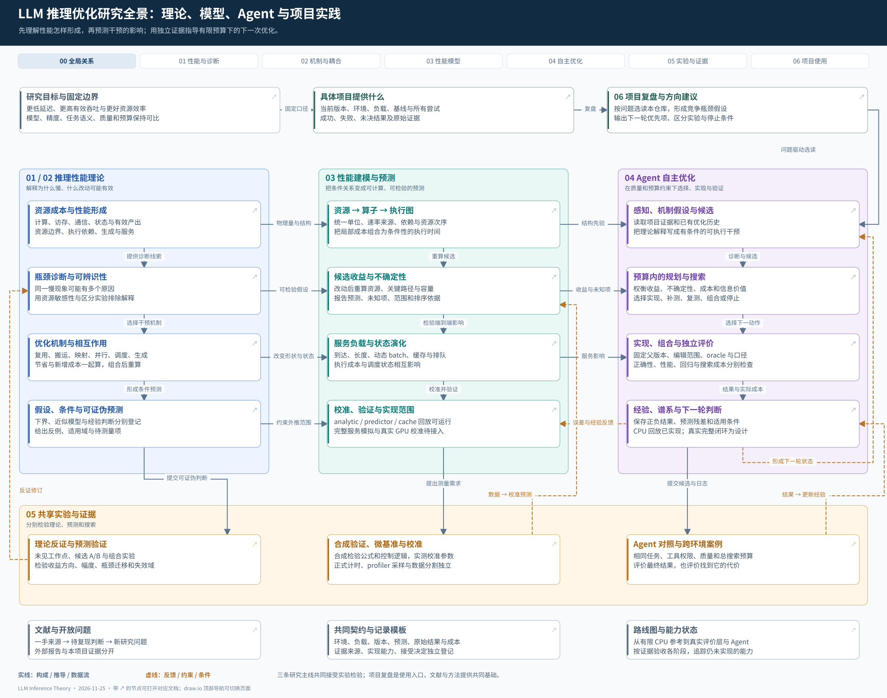

# LLM Inference Theory

**Understanding the limits. Modeling performance. Optimizing intelligently.**

理论驱动的大语言模型推理优化研究：理解资源成本与性能边界，建立可计算的预测模型，研究 Agent 如何在有限预算内自主发现、实现和验证优化。

## 三条核心研究主线

[](visualizations/diagrams/research-atlas/00-overview.svg)

[全局总图与六张子图](visualizations/diagrams/research-atlas/README.md) · [七页可编辑 draw.io](visualizations/diagrams/research-atlas/llm-inference-research-atlas.drawio) · [内容地图与完成状态](docs/content-map.md)

| 主线 | 核心问题 | 从这里开始 |
| --- | --- | --- |
| **推理性能理论** | 为什么慢？边界在哪里？哪些干预有意义？ | [图解导读](theory/README.md) · [统一理论](theory/foundations/unified-theory.md) · [瓶颈诊断](theory/diagnosis/README.md) · [章节索引](theory/INDEX.md) |
| **性能建模与预测** | 怎样把理论变成可校准、可组合的预测？ | [分层模型](models/README.md) · [统一契约](models/contracts.md) · [校准与不确定性](models/calibration/README.md) · [CPU 解析参考](models/analytic/README.md) |
| **Agent 自主优化** | 在质量与资源约束下，怎样更高效地搜索、实现和验证？ | [自主优化总入口](optimizer/README.md) · [理论总纲](optimizer/foundations/autonomous-optimization.md) · [规划与搜索](optimizer/planning/README.md) · [离线控制参考](optimizer/systems/README.md) |

[实验与评估](experiments/README.md)为三条主线提供共同证据；[文献研究](research/README.md)提供外部方法与对照；[图谱](visualizations/README.md)解释它们之间的关系。

理论给出条件和可证伪判断，模型给出带来源的估计，优化器选择下一次干预。实验可以支持或否定三者，负结果同样用于更新知识。Agent 自主优化与理论、建模并行推进，不等待全部理论完成。

## 用于具体项目

**推荐安装 [LLM Inference Optimizer Skill](skills/llm-inference-optimizer/README.md)**：可在任意推理项目中调用 `$llm-inference-optimizer`。内置 37 篇版本化理论快照、项目审计与决策、每轮事前预测/实测比较，以及私有跨项目理论库。通过预先登记的留出实验和独立审阅验证理论修订，保留全部历史版本和正负证据。

[图解介绍与完整工作流程](skills/llm-inference-optimizer/INTRODUCTION.md) · [Skill 入口](skills/llm-inference-optimizer/SKILL.md) · [初始知识](skills/llm-inference-optimizer/knowledge/INDEX.md) · [理论演化](skills/llm-inference-optimizer/references/theory-evolution.md)

已有推理项目和优化记录时，从 **[项目优化指导](docs/project-optimization-guide.md)** 进入：整理历史结果的可比性，把尝试转成机制证据，再按问题选读理论、模型与验证章节，形成下一轮优先方向、最小区分实验和停止条件。

**[直接交给项目 Agent 的完整提示词](docs/prompts/review-project.md)** · [项目使用关系图](visualizations/diagrams/research-atlas/06-project.svg)。指导分析可以直接使用当前项目的源码、日志与历史结果；已有 CPU 原型是辅助参考。

## 首次阅读

1. 先读 [推理性能图解](theory/README.md)，理解成本、Roofline、关键路径与服务指标。
2. 再读 [AI 如何自动优化 AI 推理](research/industry/agentic-inference-optimization-guide.md)，了解已有工作的思想。
3. 进入本仓库的 [自主优化理论总纲](optimizer/foundations/autonomous-optimization.md)，从问题、约束与反馈建立完整认识。
4. 沿 [瓶颈诊断](theory/diagnosis/README.md) → [优化机制](theory/optimization/mechanisms.md) → [收益与耦合](theory/optimization/coupling.md) → [搜索评价](experiments/agent-benchmark/README.md)阅读。

底层六大理论及其细分关系继续见 [全景思维导图](visualizations/diagrams/llm-inference-theory-mindmap.md)。完整专题与实现状态统一记录在 [内容地图](docs/content-map.md)。

## 现在可以运行什么

以下均在 CPU 上运行，只依赖 Python 标准库；输入是明确标注的合成数据。

```bash
# 资源边界、固定执行图及候选重算
python3 models/analytic/analyze.py models/analytic/examples/synthetic-system.json

# 预算受限搜索与独立结果回放
python3 optimizer/systems/replay.py optimizer/systems/examples/synthetic-search.json --policy cost-aware --budget 12 --seed 0

# 已有的收益场景与缓存 trace 模型
python3 models/predictor/predict.py models/predictor/examples/synthetic-baseline.json --format markdown
python3 models/predictor/cache_context.py models/predictor/examples/synthetic-cache-context.json --format markdown
```

解析参考区分严格资源下界与有效速率预测；离线搜索参考验证预算、失败处理与最佳候选更新，不调用 Coding Agent 或 GPU。示例结果不作为真实加速成绩。[合成验证说明](experiments/synthetic/README.md)

## 研究状态

| 内容 | 当前能力与边界 |
| --- | --- |
| 理论体系 | 统一综述和独立专题，含假设、条件推导、反例及可证伪预测 |
| 性能模型 | 已有场景预测器、缓存回放和新的解析参考；没有经过跨环境实测校准的通用预测库 |
| 自主优化 | 已有算法/系统设计与 CPU 离线搜索参考；真实 LLM、编译器、profiler 和 GPU 适配仍待接入 |
| 评价体系 | 已有模型验证、Agent 对照、预算账本、实验模板与跨环境方案；没有新增 GPU 或真实 Agent 对照结果 |

研究路线、验收条件与待接入工作见 [Roadmap](docs/roadmap.md)；尚未解决的科学问题见 [Open problems](research/open-problems/README.md)。

## 证据与维护

固定任务实验保持模型、精度、任务语义、输出口径和资源预算一致。理论下界、预测、文献报告、用户反馈、合成数据与独立实测分别登记，不互相替代。

[研究方法](docs/methodology.md) · [符号与单位](docs/notation.md) · [性能测量协议](docs/benchmark-protocol.md) · [实验模板](experiments/templates/README.md) · [维护规则](AGENTS.md)

维护时可从仓库根目录运行以下检查：

```bash
python3 scripts/check_docs.py
python3 visualizations/diagrams/research-atlas/build_atlas.py
python3 -m unittest discover -s models/predictor/tests -v
python3 -m unittest discover -s models/analytic/tests -v
python3 -m unittest discover -s optimizer/systems/tests -v
python3 -m unittest discover -s skills/llm-inference-optimizer/tests -v
```

[文档检查器](scripts/check_docs.py)检查当前研究文档的本地链接、公式块与代码围栏，以及 JSON、SVG 和 draw.io 文件的格式；外部链接可用性、锚点和数学正确性仍需人工审阅。

原 Qwen/H800 优化研究保存在 [历史快照](archive/qwen-h800-tricks/README.md)，通过 [案例索引](experiments/case-studies/qwen-h800/README.md)访问。历史保持只读，不再以收集固定数量 Tricks 或轮次为主线。
