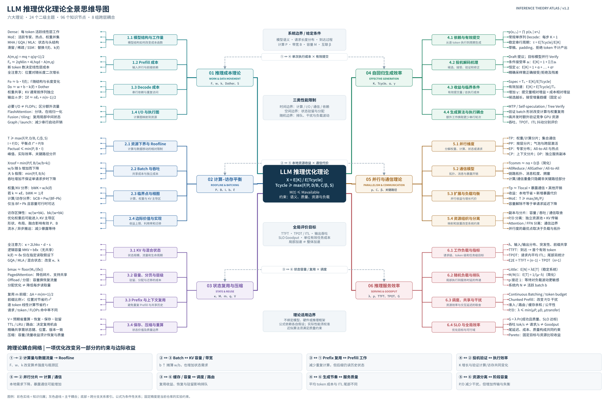
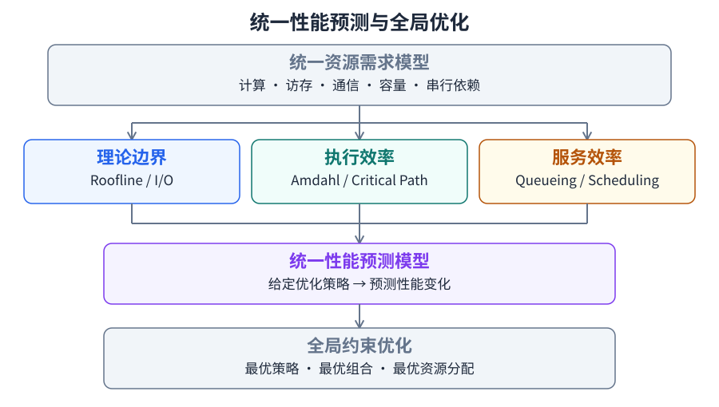

# LLM Inference Theory

**Understanding the limits. Modeling performance. Optimizing intelligently.**

大语言模型推理优化理论研究：建立模型与硬件无关的资源成本、性能边界、优化收益与耦合关系，探索理论驱动的自主优化。

[高清全景图](visualizations/diagrams/mindmap/llm-inference-theory-mindmap.svg) · [可编辑 draw.io](visualizations/diagrams/mindmap/llm-inference-theory-mindmap.drawio) · [全局关系图](visualizations/diagrams/llm-inference-theory-overview.md)

## 研究问题

1. 给定模型、硬件与负载，推理性能的物理和算法极限是什么？
2. 如何建立可解释、可校准、可组合的性能预测模型？
3. 如何预测优化的边际收益、瓶颈迁移和多策略耦合？
4. 如何利用理论提高自主优化 Agent 的搜索效率？
5. 如何通过独立实验验证或否定理论假设？

## 研究入口

| 主线 | 内容与入口 |
| --- | --- |
| Theory | [图解导读](theory/README.md) · [完整理论总纲](theory/foundations/unified-theory.md) · [章节索引](theory/INDEX.md) |
| Models | [性能建模](models/README.md) · [已有 Python 预测器](models/predictor/README.md) |
| Optimizer | [理论驱动自主优化研究](optimizer/README.md)（设计阶段） |
| Research | [文献与业界研究](research/README.md) · [开放问题](research/open-problems/README.md) |
| Experiments | [理论验证](experiments/README.md) · [Qwen/H800 案例](experiments/case-studies/qwen-h800/README.md) |
| Visualizations | [图谱与可视化](visualizations/README.md) |
| Roadmap | [研究路线](docs/roadmap.md) · [符号体系](docs/notation.md) · [研究方法](docs/methodology.md) |

## 统一理论与性能建模

理论描述工作量和资源边界；模型将它们转化为可计算的预测；自主优化利用预测缩小搜索空间；实验提供独立证据并反向修正理论。通用理论不绑定 checkpoint、引擎或加速器。案例实验必须明确精度、任务语义和资源预算。

## 当前研究状态

- 已有：统一理论综述、图解导读、前缀及状态复用推导、初步收益预测器、业界性能建模及自主优化研究。
- 研究中：跨负载性能极限、可校准的模型组合、优化耦合与性能瓶颈相图。
- 规划：理论指导的自主优化控制器、独立实验评价和跨模型/硬件验证。尚无通用自主优化器或新增 GPU 实测结论。

## 历史与维护

原 Qwen/H800 优化研究完整保存在 [历史快照](archive/qwen-h800-tricks/README.md)，仅作为研究案例和负面证据，不再以收集 Tricks 或轮次为主线。旧 Git 历史保留。项目维护遵循 [AGENTS.md](AGENTS.md)。

**证据原则：** 理论下界、近似预测、文献报告、用户反馈和独立实测不可互相替代。所有新的性能结论应可复现。
