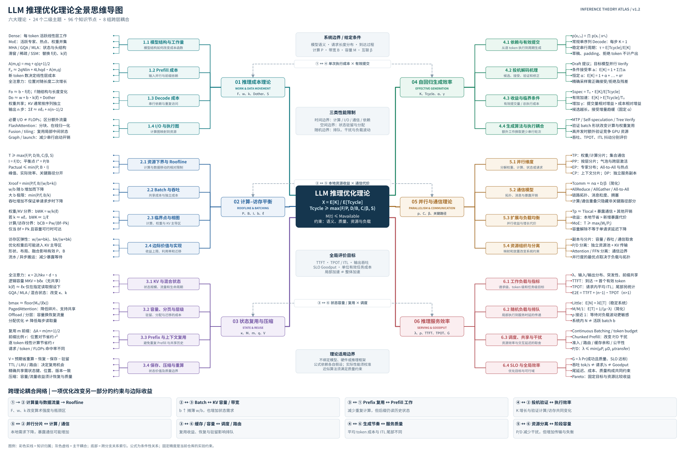

# LLM 推理优化理论全景思维导图

> v1.2 · 模型与硬件无关 · 4400 × 2910 大画布 · 六个理论主分支、24 个二级主题、96 个知识节点、8 组跨层耦合关系。

[打开高清 SVG 大图](mindmap/llm-inference-theory-mindmap.svg) · [下载可编辑 draw.io 源文件](mindmap/llm-inference-theory-mindmap.drawio) · [推理系统关系图](llm-inference-theory-overview.md) · [理论正文](../llm-inference-optimization-theory.md)

GitHub 会将内嵌图片缩放到正文宽度。为了阅读细节，点击上方图像或打开独立 SVG；也可在 [diagrams.net](https://app.diagrams.net/) 中导入 draw.io 文件，使用缩放、平移及原生图元编辑。图是独立矢量图，不依赖 Mermaid、LaTeX、外部资源或脚本。

## 知识树（文本索引）

每个分支与理论正文相应章节对应。彩色树线表示知识归属；灰色虚线连接三组主干耦合；底部八组关系用于跨分支阅读，不代表固定流程。图中公式在各自简化假设下成立，详细假设见正文。

### 1. 推理成本理论

**1.1 模型结构与工作量** — 模型结构如何改变成本函数

- Dense：每 token 活跃线性层工作
- MoE：活跃专家、热点、权重并集
- MHA / GQA / MLA：状态与头结构
- 滑窗 / 稀疏 / SSM：替换 f(ℓ)、k(ℓ)

**1.2 Prefill 成本** — 输入并行与前缀依赖

- A(m,q) = mq + q(q+1)/2
- Fₚ ≈ 2qNlin + 4Lhqd·A(m,q)
- 新 token 数决定线性层成本
- 全注意力：位置对随长度二次增长

**1.3 Decode 成本** — 串行依赖与重复访问

- Fᴅ ≈ b·f(ℓ)；f 随结构与长度变化
- Dᴅ ≈ w + b·k(ℓ) + Dother
- 权重共享；KV 通常按序列独立
- 输出 n 步：Σℓ ≈ nℓ₀ + n(n−1)/2

**1.4 I/O 与执行图** — 计算图映射到资源

- 必要 I/O ≠ FLOPs；区分额外流量
- FlashAttention：分块、在线归一化
- Fusion / tiling：复用局部中间状态
- Graph / launch：减少串行启动开销

### 2. 计算–访存平衡

**2.1 资源下界与 Roofline** — 计算与数据移动的相对限制

- T ≥ max(F/P, D/B, C/β, S)
- I = F/D；平衡点 I* = P/B
- Pactual ≤ min(P, B·I)
- 峰值、实际效率、关键路径分开

**2.2 Batch 与吞吐** — 共享成本与独立成本

- Xroof = min(P/f, B/(w/b+k))
- w/b 随 b 增加而下降
- 大 b 极限：min(P/f, B/k)
- 吞吐增加不保证单请求步时下降

**2.3 临界点与相图** — 计算、权重与 KV 主导区

- 权重/KV 分界：bWK = w/k(ℓ)
- 若 k ≈ κℓ，bWK ∝ 1/ℓ
- 计算/访存分界：bCB = Pw/(Bf−Pk)
- 仅当 Bf > Pk 且容量可行时可达

**2.4 边际价值与实现** — 收益上限、利用率和迁移

- 访存区弹性：w/(w+bk)、bk/(w+bk)
- 优化权重后可能进入 KV 主导区
- 形状、布局、融合影响有效 P、B
- 流水 / 异步搬运：减少暴露等待

### 3. 状态复用与压缩

**3.1 KV 与混合状态** — 状态规模、流量和生命周期

- 全注意力：κ = 2Lhkv·d·s
- 逻辑容量 MKV = bℓκ（无共享）
- k(ℓ) ≈ ℓκ 仅在指定读取假设下
- GQA / MLA / 混合状态：改变 κ、k

**3.2 容量、分页与层级** — 驻留、分配与迁移的成本

- bmax ≈ floor(M₀/(ℓκ))
- PagedAttention：降低碎片、支持共享
- Offload / 分层：容量换恢复流量
- 分配优化 ≠ 降低每步读取量

**3.3 Prefix 与上下文复用** — 避免重复 Prefill 与共享历史

- 复用 m 前缀：ΔA = m(m+1)/2
- 前缀比例 r：位置对节省约 r²
- 逐 token 线性计算节省约 r
- 请求 / token / FLOPs 命中率不同

**3.4 保存、压缩与重算** — 状态价值及质量边界

- V = 预期省重算 − 恢复 − 保存 − 驻留
- TTL / LRU / 路由：决定复用机会
- 精确共享需状态键、位置、版本一致
- 压缩：容量/流量收益须计恢复与质量

### 4. 自回归生成效率

**4.1 依赖与有效提交** — 从逐 token 执行到周期生成

- p(x₁:ₙ) = ∏ p(xₜ | x<ₜ)
- 常规单序列 Decode：每步 K = 1
- 稳定串行周期：τ = E[Tcycle]/E[K]
- 草稿、padding、拒绝 token 不计产出

**4.2 投机解码机理** — 候选、接受、验证和修正

- Draft 提议；目标模型并行 Verify
- 条件接受率 aᵢ：E[K] = 1 + Σ∏aᵢ
- 恒定 α：E[K] = 1 + α + … + αᵞ
- 精确采样需正确接受/拒绝及残差

**4.3 收益与临界条件** — 有效提交量 / 总执行成本

- Sspec = T₀·E[K]/E[Tcycle]
- 有效加速：E[K] > E[Tcycle]/T₀
- 增加 γ：提交量相对增益 > 成本相对增益
- 候选越长，接受增量趋缓（固定 α）

**4.4 生成算法与执行耦合** — 额外工作换取更少串行轮次

- MTP / Self-speculation / Tree Verify
- 验证 batch 形状改变计算与权重复用
- 高并发时额外验证竞争 GPU 资源
- 吞吐、TPOT、ITL 抖动分别评价

### 5. 并行与通信理论

**5.1 并行维度** — 分解权重、计算、状态或请求

- TP：权重/计算分片；集合通信
- PP：按层分片；气泡与跨层激活
- EP：专家分布；All-to-All 与热点
- CP：上下文分片；DP：独立服务副本

**5.2 通信模型** — 拓扑、消息与暴露开销

- Tcomm ≈ nα + D/β（简化）
- AllReduce / AllGather / All-to-All
- 链路拓扑、消息粒度、拥塞
- 计算/通信重叠只隐藏非关键路径部分

**5.3 扩展与负载均衡** — 并行收益与增长代价

- Tp ≈ Tlocal + 暴露通信 + 其他开销
- 收益：本地节省 > 新增暴露代价
- MoE：T ≥ maxⱼ(Wⱼ/Pⱼ)
- 容量解除不等于单请求延迟下降

**5.4 资源组织与分离** — 映射和放置改变系统约束

- 副本与分片：容量 / 吞吐 / 通信取舍
- P/D 分离：独立资源池 + KV 传输
- Attention / FFN 分离：通信边界
- 并行度的最优点取决于负载与拓扑

### 6. 推理服务效率

**6.1 工作负载与指标** — 请求级、token 级和任务级目标

- λ、输入/输出分布、突发性、前缀共享
- TTFT：到达 → 首个有效 token
- TPOT：请求内平均 ITL；尾部另统计
- E2E = TTFT + (n−1)·TPOT（n>1）

**6.2 随机负载与排队** — 局部执行到服务时延的传递

- Little：E[N] = λE[T]（稳定系统）
- M/M/1：E[T] = 1/(μ−λ)（简化）
- ρ 接近 1：等待对负载波动更敏感
- 系统内 N ≠ 活跃 batch b

**6.3 调度、共享与干扰** — 资源效率与交互延迟的取舍

- Continuous Batching / token budget
- Chunked Prefill：改变 P/D 干扰
- 准入 / 路由 / 缓存亲和 / 公平性
- P/D：λ ≤ min(μP, μD, μtransfer)

**6.4 SLO 与全局效率** — 优化目标与可行域

- G = λ Pr(成功且质量、SLO 达标)
- 吞吐 tok/s ≠ 请求/s ≠ Goodput
- 尾延迟、成本、质量构成共同约束
- Pareto：固定目标与资源比较收益

## 八组跨理论联系

| 关系 | 核心含义 | 具体影响 |
| --- | --- | --- |
| ① → ② | 计算量与数据流量 → Roofline | F、w、k 改变算术强度与瓶颈区 |
| ② ↔ ③ | Batch ↔ KV 容量 / 带宽 | b ↑ 摊薄 w/b，也增加状态需求 |
| ③ ↔ ① | Prefix 复用 ↔ Prefill 工作 | 减少重复计算，但后缀仍读历史状态 |
| ④ ↔ ② | 投机验证 ↔ 执行效率 | K 增长与验证计算/访存共同变化 |
| ⑤ ↔ ② | 并行分片 ↔ 计算 / 通信 | 本地需求下降，暴露通信可能增加 |
| ③ ↔ ⑥ | 缓存 / 容量 ↔ 调度 / 路由 | 复用收益、恢复与驻留影响排队 |
| ④ ↔ ⑥ | 生成节奏 ↔ 服务质量 | 平均 token 成本与 ITL 尾部不同 |
| ⑤ ↔ ⑥ | 资源分离 ↔ 阶段容量 | P/D 减少干扰，但增加传输与失衡 |

理论结论的重点不是技术名称，而是变量、约束、临界条件与耦合：一个方向改变的量可能使另一个模块成为新瓶颈。资源下界不等于实际耗时，固定精度仍是本仓库当前实验约束；近似和压缩只作为一般理论的边界讨论。

## 与其他图的分工

- 本图：完整知识体系与跨理论联系。
- [推理系统关系图](llm-inference-theory-overview.md)：Prefill/Decode、状态、调度及执行资源在系统中的实际相互作用。
- [H800 专项三页图](README.md)：具体模型及固定精度下的策略和收益预测。
