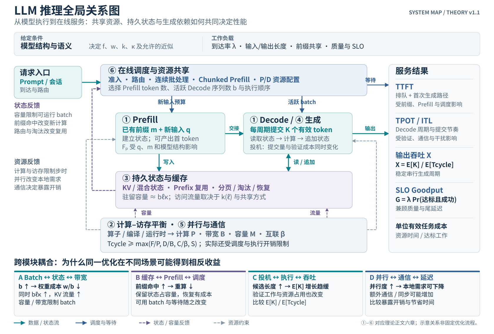

# LLM 推理全局关系图

> 理论总纲配套图 · v1.1 · 不依赖具体模型、硬件或框架

[打开独立 SVG 大图](previews/llm-inference-theory-overview.svg) · [理论正文](../llm-inference-optimization-theory.md)

## 1. 一个统一的系统，而非六类孤立技术

给定模型结构、请求负载和语义质量约束，推理服务由四类相互作用的对象构成：请求与调度、模型执行、持久状态、执行资源。它们共同决定服务结果。

| 系统对象 | 与其他部分的关系 | 对应理论 |
| --- | --- | --- |
| 请求与调度 | 根据到达、优先级、缓存状态和资源预算，决定运行的 Prefill token 与活跃 Decode batch；排队时间及共置干扰改变延迟。 | 第 6 章 |
| Prefill | 对新输入和历史状态计算，创建或扩展持久状态；前缀缓存改变所需重算工作量。首 token 可以由 Prefill 产生。 | 第 1、3 章 |
| Decode 与生成算法 | 读取已有状态，执行目标模型或草稿/验证机制，提交有效 token 并更新状态；生成周期数和每周期成本共同决定生成效率。 | 第 1、4 章 |
| 持久状态 | 连接 Prefill、Decode 与后续会话；逻辑状态容量、实际读取流量、共享、恢复和淘汰影响资源与调度。 | 第 3 章 |
| 算子、运行时与资源 | 将模型计算映射到计算单元、存储层级和互联；并行决定单设备需求、通信及关键路径。 | 第 2、5 章 |
| 服务结果 | TTFT、TPOT、ITL、吞吐、goodput 与成本是不同层级的输出；局部加速通过 batch、状态及排队传递到这些指标。 | 第 4、6、7 章 |

图中的实线表示数据/状态流或调度作用，虚线表示状态反馈与资源约束。Prefill 和 Decode 的交接可能发生在同一执行组，也可能涉及 P/D 分离后的状态传输。Decode 的迭代以及多轮会话中的重新 Prefill 由持久状态连接，而不是独立的无状态任务。

## 2. 四组跨层耦合

### A. Batch、权重摊薄和状态容量

活跃 batch 增大，在权重能够共享时可降低每 token 的权重流量 w/b；但独立状态的容量和访问量一般增加。容量又反过来限制可调度 batch。在简化等长全注意力模型中，权重流量 w 与 KV 流量 b·k 的相对大小决定了访存优化的重点；计算上界、延迟约束还可能更早生效。

这解释了为什么优化 KV 容量可能改善权重摊薄，为什么提高 batch 的收益递减，以及为什么高吞吐并不必然对应低 TPOT。

### B. 缓存、Prefill 与调度

更多可正确复用的前缀意味着更少 Prefill 重算，但保留与恢复状态有容量、读取和传输成本。缓存策略改变空闲容量与请求路由，进而影响活跃 batch 和排队；调度与路由又改变后续复用机会。缓存优化必须同时考虑计算节省、状态成本与服务负载，不能仅用请求命中率判断价值。

### C. 投机生成、执行成本与资源竞争

候选生成和并行验证可能增加一个周期内有效提交的 token 数，但也改变计算量、访存、状态和批处理资源需求。固定条件接受率的简化模型中，有效提交的边际增长呈几何衰减。是否获得加速取决于期望提交数与期望周期时间的比值，而非接受率本身。高并发时额外验证资源还可能影响其他请求。

### D. 并行、本地成本与通信

分片或分离可降低单设备计算、权重或状态需求，或者解除容量限制，但也引入通信、同步和负载不均衡。只有本地关键路径的节省超过新增暴露成本时，单请求延迟才改善。分离 Prefill 与 Decode 还需要考虑阶段服务能力、KV 传输及跨阶段排队。

## 3. 从局部成本到服务目标的统一联系

- **计算与数据移动决定执行时间下界**：Tcycle ≥ max(F/P, D/B, C/β, S)。各项是必要边界，不是精确耗时。
- **生成算法决定有效提交数**：在稳定、无额外空闲的串行生成周期模型中，长期输出吞吐 X = E[K] / E[Tcycle]。多副本需采用系统观测口径。
- **容量和调度决定可行的 batch 与等待**：M(t) 不超过可用容量，同时考虑动态长度、缓存及其他工作区。
- **服务质量决定有效产能**：稳定接纳率乘以成功且满足质量/SLO 的联合概率给出请求级 goodput。局部加速不能直接等同于 goodput 提升。

因此，理论的统一性来自这些相互作用，而非把不同技术归入独立栏目。局部优化可能迁移瓶颈、改变其他模块的边际价值。公式的假设、推导与适用范围见[完整正文](../llm-inference-optimization-theory.md)。

## 预览与维护

总图使用独立 SVG 形状、文本、连线和箭头标记；没有脚本、foreignObject、外部字体资源、Mermaid 或 LaTeX 依赖，GitHub Markdown 通过相对路径直接嵌入。可打开 SVG 放大阅读；如果客户端字体不完整，上方文字表提供等价关系说明。本图独立于仓库原三页专项图解的生成脚本。
