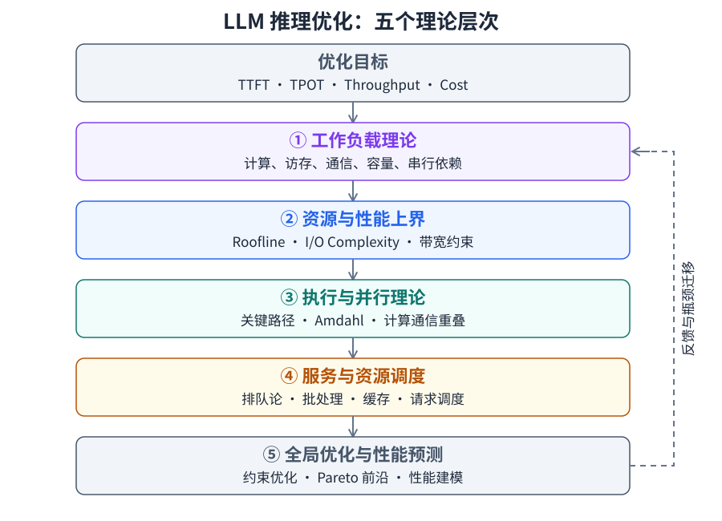
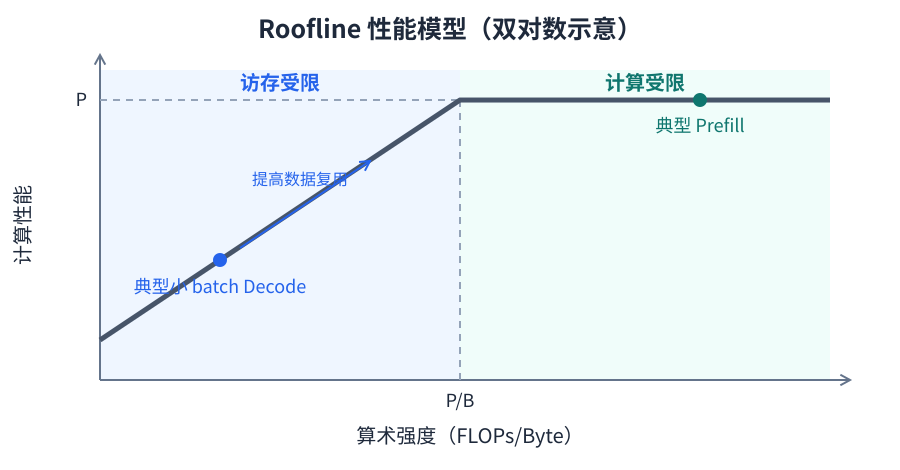
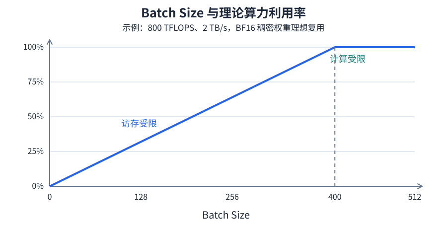
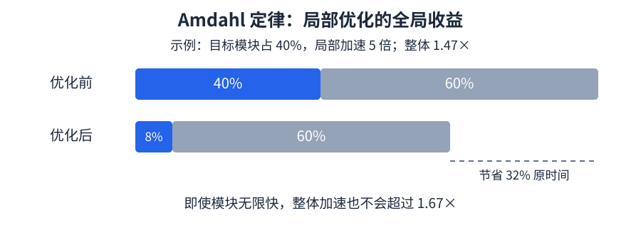
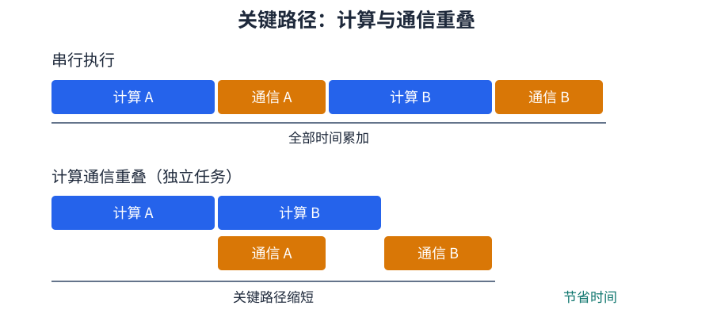
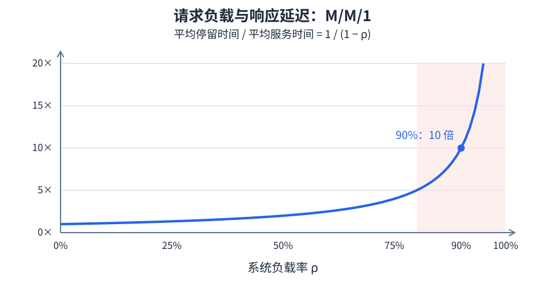
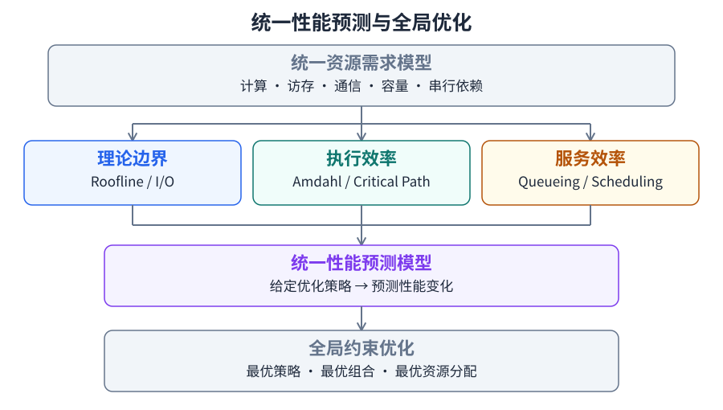

# LLM 推理优化理论框架：从性能极限到优化实践

> 2026-11-24 · 图解导读 · 模型与硬件无关  
> 本文是[完整理论总纲](llm-inference-optimization-theory.md)的入门导读，重心是理解理论关系、判断优化方向与估计收益。所有曲线和数值示例均为理论演示，不是 H800 实测结果。项目保持现有 checkpoint、精度、任务语义与资源预算，不引入重新量化作为优化手段。

目前 LLM 推理优化尚未形成单一公认的统一理论。业界结合体系结构、并行计算、编译优化、排队论及资源调度解决问题。我们可以将这些理论组织起来，回答三个问题：一次推理消耗了哪些资源？什么决定了速度上限？如何逼近这一上限？

## 1. 全局理论框架

| 理论 | 核心问题 |
| --- | --- |
| 工作负载理论 | 哪些工作可以不做？ |
| Roofline 与 I/O 理论 | 完成这些工作最快需要多久？ |
| 执行与并行理论 | 为什么实际速度达不到理论上限？ |
| 排队与调度理论 | 如何让大量请求高效共享资源？ |
| 全局优化理论 | 如何组合不同技术，使整体性能最优？ |

前两层关注资源约束，第三层关注程序执行效率，第四层关注服务系统效率，第五层协调优化决策。五层是本文的综合归纳，并非业界统一命名的标准，也不是强制按顺序执行的优化流程。

## 2. 工作负载理论：减少必须完成的工作

对 Transformer、MoE 或混合模型，将一次推理的资源需求概括为：

$$
\mathcal W=(F,D,C,M,R).
$$

| 变量 | 含义 |
| --- | --- |
| $F$ | 浮点计算量（FLOPs） |
| $D$ | 指定存储层级的数据搬运量（Bytes） |
| $C$ | 设备间通信量（Bytes） |
| $M$ | 峰值内存容量需求 |
| $R$ | 串行执行轮数 |

该向量是粗粒度账本，不能代替依赖图与各层级的资源需求。各种技术首先可以解释为改变其中一个或多个变量：

- Prefix Caching：复用已有前缀，减少重复计算。
- FlashAttention：减少中间张量的显存读写。
- KV Cache：以额外存储空间换取历史状态复用。
- 投机解码：减少每个有效输出 token 的平均目标模型验证轮数，但可能增加计算量。
- Kernel Fusion：减少中间数据搬运与算子启动次数。

计算、存储和通信可以相互交换。优化不一定意味着减少所有资源消耗，而是减少当前限制性能的资源消耗，并考虑交换带来的新成本。

## 3. Roofline 理论：确定性能的物理上限

令 $P$ 为当前精度和执行类型的峰值算力，$B$ 为指定存储层级的峰值带宽，$F$ 和 $D$ 为相应计算量与数据搬运量。理想资源时间下界：

$$
T\geq\max\left(\frac{F}{P},\frac{D}{B}\right).
$$

定义算术强度：

$$
I=\frac{F}{D}.
$$

于是实际计算性能受如下上界约束：

$$
P_{\mathrm{attainable}}\leq\min(P,BI).
$$

Roofline 的转折点为 $I^*=P/B$。在其左侧，减少访存或提高数据复用更有价值；在右侧，减少计算量或提高计算效率更有价值。实际实现可能因依赖、低占用、调度等远低于上界。

### 3.1 为什么 Prefill 和 Decode 的优化方向不同？

Prefill 一次处理多个输入 token，模型权重可以被多个 token 共享，算术强度通常较高。小 batch Decode 每轮通常只为每个请求生成一个 token，却要读取大量权重及历史状态，因而常受显存带宽限制。具体位置取决于模型结构、上下文长度、batch 与硬件。

以简化的稠密线性层为例，权重参数数目为 $N$，每参数占 $s$ 字节，batch 为 $b$。假设权重充分复用，忽略其他访存：

$$
F\approx2bN,\qquad D\approx sN,\qquad I\approx\frac{2b}{s}.
$$

BF16 下 $s=2$，因而 $I\approx b$（这里只作理论说明，不建议修改项目实际精度）。

图中假设峰值算力 800 TFLOPS、显存带宽 2 TB/s，对应临界算术强度 400 FLOPs/Byte。简化模型给出的利用率上限为：

$$
u_{\max}(b)=\min(1,b/400).
$$

真实系统还要读取 KV Cache、激活与其他状态；MoE 的活跃专家集合也随 batch 变化，因此不能直接把上述稠密权重模型当作真实吞吐曲线。增大 batch 还可能提高单轮时延和排队延迟。

### 3.2 实践启示

- 访存受限：优先减少 HBM 访问、提高复用率。
- 计算受限：优先研究矩阵乘法效率和计算冗余。
- 两种资源均未充分利用：进一步检查小算子、并行度、同步及主机运行时。

FlashAttention 的 I/O-aware 分块是典型的访存优化：精确 Attention 的主要计算复杂度不变，但减少片上存储和 HBM 间的数据搬运。

## 4. 执行与并行理论：缩小实际性能与理论上限的差距

### 4.1 Amdahl 定律

若某个模块原占串行总耗时比例 $p$，该模块加速 $k$ 倍且其他成本不变，则端到端加速比为：

$$
S=\frac{1}{(1-p)+p/k}.
$$

无限加速时，$S_{\max}=1/(1-p)$。一个模块原占总时间 20%，即便加速十倍，整体也仅为约 1.22 倍。

示例：目标模块占 40%，局部加速 5 倍，优化后总时间为原来的 68%，整体加速约 1.47 倍。即使该模块耗时降为零，整体加速上限也只有约 1.67 倍。

因此不能只根据 kernel 的加速倍数判断优化价值；应考察其暴露在关键路径上的耗时和优化后的其他成本。

### 4.2 关键路径理论

将推理表示为有向无环执行图。设总工作量为 $W$，理想同质处理单元数为 $p$，最长依赖路径耗时为 $T_{\mathrm{critical}}$。在一致计量口径下：

$$
T\geq\max\left(\frac{W}{p},T_{\mathrm{critical}}\right).
$$

其中 $W$ 以单处理单元执行所需时间的口径表示。关键路径揭示即使拥有很多计算资源，串行依赖也无法简单消除。

图中两个任务的计算与通信独立时可以部分重叠。重叠依赖数据就绪、运行时支持和实际资源竞争；无法把所有通信时间无条件隐藏。CUDA Graph 减少主机发射等开销，流水线、异步执行、计算通信重叠以及投机解码则分别从不同机制缩短实际关键路径。

### 4.3 通信复杂度理论

对简单点到点通信或给定集合通信算法的有效路径，可用经典 alpha-beta 模型描述：

$$
T_{\mathrm{comm}}\approx n\alpha+\frac{V}{B_{\mathrm{link}}}.
$$

$n$ 为该路径上的通信启动次数，$\alpha$ 为启动时延，$V$ 为通信量，$B_{\mathrm{link}}$ 为有效带宽。实际 collective 还取决于拓扑、算法、消息大小、链路争用和重叠。

增加 GPU 数量可以降低每卡工作量，却可能增加通信及同步开销。因此 TP、EP、PP、DP 的选择是计算、访存、通信、容量与依赖之间的权衡，而不是卡数越多越快。

## 5. 排队与调度理论：从单次推理到服务系统

即使单次推理很快，也不代表服务表现一定好。稳定系统中的 Little 定律为：

$$
L=\lambda W.
$$

其中 $L$ 为平均在途请求数，$\lambda$ 为平均有效到达或离开率，$W$ 为平均系统停留时间。

对于理想 M/M/1 模型（泊松到达、指数服务、单服务台、稳定负载）：

$$
W=\frac{1}{\mu-\lambda},\qquad
\rho=\frac{\lambda}{\mu}<1,
\qquad
\frac{W}{1/\mu}=\frac{1}{1-\rho}.
$$

负载率为 90% 时，该模型的平均停留时间为平均服务时间的 10 倍。动态 batching、可变输入输出长度与多阶段服务并不满足 M/M/1 假设；此图只能解释饱和附近延迟急剧增加的现象，不能直接预测真实 P99。

Continuous Batching、Chunked Prefill、P/D 分离、负载均衡与请求优先级调度主要作用于这一层，但也会改变执行层工作量及资源复用。

服务层的重要优化目标是 Goodput：单位时间内成功完成且满足规定 SLO 的有效请求数。它有别于不考虑服务质量的原始吞吐量。Sarathi-Serve 利用 Chunked Prefill 改善吞吐和时延之间的权衡，是这一层的代表工作。

## 6. 全局优化与统一性能预测

先构造一个简化的单次执行模型：

$$
T_{\mathrm{step}}\approx
\max\left(\frac{F}{\eta_c P},\frac{D}{\eta_m B}\right)
+T_{\mathrm{comm,exposed}}+T_{\mathrm{overhead}}.
$$

| 变量 | 物理意义 |
| --- | --- |
| $F,D$ | 实际计算量、指定存储层级访问量 |
| $P,B$ | 对应硬件峰值算力、带宽 |
| $\eta_c,\eta_m$ | 计算与访存的有效执行效率 |
| $T_{\mathrm{comm,exposed}}$ | 未被隐藏且暴露在关键路径上的通信时间 |
| $T_{\mathrm{overhead}}$ | 额外启动、同步及其他运行时成本 |

这是粗粒度近似，不是适用于所有执行图的精确等式。更精确的模型应按算子分别估计时间，再根据依赖图和资源竞争组合。若使用完整实测算子时延，不应重复叠加已包含的内部成本。

### 6.1 优化技术与理论变量的映射

| 优化技术 | 主要影响 | 重要约束或副作用 |
| --- | --- | --- |
| Prefix Caching | $F,D$，重复 Prefill 工作 | 缓存命中、状态占用、淘汰与恢复 |
| FlashAttention | $D$ | 算子形状、数据复用、片上资源 |
| Kernel Fusion | $D,T_{\mathrm{overhead}}$ | 寄存器压力、并行度 |
| CUDA Graph | $T_{\mathrm{overhead}}$ | 动态形状、图捕获和状态内存 |
| 投机解码 | $R,F,D$ | 接受率、验证成本、提交语义 |
| Continuous Batching | 单 token 数据流量、执行效率 | 单轮延迟、队列、容量 |
| Tensor Parallelism | 每卡 $F,D,M$ 与通信 $C$ | collective、互联带宽及同步 |
| 计算通信重叠 | $T_{\mathrm{comm,exposed}}$ | 依赖、共享资源争用 |
| PagedAttention | $M$ 与可服务并发 | 页管理、间接访问 |
| P/D 分离 | 阶段竞争、排队、资源分配 | 状态迁移、网络、阶段容量匹配 |

### 6.2 从性能模型到决策问题

令 $\boldsymbol{\theta}$ 为调度、并行布局、kernel 实现、缓存等策略。一个可能的全局目标是：

$$
\begin{aligned}
\max_{\boldsymbol{\theta}}\quad&
\mathrm{Throughput}(\boldsymbol{\theta})\\
\mathrm{s.t.}\quad&
\mathrm{TTFT}_{P99}\leq\tau_1,\\
&\mathrm{TPOT}_{P99}\leq\tau_2,\\
&M(\boldsymbol{\theta})\leq M_{\max},\\
&Q(\boldsymbol{\theta})\geq Q_{\min}.
\end{aligned}
$$

实际还应固定总 GPU 预算、模型版本、精度及负载。吞吐量须明确是输出 token/s、总 token/s 或请求/s，TTFT/TPOT 按统一协议计量，$Q$ 表示任务质量或语义约束。针对服务场景也可以直接最大化 Goodput，或研究延迟、吞吐与成本的 Pareto 前沿。

## 7. 业界已有的理论与工具

| 工作 | 主要理论或方法 | 可以借鉴的方向 |
| --- | --- | --- |
| Roofline Model（2009） | 计算与访存上界 | 基础性能边界 |
| FlashAttention（2022） | I/O Complexity | Attention 的数据搬运与分块 |
| LLM-Viewer（2024） | LLM Roofline 分析 | 算子级瓶颈分析 |
| Vidur（2024） | 算子性能预测与服务仿真 | 负载与调度、配置搜索 |
| Sarathi-Serve（2024） | Chunked Prefill 与服务调度 | 吞吐与时延权衡 |
| InferSim | 解析资源成本与算子效率 | 结构、batch、上下文敏感性 |
| AIConfigurator（2026） | 算子时延数据库、配置搜索 | 部署规划与 Pareto 边界 |

这些工作对应理论体系的不同部分。尤其值得区分解析资源下界、通过性能数据校准的时延模型，以及真实服务负载下的仿真与实测。三者不能互相替代。

关于两项业界工具的安装、使用、参数解释和应用场景，见[InferSim 与 AIConfigurator 专题](infersim-aiconfigurator.md)。

## 8. 如何用理论指导优化实践

| 观测到的现象 | 可能的理论瓶颈 | 优化方向 |
| --- | --- | --- |
| 算力利用率低，显存带宽利用率高 | Memory Bound | 提高数据复用、减少访存 |
| 算力和带宽利用率都低 | 执行效率不足或其他约束 | kernel、CUDA Graph、并行度、主机路径 |
| 多 GPU 扩展效率低 | 通信与同步约束 | 并行策略、通信融合及重叠 |
| 长上下文 TPOT 急剧增加 | 状态访问成本 | 状态管理、Attention 优化 |
| 大量相同前缀重复计算 | 工作量冗余 | Prefix Caching |
| 并发上升后 TTFT 急剧增长 | 排队与资源竞争 | 请求调度、P/D 分离 |
| 局部算子加速但整体收益不明显 | Amdahl、关键路径 | 重新确定主要优化对象 |
| 多项优化组合后收益下降 | 瓶颈迁移、资源竞争 | 全局联合优化 |

表中是候选解释，不是仅凭现象即可得出的唯一诊断。通过 profiler、时间线、资源计数器和固定负载对照确认原因。

理论更大的价值是预测优化是否值得实施。例如，若某 kernel 仅占暴露时间的 5%，不改变其他成本时它无限加速也只能带来约 5.3% 的整体加速；若观察到批处理带来高权重复用，但 KV 容量成为活跃约束，就应研究容量或调度，而非继续无条件增大 batch。

## 9. 建议建立的三个核心模型

**性能极限模型。** 给定模型结构、工作负载和硬件参数，计算 TTFT、TPOT 的理想下界与吞吐量的上界。先从资源账本和关键路径入手；对于服务级指标，应明确负载与调度假设。

**优化收益模型。** 给定一种优化技术，预测它改变的资源需求、实际效率和暴露时间，并分析是否发生瓶颈迁移。真实执行效率通过目标系统实测校准。

**优化耦合模型。** 分析不同优化的协同、竞争和收益饱和关系。例如在固定负载下，令 $T_0,T_A,T_B,T_{AB}$ 分别为基线、单独 A、单独 B 和联合优化耗时，定义：

$$
\Delta_{AB}=T_A+T_B-T_0-T_{AB}.
$$

在绝对耗时节省的加法口径下，$\Delta_{AB}>0$ 表示联合节省超过两项独立节省之和，$\Delta_{AB}<0$ 表示低于该和。这只是一个交互诊断量，并不意味着存在单一全局最优；需进一步检查约束、基线、负载和测量误差。单项优化可能改变另一项优化所面对的算术强度、状态容量、并行策略或排队条件。

最终形成一套从物理性能边界、实际执行效率到系统级服务性能的统一预测方法。现有仓库的[优化收益预测模型](optimization-benefit-prediction.md)与[可运行预测器](predictor/README.md)是后续实例化的入口。

## 参考资料与延伸阅读

- Williams et al., *Roofline: An Insightful Visual Performance Model for Multicore Architectures*, CACM, 2009. [DOI](https://doi.org/10.1145/1498765.1498785).
- Amdahl, *Validity of the Single Processor Approach to Achieving Large Scale Computing Capabilities*, 1967. [DOI](https://doi.org/10.1145/1465482.1465560).
- Little, *A Proof for the Queuing Formula: L = λW*, 1961. [DOI](https://doi.org/10.1287/opre.9.3.383).
- Dao et al., *FlashAttention: Fast and Memory-Efficient Exact Attention with IO-Awareness*, 2022. [arXiv](https://arxiv.org/abs/2205.14135).
- *LLM Inference Unveiled: Survey and Roofline Model Insights*. [LLM-Viewer](https://github.com/hahnyuan/LLM-Viewer).
- *Vidur: A Large-Scale Simulation Framework for LLM Inference*. [官方仓库](https://github.com/microsoft/vidur).
- *Taming Throughput-Latency Tradeoff in LLM Inference with Sarathi-Serve*. [arXiv](https://arxiv.org/abs/2403.02310).
- [Alibaba InferSim](https://github.com/alibaba/InferSim).
- *AIConfigurator: Lightning-Fast Configuration Optimization for Multi-Framework LLM Serving*. [arXiv](https://arxiv.org/abs/2601.06288).
- [本仓库完整理论总纲](llm-inference-optimization-theory.md) · [全景思维导图](diagrams/llm-inference-theory-mindmap.md) · [Benchmark 协议](../docs/benchmark-protocol.md).

本文图形为上一轮对话示意图的静态 SVG 重制，使用 GitHub 原生 Markdown 数学语法及相对图片链接，不依赖交互组件。
