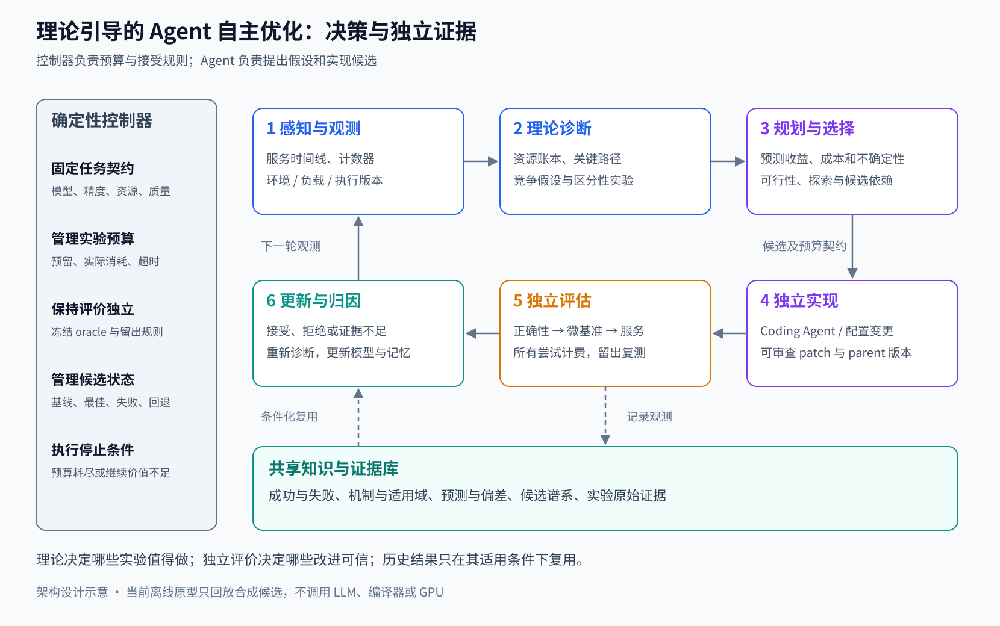

# 理论驱动的 Agent 自主优化

[](../visualizations/diagrams/research-framework/optimization-loop.svg)

[高清图与可编辑源](../visualizations/diagrams/research-framework/README.md)

**研究目标：在固定任务质量、硬件与搜索预算下，让 Agent 更有效地发现、实施和验证推理优化。** 自主优化与性能理论、可计算模型并行发展；实际失败也应反过来修正理论。

本模块首先解释“如何决定下一次实验”，再讨论执行控制与代码实现。研究范围覆盖配置、Kernel、Runtime 和 Serving，当前实验主线保持模型、精度与任务语义。增加多个 Agent 只是组织方式，不能代替明确目标、搜索方法和独立证据。

## 阅读路线

| 入口 | 解决的问题 | 内容状态 |
| --- | --- | --- |
| [自主优化理论总纲](foundations/autonomous-optimization.md) | 怎样定义状态、动作、反馈、目标与预算？ | 问题定义与条件分析 |
| [诊断接口](diagnosis/README.md) | 怎样把观测变成可检验的瓶颈假设？ | 接口与研究设计 |
| [优化空间](search-space/README.md) | 怎样表示候选、约束、依赖与作用机制？ | 数据契约与示例 |
| [规划与搜索](planning/README.md) | 下一次实验做什么，何时探索或停止？ | 方法推导与研究假设 |
| [代码与配置演化](evolution/README.md) | 怎样保存基线、分支和组合证据？ | 实施设计 |
| [独立评价](evaluation/README.md) | 怎样判定正确、加速和可复现？ | 评价规范 |
| [经验记忆](memory/README.md) | 怎样利用正负结果而不错误外推？ | 知识表示与更新规则 |
| [系统与离线原型](systems/README.md) | 哪些交给程序，哪些交给 Agent？ | CPU 搜索回放已实现；真实适配器待接入 |
| [统一 Agent Benchmark](../experiments/agent-benchmark/README.md) | 怎样证明理论提高了优化效率？ | 对照实验设计 |

初次学习可先读[自主优化图解导读](../research/industry/agentic-inference-optimization-guide.md)。外部项目继续保留在 [Research](../research/README.md)；本目录负责本仓库的问题定义、方法与实现。

## 三个关键连接

1. **理论 → 搜索：** 资源边界排除确定不可能的候选；近似模型提供排序与不确定性，保留低预测分但高信息价值的探索。
2. **模型 → 实验：** 候选必须给出预测、假设、额外成本和可能的新瓶颈，实验前冻结这些记录。
3. **实验 → 理论：** 记录正确性失败、性能回归和预测偏差；“没有变快”也是证据，但须区分实现错误、模型错误与测量噪声。

## 可立即运行的内容

```bash
python3 optimizer/systems/replay.py \
  optimizer/systems/examples/synthetic-search.json \
  --policy cost-aware --budget 12 --seed 0

python3 -m unittest discover -s optimizer/systems/tests -v
```

原型比较 `random`、`predicted`、`cost-aware` 三种**有限候选搜索策略**，验证预算、失败处理和最佳候选维护。输入与输出均明确标记 `synthetic / simulated`；它不调用 LLM、不生成补丁、不测 GPU，不构成自主优化性能成绩。

## 完成标准

研究闭环的终点是：同预算比较能够回答“理论带来的额外分析成本是否值得”，并给出负结果与适用范围。下一步真实系统接入需要冻结基线和评价器，接入 profiler、Coding Agent、构建环境与独立 GPU 评估；其依赖和验收条件见[系统设计](systems/README.md)。
