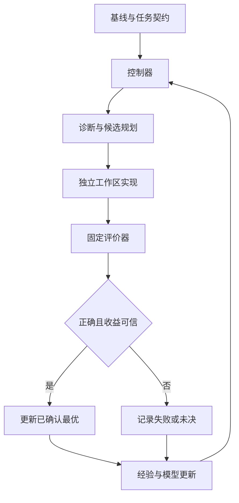

# 自主优化系统与离线搜索原型

> 2026-11-25｜系统架构为研究设计；`replay.py` 为已实现的 CPU 控制逻辑原型。合成回放不是真实 Agent/GPU 优化结果。

## 1. 控制器与 Agent 各自负责什么

| 组件 | 输入与输出 | 负责的确定性约束 |
| --- | --- | --- |
| Profiler adapter | 执行环境 → 时间线、计数器、元数据 | 固定采集范围、版本、成本 |
| Model adapter | 资源账本与 profile → 预测、假设、不确定性 | 单位、作用域、证据来源 |
| Planner | 公共候选与历史 → 下个动作 | 不读取未评估结果 |
| Coding Agent adapter | 冻结的任务包 → patch、说明、实现日志 | 限定编辑范围、记录 token/时间 |
| Build / runner | 父版本与 patch → 可执行产物 | 工作区、超时、资源独占 |
| Evaluator | 产物与固定 oracle → 正确性、性能、成本 | 独立评分、全部失败计数 |
| Controller / store | 上述记录 → 状态转换、最优版本、下一轮 | 预算、版本、原子记录、停止与恢复 |

语义推理、代码阅读和提出新机制适合交给 Agent；预算锁定、计时、候选身份和 oracle 保护由程序处理。分工并不要求每行都部署一个 LLM。



## 2. Adapter 的最小契约

接口返回结构化记录，不用一段“已完成”文本代替证据：

| 接口 | 最小输入 | 最小输出 |
| --- | --- | --- |
| `propose` | 公共状态、预算、允许编辑范围 | 候选定义、机制、预测与前置条件 |
| `build` | 候选 ID、父 SHA、补丁 | 产物 hash、成功/失败、完整成本 |
| `evaluate` | 产物、oracle/负载版本、预算硬上限 | 指标、正确性、错误、原始产物引用 |
| `decide` | 历史、当前最优、剩余预算 | 接受/拒绝/复测/停止及依据 |
| `persist` | 不可变输入输出及 provenance | 可恢复的记录 ID |

实际实现需保存确定性请求 ID，避免重试导致重复 GPU 任务或重复计费。崩溃恢复先确认已提交任务状态，再决定续跑；未完成的结果不晋升。运行时取消和 GPU 回收失败必须保留实际消费记录。

## 3. 当前原型到底实现了什么

[replay.py](replay.py)从一份合成 JSON 读取独立候选及结果表。候选全部相对同一基线，不累积补丁。策略只收到只读 `Candidate`、已完成的 `Observation` 和当前最优；评价器在选择完成后返回该候选结果。

已经实现：

- 三种排序策略与可复现随机种子。
- 公共预测、预估成本、候选硬上限与实际消费的分离。
- 按硬上限准入，按实际成本结算；超出上限时返回被截断的超时结果。
- 正确性失败、编译失败、回归和超时的完整记录。
- 只有正确且超过固定改进门槛的候选才更新 incumbent。
- 输入验证与纯标准库单元测试。

尚未实现：LLM 调用、代码生成、补丁分支、真实 oracle、GPU 作业、噪声统计、holdout、跨任务记忆、候选组合、模型后验更新。这些是上面的 adapter 接入目标。`outcomes` 与公共特征位于同一示例文件，接口隔离用来检验数据流，**不构成操作系统或恶意代码安全隔离**。

## 4. 运行

从仓库根目录执行：

```bash
python3 optimizer/systems/replay.py \
  optimizer/systems/examples/synthetic-search.json \
  --policy random --budget 12 --seed 0

python3 optimizer/systems/replay.py \
  optimizer/systems/examples/synthetic-search.json \
  --policy predicted --budget 12 --seed 0

python3 optimizer/systems/replay.py \
  optimizer/systems/examples/synthetic-search.json \
  --policy cost-aware --budget 12 --seed 0 --exploration 0.2

python3 -m unittest discover -s optimizer/systems/tests -v
```

CLI 输出 JSON 到标准输出，使用 `status: simulated`、`evidence_origin: synthetic`。不访问网络、不启动模型或 GPU。`--budget` 是合成 cost unit 的上限，包含 fixture 的固定准备成本；不能解释成 GPU 小时。`--seed` 控制选取随机性，`--exploration` 仅影响 `cost-aware`。

`cost-aware` 在探索轮次均匀随机选择，在其余轮次使用

$$
\operatorname{score}(a)=
\frac{p_a\max(0,T^* -\widehat T_a+u_a)}{\widehat C_a},
$$

其中 $T^*$ 是当前已接受候选的回放延迟，$u_a$ 是合成不确定性代理，$p_a$ 是合成可行性估计。此分数是演示启发式，不是已校准的置信界或 CEI。策略不训练后验；`history` 为后续方法预留，当前主要通过 incumbent 适应已有反馈。

## 5. 输入与输出

完整例子见 [synthetic-search.json](examples/synthetic-search.json)。

| 字段 | 含义与校验 |
| --- | --- |
| `schema_version` | 当前只接受整数 1 |
| `evidence_origin` | 当前只接受 `synthetic` |
| `baseline` | 初始已提供的基线 ID、正延迟、非负准备成本 |
| `minimum_improvement_ms` | 相对 incumbent 的最小严格改进门槛；不模拟统计显著性 |
| `candidates` | 公共特征：ID、父基线、机制、预测延迟、不确定性代理、可行概率、预估成本和硬上限 |
| `outcomes` | 仅评价器读取的结果：状态、正确性、延迟、实际成本、解释 |

候选 ID 唯一，公共字段不允许混入结果；概率必须在 $[0,1]$，成本/延迟必须有限且满足相应非负或正值要求。失败不能携带成功的正确性或延迟声明。所有候选必须以同一 baseline 为父。

输出包含 `history`、`best_candidate_id`、`best_replay_latency_ms`、`spent_cost_units`、未评估候选及停止原因。不能支付准备成本时不搜索，仍返回输入提供的基线。准备成本不代表程序在此时重新测量了基线。

成本账本使用 `Decimal`，按已读取数值的十进制表示做准入和结算，整数成本保留整数精度。例如准备成本 `0.1` 加候选上限 `0.2` 可准确进入 `0.3` 预算；比上限略大的实际成本仍按超时处理，不使用容差放行真实超支。普通 JSON 数值字段便于绘图，同时输出字符串 `budget_cost_units_exact`、`spent_cost_units_exact` 和每条历史的 `cumulative_cost_units_exact` 供精确核账。输入必须可表示为有限浮点数；排序分数、收益代理或加速倍数溢出时明确返回输入错误，不输出 `Infinity`，也不把无法表示的加速结果晋升。未选候选的加速比不会提前计算。

硬上限准入是保守调度：即使剩余预算可能足以支付候选的隐藏实际成本，只要不足以预留上限，就不执行。策略不会为了挑选可支付候选而偷看实际成本。超时后不暴露假设无限预算才会得到的性能。

## 6. 示例为何包含失败

示例包含：预测正确但幅度偏乐观、最快但错误、正确但变慢、低预测分却表现好的候选、编译失败、超出成本上限以及小收益候选。它使不同策略在不同种子和预算下产生不同结果，也允许理论排序输给随机搜索。

这不是人为构造的排行榜，只用于发现控制逻辑错误。示例中的任何加速倍数都由给定数字产生，不能用于证明搜索算法或 Agent 的能力。真实有效性需按 [Agent Benchmark](../../experiments/agent-benchmark/README.md)采用独立任务、重复搜索和冻结的最终评价。

## 7. 接入真实系统的验收顺序

1. 选择一个固定接口与 shape 范围的真实任务，先独立建立基线和 oracle。
2. 用人工指定候选接通构建与 evaluator，检查版本、成本和失败完整记录。
3. 接入 Coding Agent，保持允许编辑范围与评价器固定，先只允许单项修改。
4. 接入 profile 与性能模型，比较同预算普通 Agent、传统搜索和理论引导方法。
5. 单项证据充分后才扩展到组合修改、服务调度和跨模型/硬件迁移。

每一步的结论独立登记。CPU 控制测试通过只能支持控制层的对应性质，不能提前升级真实 GPU 能力状态。
