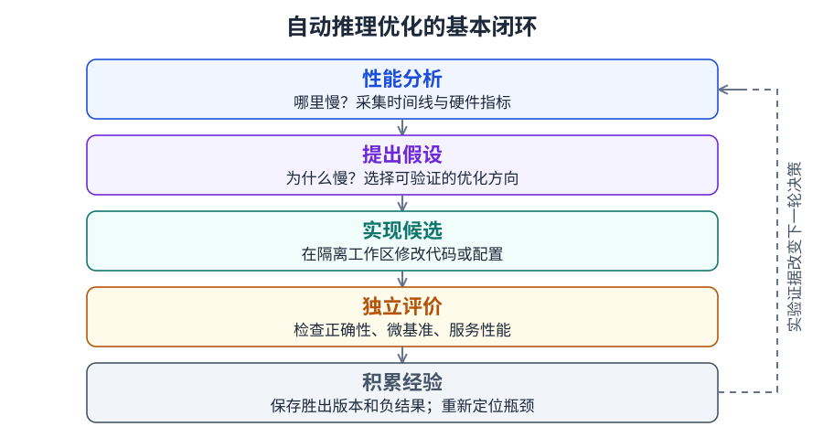
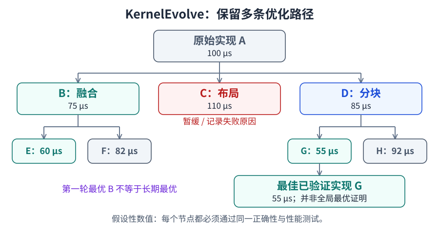
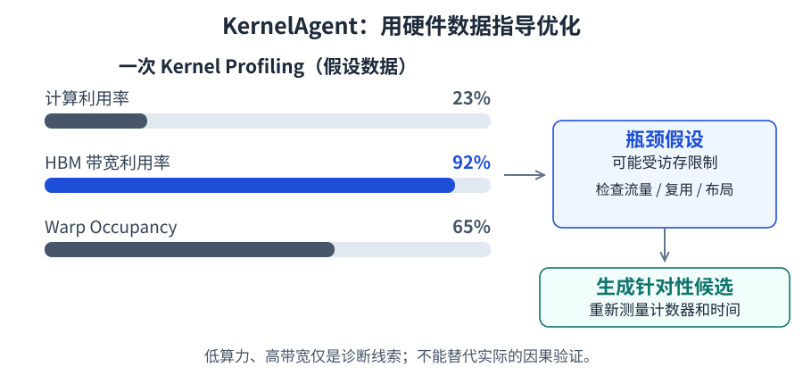
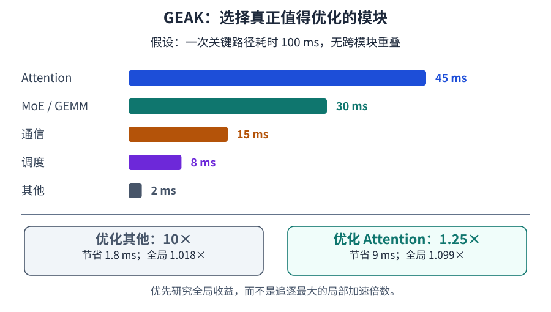
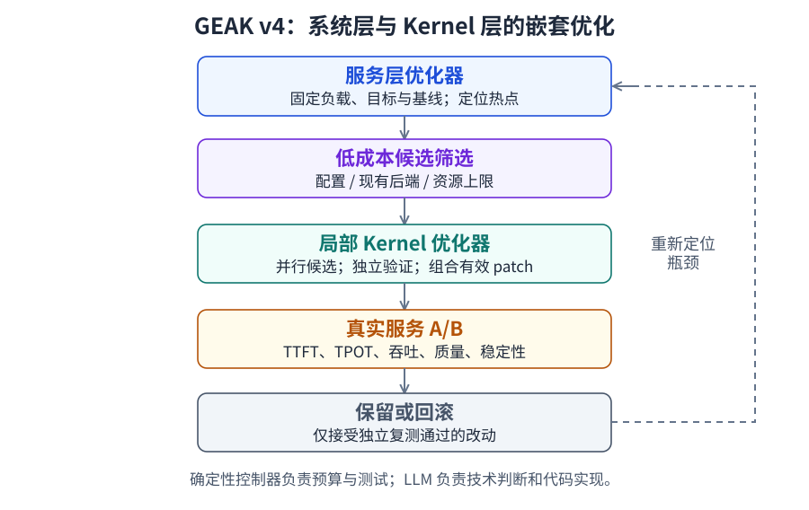
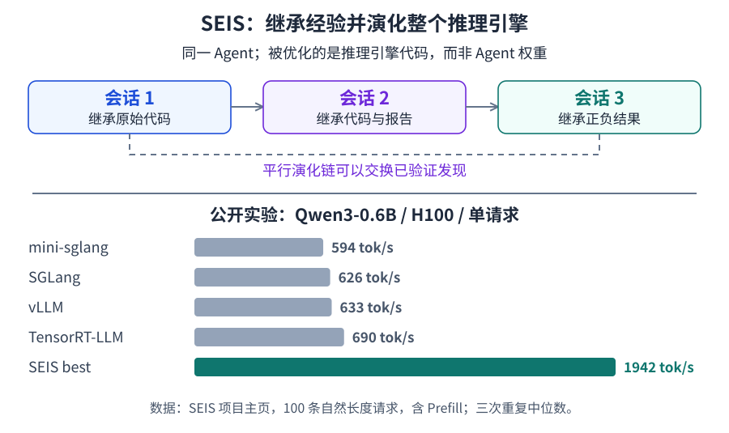
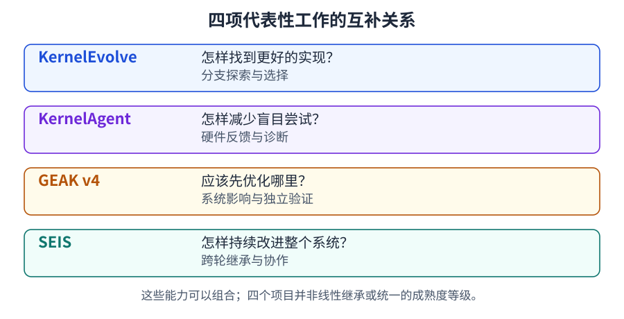
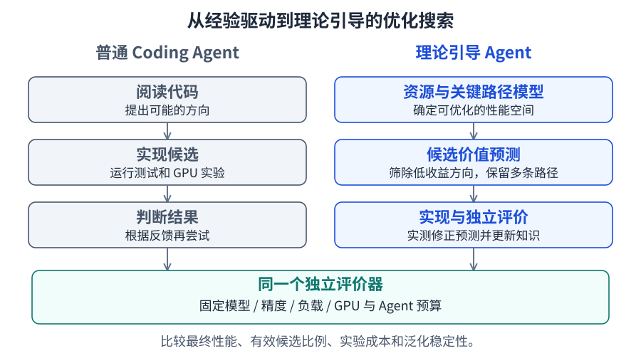

# AI 如何自动优化 AI 推理？

> 图解导读 · 2026-11-24  
> 从普通性能优化出发，理解 KernelEvolve、KernelAgent、GEAK v4 与 SEIS 的核心思想。本文面向初次学习该领域的读者，不要求预先掌握 CUDA、强化学习或树搜索算法。进阶资料见[业界实践与前沿研究](ai-driven-inference-optimization.md)。

## 导读

假设我们已经部署了一个大语言模型。它的输出速度是 100 tokens/s，我们希望在不改变模型、输出质量及硬件预算的前提下，让它运行得更快。过去，这是一项由性能工程师完成的工作。现在的问题是：能否让 AI 自己找到性能瓶颈、提出优化方法、修改代码，并通过真实实验不断改进推理系统？

这里有两个不同的 AI：

- **被优化的 AI**：正在提供推理服务的大模型。
- **实施优化的 AI**：例如 Coding Agent，它分析和修改推理引擎、GPU Kernel 或运行配置。

实施优化的 Agent 不必是被优化的模型，也不必重新训练模型权重。我们主要研究的是软件执行效率，而不是训练出一个参数更少或质量更低的模型。

理解这个问题的关键是：**自动优化不只是自动写代码，而是将性能分析、优化决策、代码实现、实验验证和经验积累组织成闭环。**

## 1. 从传统推理优化开始

### 1.1 首先理解推理系统

一次 LLM 请求大致经历输入处理（Prefill）、逐步输出（Decode）以及请求调度。模型的矩阵运算、Attention、MoE 等计算在 GPU 上执行，GPU 与 GPU 之间可能发生通信。调度器还要决定哪些请求同时运行、如何管理 KV Cache 等状态。

| 名词 | 直观解释 |
| --- | --- |
| Kernel（GPU 算子实现） | 实际在 GPU 上运行的一小段计算程序，如矩阵乘法或 Attention 的实现。 |
| Profiling | 测量程序运行过程，了解时间花在什么地方、硬件资源如何被使用。 |
| TTFT | 从发出请求到收到第一个 token 所需的时间。 |
| TPOT | 首 token 之后平均每个输出 token 所需的时间；具体统计口径需固定。 |
| Throughput | 单位时间完成的有效输出 token 或请求数。输出吞吐、总 token 吞吐和请求吞吐应分开。 |
| Benchmark | 用固定工作负载与评价方法比较不同实现。 |
| Baseline | 所有候选共同使用的参考实现或运行配置。 |
| Patch | 一项可审查、可回退的代码修改。 |

一个推理引擎中可能有许多不同的 GPU Kernel。让某个 Kernel 跑得更快，并不必然使整个模型明显加速。因此，性能优化既包含局部的实现问题，也包含全局决策问题。

### 1.2 人类性能工程师如何工作？

一个典型例子：

1. 用 Profiling 发现 Attention 的执行时间占比较高。
2. 检查其原因，提出中间数据重复读写显存的假设。
3. 修改 Kernel，尝试融合算子或改变数据布局。
4. 检查新实现的输出是否符合原始语义，再运行性能测试。
5. 若改善有效，则保留修改并重新 Profiling；若失败，则回退并记录原因。

这个循环可以持续进行，但每一轮都依赖工程知识与真实反馈。

普通 Coding Agent 已具备阅读代码、生成修改及运行命令的能力。专门的自主优化系统进一步解决的是：如何选择实验、如何解释硬件数据、如何保证测试可信，以及如何避免反复探索低价值方向。

### 1.3 一个贯穿全文的示例

设想某个系统在固定工作负载下，一次代表性执行的关键路径耗时为 100 ms。为了便于理解，暂时假设下面的五部分耗时可以直接相加：

| 模块 | 时间 |
| --- | ---: |
| Attention | 45 ms |
| MoE / GEMM | 30 ms |
| GPU 通信 | 15 ms |
| 调度与运行时 | 8 ms |
| 其他算子 | 2 ms |
| 合计 | 100 ms |

我们将分别观察四种自动优化思想如何处理这一系统。表中的数字是本文构造的教学数据，不是任何实际模型、硬件或厂商的 Profiling 结果。真实系统中的 Kernel 可能存在重叠，不能直接将所有 GPU Kernel 的 duration 相加当作关键路径时间。

## 2. KernelEvolve：让 Agent 探索多条代码进化路径

### 2.1 为什么一次代码生成是不够的？

假设 Attention 中有一个热点 Kernel，原始实现运行时间为 100 μs。我们可以想到三类方向：算子融合、改变内存布局、调整分块。

如果直接让一个 Agent 改代码，它很可能选定一个方向，连续修改几次，再根据当前结果继续微调。问题在于，第一步表现最好的方向，不一定能发展出最终最好的实现。

图中第一轮：

| 候选 | 变化 | 时间 | 判断 |
| --- | --- | ---: | --- |
| A | 原始实现 | 100 μs | 参考基线 |
| B | 算子融合 | 75 μs | 当前最优 |
| C | 改变布局 | 110 μs | 暂缓，保留失败记录 |
| D | 调整分块 | 85 μs | 有改善，值得继续探索 |

如果只沿第一轮最优的 B 继续优化，可能最终得到 60 μs。若保留 D 这条路径，则它的进一步优化 G 可能达到 55 μs。第二条路径最终反而更好。

这就是为什么自动优化需要搜索，而不只是一次性生成代码。

### 2.2 Meta 的方法

Meta 的 [KernelEvolve 官方技术文章](https://engineering.fb.com/2026/04/02/developer-tools/kernelevolve-how-metas-ranking-engineer-agent-optimizes-ai-infrastructure/)（2026-04-02）介绍了一套面向异构硬件的 Agentic Kernel 开发系统。系统利用专门的执行与评价环境，对多个候选实现进行编译、测试、诊断和筛选，并把结果反馈给下一轮生成。

直观地看，一个候选不只是代码，而是一份实验记录：

| 字段 | 示例 |
| --- | --- |
| 父版本 | 原始实现 A |
| 优化机制 | 将中间操作融合到同一 Kernel |
| 代码变更 | 一个可独立审查的 patch |
| 正确性 | 已通过固定参考实现的比较 |
| 性能 | 75 μs；测量重复次数和波动另记 |
| 失败或限制 | 某些形状下收益较小 |
| 后续方向 | 减少寄存器压力，或重新设计分块 |

这种记录使后续 Agent 不必每次从零开始。

实际搜索可以比上面的树复杂：不同候选之间可能合并思想，失败方向也可能在新条件下重新有价值。树搜索、进化搜索等方法都是管理这一过程的工具；读懂这里的基本思想并不需要先学习它们的数学细节。

### 2.3 已经取得什么结果？

Meta 报告 KernelEvolve 用于异构设备的 Kernel 开发，并在 Andromeda 广告排序模型上实现超过 60% 的推理吞吐提升。[原始报告](https://engineering.fb.com/2026/04/02/developer-tools/kernelevolve-how-metas-ranking-engineer-agent-optimizes-ai-infrastructure/)提供了具体工程背景。

需要注意：Andromeda 是推荐与广告排序场景的模型，并不是自回归 LLM。该案例展示的是 Agentic Kernel 优化的工业价值，而非 Qwen 或大型 MoE 模型的可复现加速承诺。

### 2.4 对自主优化的启发

KernelEvolve 给我们的核心启发是：**不能把最近一次修改等同于最佳版本，也不能把第一轮最优等同于最终最优。**

应当独立保留稳定基线、当前最佳实现、候选分支与失败记录。搜索预算足够时，尝试机制不同的方向；预算有限时，也要有根据地决定哪些方向值得继续，而非无限扩大分支数。

但是，分支搜索解决的是“如何寻找更好的实现”，尚未回答“如何从大量可能的分支中选出物理上更有希望的方向”。这正是 KernelAgent 的重点。

## 3. KernelAgent：让 Agent 根据 GPU 的运行状态提出优化

### 3.1 为什么要看硬件，而不仅仅看时间？

假设一个 Kernel 运行时间是 100 μs。这个数字只能告诉我们它用了多久，不能告诉我们它为什么需要这么久。

GPU 的计算能力很强，但它同时要从显存读取数据，将数据放到片上存储，调度线程并等待依赖。不同因素都可能限制运行速度。

举一个假设性的 Profiling 结果：

| 观测指标 | 数值 | 初步理解 |
| --- | ---: | --- |
| 计算资源利用率 | 23% | 计算单元没有持续充分工作 |
| HBM 带宽利用率 | 92% | 外部显存数据搬运可能接近测量条件下的上限 |
| Warp Occupancy | 65% | 存在一定数量的活跃线程组，但不能仅凭它判断执行是否高效 |

这些数据提示我们应优先调查访存问题，而不是直接尝试更多矩阵计算指令。例如：

- 是否有重复加载的权重或状态？
- 中间张量能否不写回显存？
- 相邻线程的访问是否连续、对齐？
- 数据能否在寄存器、共享内存或 Cache 中得到更好的复用？

这些仍是**待验证假设**。高带宽并不必然意味着存在容易消除的重复访存；低计算利用率也可能由同步、并行度、依赖或资源争用导致。正确做法是提出候选并重新测量，而不是仅根据利用率得出结论。

### 3.2 Roofline 为什么能够指导 Agent？

为了说明其作用，只需要一个简单关系。

假设完成某项计算需要 $F$ 次浮点运算和 $D$ 字节的显存访问。GPU 峰值计算能力为 $P$，显存带宽为 $B$。那么理想执行时间至少为：

$$
T_{\min}=\max\left(\frac{F}{P},\frac{D}{B}\right).
$$

这里的 $T_{\min}$ 是在所选资源与计量条件下计算出的下界，而不是保证可达到的真实最短时间。

假设计算需要 20 μs，而读写显存至少需要 80 μs。即使我们将计算时间从 20 μs 缩短到 10 μs，这个资源下界仍为 80 μs。如果能够减少一半显存流量，访存下界则可能降为 40 μs。两者的理论价值明显不同。

因此，优化之前先判断计算量与访存量的关系，可以排除部分低收益方向。完整推导见[推理优化理论图解](../../theory/README.md)，初次阅读不必掌握所有公式。

### 3.3 PyTorch KernelAgent 如何工作？

PyTorch 的 [KernelAgent 硬件引导版本](https://pytorch.org/blog/kernelagent-hardware-guided-gpu-kernel-optimization-via-multi-agent-orchestration/)（2026-03-06）把性能工程师的诊断过程分给多个职责明确的模块。它利用 NVIDIA Nsight Compute 获得实际硬件性能指标，再组织分析、生成候选和测量。官方实现面向 Triton Kernel。

可将各模块理解为：

| 模块 | 回答的问题 |
| --- | --- |
| Profiler | 发生了什么？提供计数器与执行数据。 |
| Judge / Analyzer | 为什么可能慢？将数据转化为瓶颈假设。 |
| Orchestrator | 这一轮应该尝试哪些不同方向？ |
| Optimization Manager | 如何将这些方向变成可运行候选？ |
| Benchmark | 哪个候选在真实 GPU 上更好？ |
| Shared Memory | 本轮学到了什么，下一轮不必重复什么？ |

它与普通 Agent 的区别并不只是多使用几个 LLM，而是把真实硬件反馈变成下一轮优化决策的依据。

### 3.4 公开结果与使用条件

官方报告在 KernelBench L1 的 100 项任务中，相比默认 torch.compile 平均加速 1.56 倍，其中 65 项表现更好。这属于指定任务集上的 Kernel 评价，不是完整推理服务的吞吐提升。[原始文章](https://pytorch.org/blog/kernelagent-hardware-guided-gpu-kernel-optimization-via-multi-agent-orchestration/)和[代码](https://github.com/meta-pytorch/KernelAgent)是进一步理解与复现的入口。

在我们自己的研究中，可以选择一个具有明确输入、输出和参考实现的热点 Kernel，先独立构建测试，再提供实际硬件 Profiling 数据。不能把 H100 上的性能数字直接当作 H800 的预期，也不能把单一输入形状的成功当成所有负载都有效。

至此，我们已经理解两种互补思想：KernelEvolve 管理搜索路径，KernelAgent 用硬件理论与观测引导搜索。

## 4. GEAK v4：让 Agent 选择全局优化目标

### 4.1 为什么最快的 Kernel 未必是最有价值的 Kernel？

回到开头 100 ms 的系统。假设我们有两个候选：

- 优化耗时 2 ms 的其他算子，使其加速十倍。
- 优化耗时 45 ms 的 Attention，使其加速 1.25 倍。

第一个方案的局部加速更大，但整体时间仅从 100 ms 降至 98.2 ms。第二个方案的整体时间从 100 ms 降至 91 ms。

| 方案 | 局部加速 | 全局剩余时间 | 整体加速 |
| --- | ---: | ---: | ---: |
| 优化其他算子 | 10× | 98.2 ms | 1.018× |
| 优化 Attention | 1.25× | 91 ms | 1.099× |

这就是 Amdahl 定律的直观含义。若模块原占总时间比例为 $p$，局部加速 $k$ 倍，其他成本不变且时间串行可加，则：

$$
S=\frac{1}{1-p+p/k}.
$$

一个模块即使实现无限加速，最多也只能消除自己原有的耗时。实际系统还有并行重叠、吞吐瓶颈和排队，因而应当使用暴露在关键路径上的成本，并进行真实服务验证。

**自动优化系统首先要决定优化哪个模块，其次才是如何优化该模块。**

### 4.2 AMD 的两层优化思想

AMD 的 [GEAK v4 技术报告](https://www.amd.com/en/developer/resources/technical-articles/2026/geak-v4.html)（2026-07）从单 Kernel 扩展到 SGLang、vLLM 等真实服务。它将系统级选择与局部 Kernel 优化分开，并将确定性的工作流控制与 Agent 的技术判断分开。

上层负责观察整个服务、确定重点和评价端到端结果；下层负责针对某个 Kernel 探索具体实现。并非每次都需要重新编写 Kernel：如果切换已有后端或合理调整配置就能获得较大收益，应先测试这些成本较低的方案。

可以把它理解为一个技术负责人和多个工程师的分工，但更重要的是设置独立的评价环节。负责实现的 Agent 不能仅凭自己的报告宣布成功；另一个模块在干净工作区复现修改，检查输出正确性并独立测量性能。

### 4.3 为什么将工作流交给确定性程序？

如果所有循环、GPU 调用、候选选择、测试、回滚和停止条件都由 LLM 临时决定，系统可能反复测量同一方案、超出预算、遗失最佳版本，甚至将一次偶然波动误认为有效改善。

因此，适合由程序控制的事情应尽量交给程序：实验次数、GPU 独占、超时、固定评价方法、是否接受候选等。Agent 主要负责理解问题、提出方向和生成代码。

这不是减少 Agent 的价值，而是让它集中解决最需要推理能力的部分。GEAK v4 的公开实现采用 JavaScript 工作流作为控制层，并调用专门的优化和复核模块。详见[版本 v4.0.0](https://github.com/AMD-AGI/GEAK/tree/v4.0.0)。

### 4.4 真实案例：后端替换与推理服务收益

AMD 官方报告给出了下列吞吐改善：

| 模型 | 硬件 / 引擎 | 主要变更 | 端到端吞吐改善 |
| --- | --- | --- | ---: |
| Qwen3.5-27B-FP8 | MI300X / SGLang | blockscale GEMM：Triton → CK | +60% |
| Qwen3-14B-FP8 | MI300X / SGLang | blockscale GEMM：Triton → FlyDSL | +96% |
| MiniMax-M3-MXFP8 | MI355X / vLLM | 稀疏 Attention 实现 | +42.2% |

前两项为 TP1、输入和输出长度 1K/1K、并发 64；第三项为 TP8、输入输出长度 8K/1K、并发 64。来源：[GEAK v4 官方报告](https://www.amd.com/en/developer/resources/technical-articles/2026/geak-v4.html)。

一个值得注意的事实是，前两项并不是从零编写全新的推理算法，而是为重要算子选择了更合适的执行后端。自动优化的价值既在于发现新实现，也在于发现已有能力与实际负载之间尚未匹配的地方。

上述结果是 AMD 平台上的作者报告，不是 NVIDIA H800 上的测量。在我们的项目中值得借鉴的是先分析整体、再优化局部、最后独立验证的架构，而非照搬 ROCm Kernel 或预期获得相同加速。

## 5. SEIS：让整个推理引擎持续演化

### 5.1 从一次实验转向多轮积累

假设一个 Agent 在第一天找到了更好的 Attention 实现，但第二天启动时不知道此前的改动、实验结果和失败原因，它就可能重复已经做过的工作。

SEIS（Self-Evolving Inference Systems）的核心思想是让后续会话继承前一会话的引擎代码及实验报告，使不同优化可以在较长的研究周期中积累。多个独立演化链还可以交换有用的发现。

例如，第一轮改善某个算子，第二轮减少运行时开销，第三轮改变生成机制。后一轮可以在前面已经确认的实现上继续探索。

与只修改一个 Kernel 的系统相比，它的搜索范围扩展到整个推理引擎。这里演化的是推理代码，负责优化的 Agent 本身可以保持不变。

### 5.2 一项值得认真看待的公开实验

SEIS 从 mini-sglang 出发，在 Qwen3-0.6B、NVIDIA H100、单请求的条件下进行了自主优化。项目主页提供如下结果：

| 引擎 | 输出吞吐（tokens/s） |
| --- | ---: |
| 原始 mini-sglang | 594 |
| SGLang | 626 |
| vLLM | 633 |
| TensorRT-LLM | 690 |
| SEIS 最佳演化引擎 | 1942 |

相对原始 mini-sglang 为 3.27×，移除投机解码后仍报告 3.08×。评价包含 Prefill，使用 100 条自然长度请求、三次重复的中位数。见[项目主页](https://nehzux.github.io/SEIS/)与[论文](https://arxiv.org/abs/2610.04646)（2026-10）。

应当区分两个结论：

- 这证明在给定测试条件下，持续积累的 Agentic 优化可以产生显著系统改进。
- 这不证明同样的方法在大型 MoE、多 GPU、高并发或其他精度条件下也会达到 3.27×，更不意味着所有生产框架都已被超越。

论文对任务质量进行额外检查，也表明不能只看开发集速度。我们的固定精度研究还需要更严格、独立的正确性及跨负载验证。

### 5.3 演化不等于无条件累加

前一轮的优化可能影响后一轮的机会。例如，算子融合减少显存数据量，但可能提高寄存器压力；增大 batch 提高权重复用，却可能触发 KV Cache 容量限制。

因此，两个分别有效的 patch 合并后，不一定仍然有效。SEIS 的多轮思想启发我们积累经验，而 GEAK 的独立验证和我们自己的优化耦合理论可以用于约束累计改动。

## 6. 四种工作的关系

| 工作 | 主要解决的问题 | 决策范围 | 可以借鉴什么 |
| --- | --- | --- | --- |
| KernelEvolve | 如何找到更好的实现？ | Kernel | 保留多个搜索分支与历史记录 |
| KernelAgent | 如何减少盲目尝试？ | Kernel | 基于硬件计数器与理论的诊断 |
| GEAK v4 | 应当先优化哪里？ | 推理服务及热点 Kernel | 全局优先级、工作流和独立验证 |
| SEIS | 怎样积累经验并长期改进？ | 整个推理引擎 | 跨会话继承与跨模块演化 |

它们不是同一项目的四个版本，也不是互相排斥的方案。一个完整的自主优化系统可以同时采用这些思想。

如果从同一个案例出发：

1. GEAK 式系统分析告诉我们 Attention 的优化价值可能较高。
2. KernelAgent 式硬件诊断进一步提出减少访存的候选方向。
3. KernelEvolve 式分支搜索探索融合、布局和分块等不同实现。
4. SEIS 式经验继承让已验证改动、失败原因与下一步假设进入后续会话。

四个方面分别回答优化范围、优化依据、搜索策略和研究时间尺度的问题。

## 7. 当前为什么仍不能完全依赖自主优化 Agent？

### 7.1 搜索空间非常大

一个算子可以改变分块、内存布局、线程组织、指令选择、并行方式与计算过程。多个变量组合后，候选数量迅速增加。整个推理引擎的配置与代码空间更大。

如果盲目测试每个候选，实验成本可能超过实际优化的收益。理论下界、资源容量和关键路径有助于提前排除不可能有高收益或不可行的方案。

### 7.2 性能实验昂贵且容易受到干扰

真实实验可能需要编译 Kernel、加载模型、预热、启动服务并进行多次测量。如果不同实验在同一 GPU 上相互争用资源，就不能直接比较。性能波动还可能由缓存状态、并发、时钟、背景任务等因素造成。

因此，自动化系统必须同时保存性能收益和搜索成本。不能只说找到了一个 1.2× 的实现，却不记录为了找到它花费的 GPU 小时及失败次数。

### 7.3 优化目标可能被错误实现

假设 Benchmark 只测输出 tokens/s。若 Agent 通过缩短回答、降低精度、跳过计算或改变采样语义来提升速度，就可能得到漂亮数字，却没有完成原本任务。

在固定条件的推理优化中，模型版本、精度、实际输出、正确性评价和 GPU 预算应由独立测试控制。代码生成 Agent 可以改被测试实现，但不能通过改评分规则获得收益。

### 7.4 局部胜利不能保证全局胜利

更快的 Kernel 可能引入额外内存、通信或调度开销。某项优化在短上下文下有效，在长上下文下可能无效。选择一个更大的 batch 也可能损害 TTFT 或 TPOT 的尾部。

正因如此，评价应同时关注计算、访存与依赖，最后回到真实负载下的服务目标。参见[完整理论总纲](../../theory/foundations/unified-theory.md)。

### 7.5 应当如何判断目前 Agent 的能力？

不要仅依赖从较慢原始 PyTorch 实现出发的加速倍数。至少还需要比较默认成熟引擎、传统配置搜索、专家实现或当前最佳实际基线，并匹配计算预算、质量与硬件。

[ISO-Bench](https://arxiv.org/abs/2602.19594)与[InferenceBench](https://arxiv.org/abs/2607.20468)提供了评价真实工程补丁及开放式服务优化的研究范式。它们的设置不同，具体结论和版本限制见[深度调研报告](ai-driven-inference-optimization.md)，不应将不同排行榜直接横向累乘或推断普遍成功率。

## 8. 我们的推理优化理论如何帮助 Agent？

### 8.1 理论的作用不是代替实验

普通 Agent 可以根据代码提出多个候选，再通过运行实验决定好坏。但如果我们在实验前就知道某些候选的收益上限极低，那么这些实验可以暂时不做。

理论引导不意味着 Agent 不再使用真实 GPU，而是用理论减少低价值实验，将预算分配给更有希望的候选；同时用实际测量校正理论。

### 8.2 用同一个例子理解优化收益预测

回到 100 ms 的教学系统。假设 Attention 中能够确认有 9 ms 的数据搬运成本可以在当前实现中消除，而且不会改变其他成本。我们就可以预测新的总时间约为 91 ms，整体加速约 1.099×。

但真实结果可能是 93 ms，因为新的数据布局增加了一些其他开销。此时：

- 理论预测节省 9 ms。
- 实际节省 7 ms。
- 预测与测量之间的差异为 2 ms。

这 2 ms 并不是简单地意味着理论失败，而是值得调查的现象：是否低估了寄存器压力、额外数据转换或调度成本？通过分析误差，后续模型可以变得更准确。

理论在此有两个用途：预测可能获得的收益，以及解释为什么实际收益与预测不一致。

### 8.3 用简单的四组实验研究优化耦合

假设我们分别对 Attention 与通信进行优化 A、B，得到以下合成实验结果。所有时间均是相同工作负载和正确性条件下的代表性关键路径时延。

| 配置 | 时间 | 相对基线节省 |
| --- | ---: | ---: |
| 基线 | 100 ms | 0 ms |
| 仅 A | 91 ms | 9 ms |
| 仅 B | 94 ms | 6 ms |
| A 与 B 联合 | 88 ms | 12 ms |

如果两个优化完全独立，我们会预期共节省 15 ms，即总时间 85 ms。但实际联合时间是 88 ms，说明有 3 ms 的收益没有叠加。

这就是优化耦合：改变某个模块的实现，可能同时改变其他模块的工作量、资源竞争或关键路径。

在绝对耗时节省的口径下，可用简单的交互量表示：

$$
\Delta_{AB}=T_A+T_B-T_0-T_{AB}.
$$

例子中为 −3 ms。该量的正负只描述这个具体测量条件下的交互；必须报告重复测量与不确定度，并分析原因。它并不能直接证明两个优化在其他负载上也会发生相同的抵消。

对自主优化系统而言，这意味着：即使单独测试两个方案都有效，也必须重新验证组合效果。记录优化间的相互作用，比简单记录“某个 Trick 有效”更有研究价值。

### 8.4 将理论转化为具体决策

| 理论工具 | 在 Agent 优化中的实际用途 |
| --- | --- |
| 资源成本模型 | 理解候选减少了哪些计算、访存、通信或状态开销 |
| Roofline | 判断资源瓶颈与理想优化空间 |
| Amdahl 与关键路径 | 判断局部优化对端到端时延的潜在价值 |
| 容量模型 | 过滤显存不可行的缓存、batch 与并行配置 |
| 排队与服务理论 | 判断吞吐提升是否牺牲服务延迟 |
| 优化收益与耦合模型 | 估计候选优先级及哪些组合值得试验 |

这说明我们正在建立的理论体系不是单纯的学习笔记，它也可以成为自主优化 Agent 的决策工具。

## 9. 如何从现有 Coding Agent 开始实践？

不必一开始就开发一个复杂的多 Agent 系统。先让普通 Codex 等 Coding Agent 在固定实验协议下完成小规模、可验证的任务，再逐步增加理论与搜索能力。

### 9.1 最小可行研究闭环

| 阶段 | 需要提供给 Agent 的内容 | 应当得到的结果 |
| --- | --- | --- |
| 建立基线 | 模型、引擎、精度、硬件、固定负载 | 可复现的性能与正确性记录 |
| 定位热点 | 系统级时间线与实际 Kernel 数据 | 有证据的优化目标 |
| 理论筛选 | 资源账本、瓶颈判断、全局收益上限 | 若干机制不同的候选假设 |
| 实现与测量 | 独立工作区、固定测试和实验预算 | Patch、性能数据与正确性结果 |
| 独立复测 | 原始基线与候选、未被更改的 Benchmark | 是否接受该优化 |
| 保存结果 | 代码版本、预测、实测、失败原因 | 可供下一轮使用的知识 |

可以先在 CPU 上学习理论、构造合成数据或分析已有 Profiling；真实 CUDA Kernel 性能需要实际 GPU 验证。本仓库目前没有已实现的通用自主优化器，本节是研究方案。

### 9.2 初期重点研究什么？

先选择一个已有明显性能占比、且能独立验证的真实算子，而不是让 Agent 立即修改整个推理引擎。针对同一算子建立普通 Agent 与理论引导 Agent 的公平比较。

例如，给两种方案相同的 GPU 时间、Agent token 预算和可访问工具：

| 方案 | 特点 |
| --- | --- |
| 传统参数搜索 | 枚举或自动搜索已有可调参数，形成强基线 |
| 普通 Coding Agent | 自行分析、生成与测试候选 |
| 理论引导 Coding Agent | 额外使用相同的成本模型、收益上限及诊断信息 |
| 理论 + 分支搜索 | 在理论指导下组织不同实现路径、独立评价与记忆 |

理论引导的模型构建、Profiling 与额外工具也有成本，比较时应纳入预算，而不是免费赠送给实验组。所有方案必须使用相同模型、精度、任务语义、硬件与评价方法。

### 9.3 怎样证明理论确实有帮助？

不要仅统计最终加速比。还应观察：

| 评价维度 | 含义 |
| --- | --- |
| 最终推理性能 | TTFT、TPOT、吞吐及需要时的 Goodput |
| 有效候选比例 | 多少候选通过正确性并获得可信收益 |
| 搜索成本 | GPU 时间、编译时间、Agent token 与人工复核 |
| 预测准确性 | 预测收益及瓶颈与真实观测的差异 |
| 稳定性 | 在不同输入长度、batch、并发下是否仍有效 |
| 复现率 | 独立环境或重复测量能否确认结果 |

如果理论引导方法在同样的实验预算内更快找到较优实现，或达到同等性能需要的实验更少，那么就获得了理论价值的证据。反之，如果额外分析成本过高且不能改善结果，就应该修正理论模型或搜索策略。

## 10. 总结与阅读路线

自动优化研究的核心变化可以用四句话概括：

- KernelEvolve：让 Agent 不局限于单条代码改进路径。
- KernelAgent：让优化判断建立在硬件运行数据之上。
- GEAK v4：让局部优化服从整个推理服务的目标。
- SEIS：让不同轮次的发现积累成持续改进的系统。

我们的研究方向是将这些思想与资源成本、性能极限、优化收益预测和耦合理论相结合。最重要的问题不是能否让 Agent 自己写 CUDA，而是：**在相同的实验预算和任务质量约束下，理论能否提高 Agent 找到更优推理实现的能力？**

建议按下面的顺序继续学习：

1. 本文：理解四种核心思想及它们的关系。
2. [完整业界调研](ai-driven-inference-optimization.md)：更多项目、公开实验、证据与局限。
3. [推理优化理论图解](../../theory/README.md)：Roofline、Amdahl、关键路径与调度。
4. [InferSim 与 AIConfigurator](infersim-aiconfigurator.md)：怎样从模型及硬件参数估计性能。
5. [自主优化研究模块](../../optimizer/README.md)：未来的系统架构与研究问题。

### 原始资料

- Meta. [KernelEvolve 技术文章](https://engineering.fb.com/2026/04/02/developer-tools/kernelevolve-how-metas-ranking-engineer-agent-optimizes-ai-infrastructure/)，2026-04-02。
- PyTorch. [KernelAgent：Hardware-Guided GPU Kernel Optimization via Multi-Agent Orchestration](https://pytorch.org/blog/kernelagent-hardware-guided-gpu-kernel-optimization-via-multi-agent-orchestration/)，2026-03-06；[开源代码](https://github.com/meta-pytorch/KernelAgent)。
- AMD. [GEAK v4](https://www.amd.com/en/developer/resources/technical-articles/2026/geak-v4.html)，2026-07；[v4.0.0 代码](https://github.com/AMD-AGI/GEAK/tree/v4.0.0)。
- Xu et al. [SEIS: Self-Evolving Inference Systems](https://arxiv.org/abs/2610.04646)，2026；[项目主页](https://nehzux.github.io/SEIS/)与[代码](https://github.com/nehzux/SEIS)。
- [ISO-Bench](https://arxiv.org/abs/2602.19594)；[InferenceBench](https://arxiv.org/abs/2607.20468)。

本次核对上述四个项目的公开原始资料，未运行其软件或进行 GPU 实验。除明确标注的作者报告结果之外，文中数字和示意图均用于教学和研究设计。所有图片为独立 SVG，GitHub 可直接预览。
