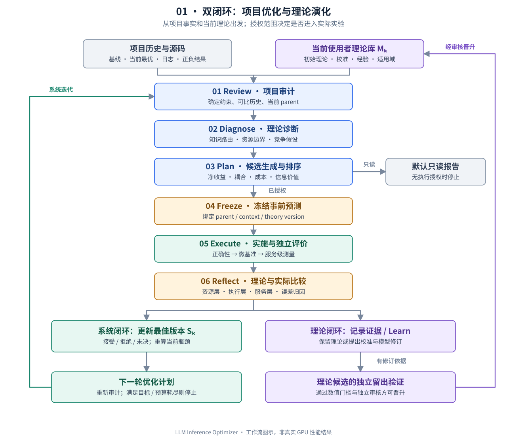
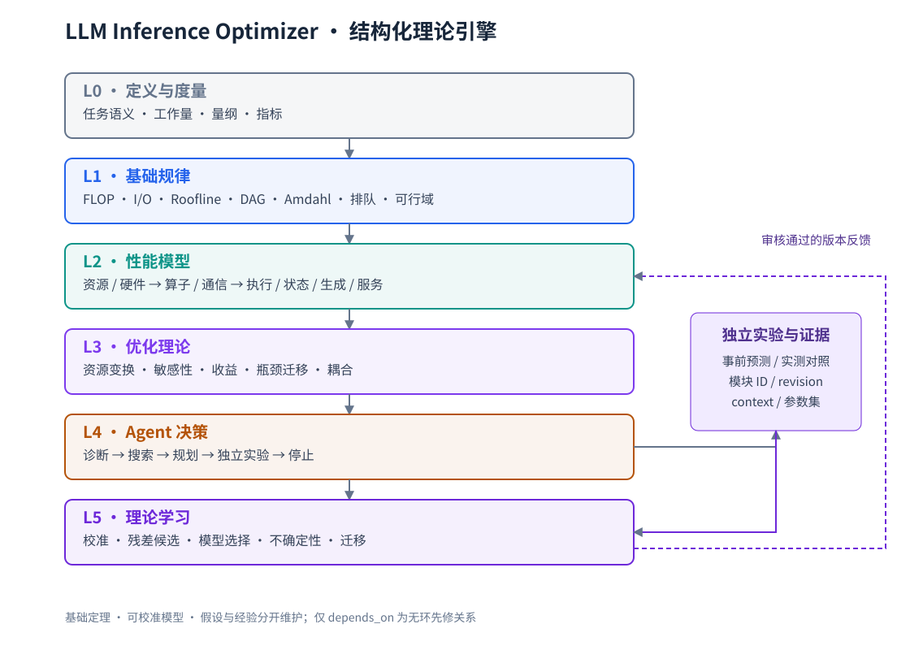
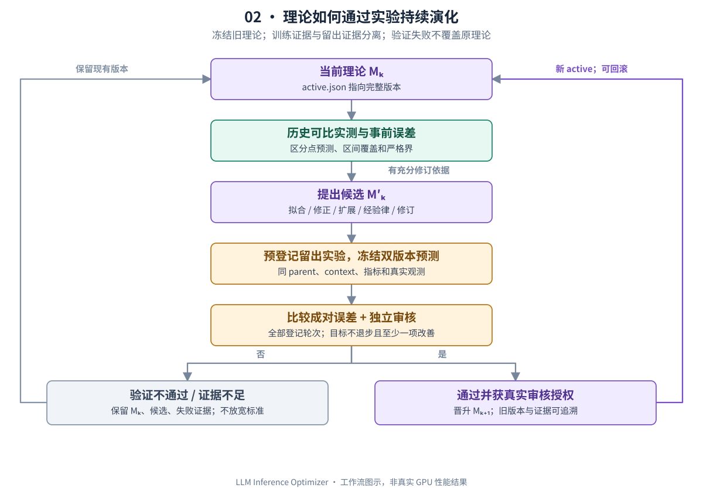
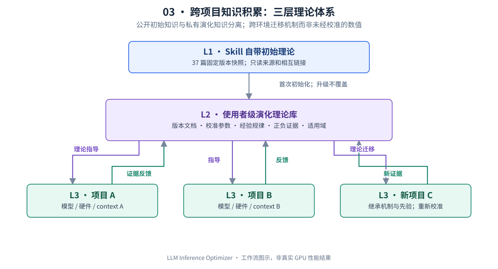

# LLM Inference Optimizer：图解介绍与完整工作流程

> Self-Evolving Theory-Guided Inference Optimization · 自演化理论驱动的推理优化。
>
> 这是一份面向使用者的导读，解释已经实现的 Skill 如何将项目历史、推理性能理论、候选决策、实测评价和个人知识积累连接起来。执行规范以 [SKILL.md](SKILL.md) 为准；安装和 CLI 用法见 [README](README.md)。

[六层结构化理论库](knowledge/structured/INDEX.md) · [初始理论索引](knowledge/INDEX.md) · [知识路由](references/knowledge-router.md) · [逐轮预测与对比](references/prediction-comparison.md) · [理论演化](references/theory-evolution.md) · [三页可编辑 draw.io](diagrams/skill-workflow.drawio)

## 1. 为什么需要这个 Skill？

一般的 Coding Agent 可以根据源码和性能数据尝试优化，但往往难以回答三个更深层的问题：当前系统真正的瓶颈是什么？哪些尚未尝试的优化值得投入有限的 GPU 和 Agent 预算？过去的成功、失败以及预测误差怎样指导以后不同项目的工作？

LLM Inference Optimizer 不以罗列 Tricks 为目标，而是把理论仓库转化为具体项目中的研究工作流。它有两个相互联系的优化对象：推理系统本身，以及用于解释和预测推理系统的理论模型。理论为决策提供依据，实验提供能够反驳理论的证据。目标是降低重复试错成本，提高单位优化预算的有效收益，并通过未见实验检验预测能力是否真的提高。

## 2. 全局工作流程：双闭环

[](diagrams/01-workflow.svg)

从项目源码、实验历史和当前使用者理论版本开始，Agent 先审计事实、诊断瓶颈，再生成与排序候选。默认只读分析到此为止；实际实施须有授权，且事前冻结预测。实验后比较预测与实际，并行判断系统候选是否接受、理论是否需要修订。

系统闭环保留固定原始基线及当前独立验证的最佳版本；理论闭环积累可比较的证据，必要时提出新版本并独立验证。两条闭环可异步推进：一轮优化不必导致一次理论晋升，失败也能提供机制线索。达到预先给定目标、预算不足以完成验证、或缺少决定性信息时停止或暂缓，不擅自声明全局最优。

## 3. 结构化理论引擎：六层理论与模型接口

[](knowledge/structured/ATLAS.md)

Skill 已从 Markdown 阅读库升级为 **Structured Theory Library v2**：原始 37 篇理论文档保留作为详细来源，新增 33 个独立理论单元。每个单元包含 model.json 与 theory.md，统一稳定 ID、revision、公式说明、输入输出及单位、适用域、可校准参数、验证与前置依赖。注册表和关系图可自动重建。

| 层级 | 模块数 | 主要内容 |
| --- | ---: | --- |
| L0 定义与度量 | 3 | 任务语义、资源与量纲、指标 |
| L1 基础规律 | 7 | 复杂度、I/O、Roofline、关键路径、Amdahl、排队、可行域 |
| L2 性能模型 | 8 | 资源、硬件、算子、通信、状态、执行、生成、服务 |
| L3 优化理论 | 5 | 变换、敏感性、净收益、迁移、耦合 |
| L4 自主优化 | 5 | 诊断、搜索、规划、实验、停止 |
| L5 理论学习 | 5 | 校准、残差、模型选择、误差与迁移 |

[完整理论索引](knowledge/structured/INDEX.md) · [可编辑六层 draw.io](knowledge/structured/theory-atlas.drawio) · [注册表](knowledge/structured/registry.json) · [机器依赖图](knowledge/structured/dependencies.json)。

Agent 从项目问题检索模型 ID，再查询适用条件、上游依赖和可校准参数；16 个窄解析函数可通过 calculate 调用，结果标记为条件计算而非 GPU 实测。其余模块仍为理论或模型契约，不假设已实现通用模拟器。公式字符串绝不直接执行。

一个理论模型可以对应多套 context-specific 参数；初始参数库为空。新的实验先记录实际证据，再提议参数集或模型 revision，不能用一组硬件数据替代另一组硬件的校准。

## 4. Agent 每轮优化的阶段

| 阶段 | Agent 的工作 | 主要产出与依据 |
| --- | --- | --- |
| Review | 读取模型、硬件、引擎、工作负载、源码、历史提交、实验结果和原始日志；区分固定原始基线与当前最优 parent | [项目概况](assets/project-profile.json)、[历史台账](assets/evidence-ledger.json)、[审计方法](references/project-audit.md) |
| Diagnose | 根据项目现象按需加载理论；从计算、分层访存、通信、状态容量、依赖、有效提交与调度分析剩余成本，保留竞争假设 | [知识路由](references/knowledge-router.md)、[诊断方法](references/diagnosis.md) |
| Plan | 生成机制不同的候选，重算条件收益、耦合、额外代价和信息价值；排除确定违反约束的方案 | [候选决策](references/decision-making.md)、[实验计划](assets/experiment-plan.json)、[复盘报告](assets/optimization-report.md) |
| Freeze | 在候选测量之前写明 parent、context、理论版本、指标口径、基线容忍度、假设与预测；生成摘要和收据 | [预测合同](references/prediction-comparison.md)、[预测 JSON](assets/prediction.json) |
| Execute | 在授权的代码、资源和实验范围内实施；先正确性，后微基准及端到端评价；失败也登记 | [独立评价](references/evaluation.md)、[测量 JSON](assets/measurement.json) |
| Reflect | 对比资源、执行与服务层；计算预测误差和区间/边界结果；检查真实后端、工作点和基线是否可比 | result/comparison.md、comparison.json 与原始证据 |
| Learn | 记录正负结果，提出校准/修订或保留当前理论；更新当前最佳 parent、下一轮计划、理论候选 | [理论更新记录](assets/theory-update.md)、[下一轮计划](assets/next-plan.md)、[理论演化规范](references/theory-evolution.md) |

Review + Plan 是默认模式；Diagnose 属于其内部分析，Freeze 是已授权候选进入实际实验的关键门槛。Execute、Reflect、Learn 可以组合调用，也可以分别完成已有项目的交接。历史实验没有事前预测时只能做回顾性分析，不补造时间戳。

## 5. 每轮的预测与实际比较

以仓库中内置的 Kernel Fusion **合成教学示例**为例（非实际 GPU 测量），假设在固定工作点下优化减少 HBM 中间张量流量。

| 指标 | 基线 | 事前预测 | 合成实际 | 预测收益 | 实际收益 | 偏差（实际 − 预测） |
| --- | ---: | ---: | ---: | ---: | ---: | ---: |
| HBM 流量（bytes/step） | 1,000,000 | 700,000 | 720,000 | 30% | 28% | −2 pp |
| Kernel 耗时（ms） | 4.00 | 3.00（区间 2.8–3.2） | 3.28 | 25% | 18% | −7 pp |
| TPOT（ms/token） | 10.00 | 8.00 | 8.60 | 20% | 14% | −6 pp |
| 吞吐（tokens/s） | 100 | unknown | 110 | unknown | 10% | unknown |

对于越低越好的指标，定义收益 $g=(T_0-T_1)/T_0$；越高越好的指标采用 $g=(X_1-X_0)/X_0$。在可比基线下，预测收益和实际收益的误差为：

$$
e_k=g_k-\widehat g_k.
$$

因此 TPOT 的收益误差为 $0.14-0.20=-0.06$，即 −6 个百分点，而非 −6% 的相对误差。Kernel 实际耗时 3.28 ms 也落在所给预测区间之外。对于零基线或未知预测，不计算相对误差；严格界只检查满足性，不能把未达到理论界当成点预测失准。

这个示例中，资源量的预测较接近，执行层与服务层收益被高估。寄存器占用、有效计算效率、额外指令或关键路径变化是待检查的竞争解释，不是仅凭误差即可确认的原因。后续可以选择能区分这些假设的最小实验，而不是盲目扩大融合。

实际轮次由 CLI 校验项目、parent、candidate、context、metric scope、unit、direction、statistic、正确性、可比性及基线漂移。失败、阻塞、不可比及缺失测量不会被记作零收益。样例的 simulated 证据禁止写入用户实测知识库。

### 模块级误差分析

| 指标 | primary model / revision | 本轮理论判断（合成示例） |
| --- | --- | --- |
| HBM 流量 | PERF-RESOURCE r1 | 资源账本偏差较小，继续收集分层流量证据 |
| Kernel 时间 | PERF-OPERATOR r1 | 有效速率/额外开销需区分观测 |
| TPOT | PERF-SERVING r1 | 检查执行误差传播和服务调度 |
| 吞吐 | model_gap | 尚无足够服务模型输入，不伪造预测 |

模型引用绑定输出、单位、revision 和适用的参数集。比较文件保留模型级出处；每个主模型/指标组合须填写结构化复盘决策、依据或缺口，必要时追踪先修模型。引用只说明预测来自哪里，不自动证明误差由哪个模块导致。

### 逐轮产物

```text
optimization/rounds/round-001/
├── prediction.md          # 实验前生成
├── prediction.json
├── freeze.json            # 预测与理论版本摘要
├── result/
│   ├── measurement.json
│   ├── comparison.json
│   ├── comparison.md      # 自动比较表
│   ├── receipt.json
│   └── module-review-template.json
├── theory-update.json     # 模块决策与依据，填写后保存
├── theory-update.md       # Agent 解释和理论修订判断
└── next-plan.md           # 接受/拒绝/未决与下一轮
```

完整样例可在 CPU 上按照 [README 的合成演示](README.md) 运行，无需 GPU。完整数据定义见 [预测与实测合同](references/prediction-comparison.md)。

## 6. 理论如何演化

[](diagrams/02-theory-evolution.svg)

理论不是每轮自动改写。Agent 可以保留当前理论，或者提出五种修订：参数校准、模型修正、模型扩展、条件经验律、理论结构修订。旧理论与冻结预测始终保留。

一种理论建模方向是物理结构与数据驱动残差相结合：

$$
M_k(x)=f(x;\theta_k)+r_k(x),
$$

其中 $x$ 表示模型、硬件、工作负载及策略；$\theta_k$ 表示有物理意义的参数；$r_k$ 表示尚未被理论近似解释的修正。预测应满足适用条件下已知的物理边界。该式为研究框架，不代表 CLI 已实现通用残差训练器；当前实现支持从兼容实测点进行稳健乘性拟合，并登记完整候选文档。

候选理论先登记训练证据、适用域、修订理由、目标指标、完整留出轮次和上下文。结构化候选修改成对模型文件或新增带证据的参数集，CLI 重建依赖图并登记受影响的下游模块；修订过的模型 revision 不再复用过期参数。留出时必须冻结 active/shadow 各自的模块输出和参数集。后续未见实验在相同定义下冻结旧版与候选版的成对预测。程序检查全部登记轮次、训练/验证不重叠、上下文覆盖、可比测量数、目标 MAE 无退步且至少一项改善；结构化候选还需逐目标、逐 context 检查退步，覆盖所有被修订模型，并在合格的 shadow 预测中使用新增参数集；独立审阅仍须确认真实数据、无泄漏、统计意义、物理约束与适用域。仅凭两条留出记录不能证明通用规律。通过独立审核并有真实批准引用才能晋升；不通过则保留原理论及失败证据。详情见 [理论演化与版本治理](references/theory-evolution.md)。

## 7. 三层知识所有权与跨项目学习

[](diagrams/03-knowledge.svg)

| 层级 | 内容 | 维护 |
| --- | --- | --- |
| L1 初始理论 | 33 个结构化理论单元及 37 篇详细来源文档 | 随 Skill 分发的固定上游版本；[目录](knowledge/INDEX.md) |
| L2 使用者理论 | 完整版本化理论文档、校准结果、经验规律、实验证据、适用范围、候选及晋升历史 | 私有本地库，默认 ~/.local/share/llm-inference-optimizer；可用 LLM_OPTIMIZER_HOME 或 --home 更改 |
| L3 项目记录 | 项目 profile、固定原始基线、当前 best parent、每轮结果与原始日志 | 项目侧维护，不自动上传 |

新项目可以继承已有机制和有适用条件的先验知识，但不能直接复制异构设备的有效速率、不同 shape 的参数或不同负载下的收益数字。跨保密域使用独立知识库。Skill 升级不会覆盖使用者的 active 版本；上游与私有知识的迁移需要审查，目前没有自动三方合并。版本目录和证据由用户独立备份。

长期评价关注同 theory version / context / metric definition 的点预测 MAE、bias、正收益分类准确率、区间覆盖率与界满足率，并结合样本数、缺失、选择偏差解读。进一步研究可比较同预算下理论引导 Agent 的最佳累计收益、候选有效率和冷启动成本；参见 [Agent Benchmark](knowledge/initial/experiments/agent-benchmark/README.md)。这些是待检验目标，不是已经取得的 GPU 加速成绩。

## 8. 实际使用顺序

所有命令位于 [scripts/skill.py](scripts/skill.py)，Python 3.10+ 标准库。根据任务选择适用命令，不需要每轮执行所有命令。

| 时机 | 命令 | 作用 |
| --- | --- | --- |
| 首次使用 | init | 初始化私有理论库，不覆盖现有 active |
| 每轮开始 | resolve / catalog / lookup | 获取版本，路由问题到理论 ID 与先修 |
| 理论计算 | calculate MODEL_ID INPUT_JSON | 条件解析计算，显式单位 |
| 修订影响 | impact MODEL_ID | 检查依赖与下游影响 |
| 旧库迁移 | migrate VERSION REVIEW_REF | 新建子版本，保留历史与本地文档 |
| 候选实验前 | freeze ROUND_DIR PREDICTION_JSON | 校验并冻结预测 |
| 候选实验后 | compare ROUND_DIR MEASUREMENT_JSON | 生成比较结果与收据 |
| 知识积累 | record ROUND_DIR THEORY_NOTE | 在本地授权范围内保存证据 |
| 周期性复盘 | summary / module-summary | 统计分组与模块级预测误差 |
| 有足够同域数据 | calibrate METRIC TRAINING_ID... | 计算候选乘性校准 |
| 有修订依据 | propose PROPOSAL_JSON | 创建理论候选及预登记验证 |
| 独立验证与审核后 | promote VERSION REVIEW_REF HOLDOUT_ID... | 晋升经过验证的候选版本 |
| 需要恢复 | rollback ANCESTOR_VERSION REVIEW_REF | 保留证据并回滚 active 指针 |

进入具体推理项目后调用：

```text
$llm-inference-optimizer

分析当前项目所有已有的优化尝试、实际结果与失败原因。
结合当前理论知识库，给出下一轮最值得推进的方向、
事前收益预测、竞争假设及最小验证方案。本次只读分析。
```

需要实际优化时，明确授权实施范围、质量约束、计算预算和测试对象；要求每轮先冻结预测、后独立测量并输出比较报告。安装、初始化和模板见 [Skill README](README.md)；Agent 的正式工作规范见 [SKILL.md](SKILL.md)。

## 9. 最终研究目标与当前边界

将两个优化对象概括为：

$$
S_{k+1}=\operatorname{Optimize}(S_k,M_k),
$$

$$
M_{k+1}=\operatorname{Learn}(M_k,D_k).
$$

这里 $S_k$ 是当前推理系统，$M_k$ 是当前经过验证的理论版本，$D_k$ 是新实验产生的证据。若没有足够依据或验证不通过，保持原系统或原理论是合理决定；上式不保证每轮都获得性能或理论进步。

当前实现包括可安装 Skill、六层知识结构与机器注册表、16 个窄解析计算接口、模型级预测冻结与误差比较、带 context 的参数库、旧版显式迁移、结构化候选和审核晋升/回滚、模板及 CPU 回归测试代码。非数值方法的理论修订还需要专门的 Agent benchmark 或数学审查，不能凭数值预测 MAE 机械晋升；当前晋升门针对可配对数值预测链。尚无通用 GPU runner、自动 profiler adapter 或完整神经网络性能模型训练器。真实 GPU 优化效率和跨项目理论泛化仍需要独立实验。CLI 不代替实际授权、科学审查或真实测量。

回到 [Skill 目录](../README.md) · [仓库首页](../../README.md) · [Agent 自主优化总纲](../../optimizer/README.md)。
