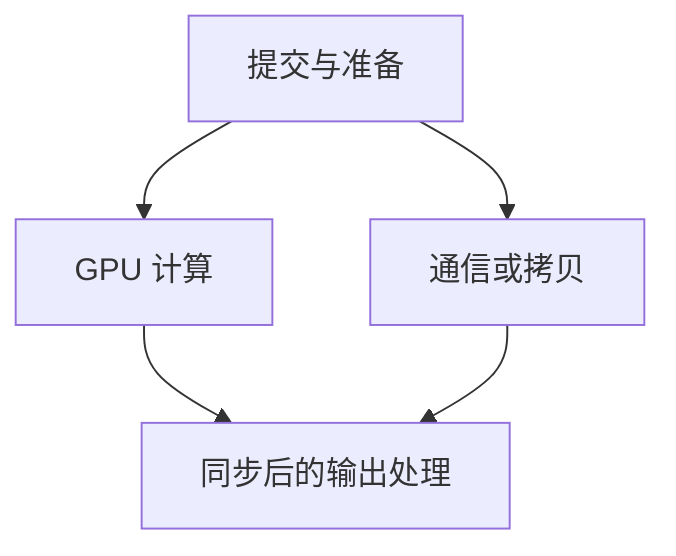

<!-- Generated seed snapshot; source: theory/execution/README.md @ 1b4c5a37763475eb39b31dd083fcad256fc2578e. Do not hand-edit. -->
# 执行与并行：依赖、资源竞争和暴露成本

> 日期：2026-11-25。性质：`derived` 固定执行图分析与条件性预测；所有算例均为合成数据。

一个推理步骤由 CPU、GPU kernel、数据拷贝、通信和同步共同完成。各项 duration 的总和回答“记录了多少工作”，完成时间回答“最晚什么时候能提交结果”。二者在存在并行时通常不同。

## 1. 执行图需要两种边

令节点 $j$ 的耗时为 $\tau_j$，开始和完成时间分别为 $s_j,f_j$。在节点耗时已给定、非抢占、依赖与资源次序已固定的模型中：

$$
s_j=\max_{i\in\operatorname{pred}(j)}f_i,\qquad
f_j=s_j+\tau_j,\qquad T=\max_j f_j.
$$

源节点从指定的释放时间开始。前驱既包括**数据依赖**，也包括**资源执行次序**：同一 stream 上顺序提交、互斥的工作区、串行通信阶段等。如果只记录数据依赖，多个没有依赖关系的 kernel 可能被错误地当作可以无成本并行。

如果共享资源允许并发但会降速，还需要使 $\tau_j$ 依赖同时执行的工作，或采用资源受限调度模型。把独占设备时的微基准耗时直接填入所有并发节点会过度乐观。执行图上的最长路径是给定模型的结果，模型是否忠实还要验证。

## 2. 暴露成本的手算例

假设准备耗时 1 ms，计算 6 ms、通信 4 ms 可以完全并行，之后输出处理 3 ms：

$$
T_0=1+\max(6,4)+3=10\ {\rm ms}.
$$

| 改动 | 新时间 | 解释 |
| --- | ---: | --- |
| 通信从 4 降到 2 ms | 10 ms | 在该图中原通信已被隐藏 |
| 计算从 6 降到 3 ms | 8 ms | 通信成为新的关键路径 |
| 二者分别降到 3 和 2 ms | 7 ms | 第二项的条件收益发生变化 |

只看通信 kernel 快了两倍会高估第一项对本次完成时间的价值。但是，它仍可能减少共享网络或 HBM 竞争，改善其他请求的服务能力；这已超出这个固定图，需重新建立资源和负载模型。

可将两个阶段的条件性重叠近似写为 $T=t_C+t_N-\omega\min(t_C,t_N)+t_{\rm sync}$，其中 $0\le\omega\le1$。$\omega$ 应由可复查时间线或情景定义给出；它不能替代任意多 stream 的真实依赖。

## 3. 通信按路径和 rank 计量

对已确定算法与拓扑的通信阶段，常用近似为：

$$
T_{\rm comm}\approx n\alpha+\frac{C}{\beta}.
$$

$n$ 是串行阶段数，$C$ 是相关瓶颈路径的字节数；有效带宽 $\beta$ 随消息大小和并发变化。集合通信不是把全局总字节数除以一条链路带宽。NCCL tests 也区分算法带宽 `algbw` 与经过操作相关换算的 `busbw`。[1]

对需要同步完成的 rank，快的 rank 仍要等待慢的 rank。因此平均 rank 时间可以帮助分析总体利用率，却不能替代最慢路径。MoE 中专家分布、路由偏斜、不同消息大小及到达不同步都可能产生这种尾部成本。

| 并行方式 | 主要分解对象 | 重新建模的关键变化 |
| --- | --- | --- |
| TP | 层内权重与计算 | GEMM 形状、层间/层内 collective |
| EP | 专家与 routed token | All-to-All、专家负载尾部、dispatch/combine |
| PP | 模型层 | 流水气泡、不同请求的重叠、单请求串行路径 |
| CP | 上下文与状态 | Attention 所需的信息交换、状态布局 |
| DP | 独立请求 | 副本数、请求路由、缓存局部性 |

这些名称不决定真实 GPU 数，进程组可能复用或嵌套，必须以部署配置核对。固定总卡数 $G$，每副本占 $g$ 张卡时，可用独立副本数最多为 $\lfloor G/g\rfloor$；比较并行策略时，要同时考虑单副本性能与副本数，而非只报告单副本加速。

## 4. 并行增加是否值得

在不重复计费的分解中，从 $p$ 增加到 $q$ 个设备只有满足下式才降低该目标延迟：

$$
T_{\rm local}(p)-T_{\rm local}(q)>
T_{\rm exposed}(q)-T_{\rm exposed}(p)+\Delta T_{\rm other}.
$$

其中 $T_{\rm exposed}$ 仅包含未被本地路径隐藏的通信与同步。容量解除、流水化和工作负载改变可能同时发生，不能仍沿用原形状的局部效率。充分流水后的稳态吞吐也不能替代单请求的启动、执行及排空时间。

**可证伪预测：** 在第 2 节固定图假设下，仅缩短已完全隐藏的通信不会降低完成时间。如果实验降低了完成时间，应检查是否原图漏了共享资源竞争、通信到达依赖或额外同步。这种不一致是修正图模型的证据。

Agent 的优化对象应包含节点、依赖和资源占用三部分。候选若改变融合边界或同步关系，应重建执行图；只改变已知节点耗时的候选才适合沿用旧图做局部预测。接口见[性能模型](../../models/README.md)与[自主优化](../../optimizer/README.md)，验证见[实验平台](https://github.com/Sunhuahai/llm-inference-theory/blob/1b4c5a37763475eb39b31dd083fcad256fc2578e/experiments/README.md)。

## 参考资料

1. NVIDIA, [NCCL tests Performance](https://github.com/NVIDIA/nccl-tests/blob/master/doc/PERFORMANCE.md)，核对日期 2026-11-25。用于通信带宽口径；具体版本在实验中固定。
2. NVIDIA, [Nsight Compute Profiling Guide](https://docs.nvidia.com/nsight-compute/ProfilingGuide/index.html)，核对日期 2026-11-25。计数器和采集扰动不能替代独立的无重 profiling 服务测量。
3. [统一理论总纲](../foundations/unified-theory.md)第 5、7 节；[收益预测](../optimization/benefit-prediction.md)第 3 节。本文图模型与数字为条件分析，不是上述来源的实验结果。
