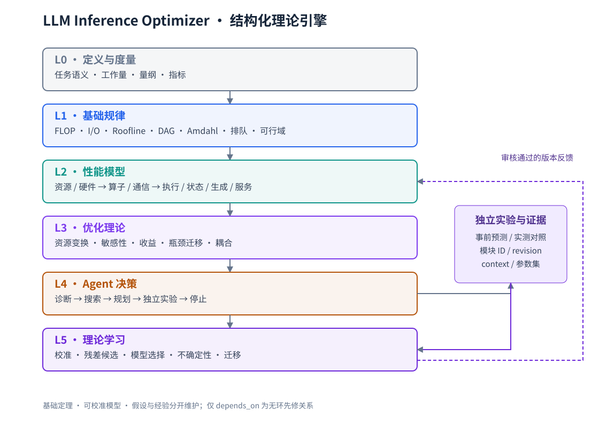

# 结构化理论图谱

[可编辑 Draw.io](theory-atlas.drawio) · [全部模块](INDEX.md) · [机器关系图](dependencies.json)

依赖方向：depends_on 从依赖者指向前置模块；feeds 从提供者指向消费者；constrains 指向被约束模型；extends 表示候选扩展关系而非已验证结论。只有 depends_on 构成必须无环的先修图。实验反馈、校准、验证与反例通过带版本的证据引用、参数集和晋升记录表达，不预先伪造事实边。

具体工作链：

- 资源、硬件 → 算子和通信 → 执行图 → 生成与服务；状态同时约束容量与服务。
- Roofline 和关键路径分别约束必要时间；有效速率产生的是预测，不是严格界。
- 完整系统重新计算 → 收益、敏感性、迁移、耦合 → Agent 诊断、候选、规划、实验、停止。
- 独立观测 → 校准、误差、候选修订、选择与迁移；只有独立验证和审核后才改变 active 版本。

图为概念拓扑，不表示全部模块之间的一一对应关系；新增模块以注册表与依赖图为准。
