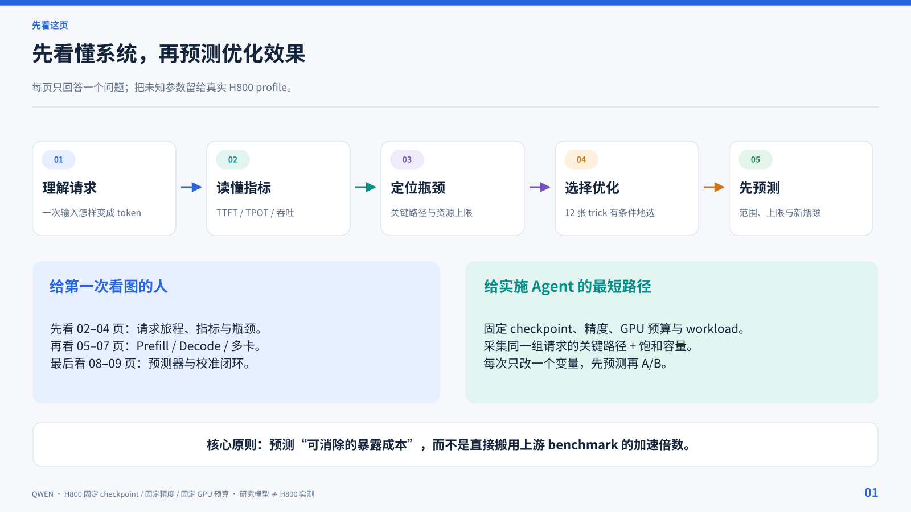
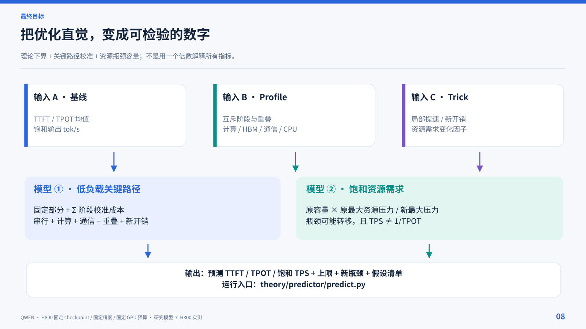

# H800 推理优化 · 逐页可编辑图解

**11 页：9 页人类友好的讲解 + 2 页原技术总览。** 围绕同一个问题：在固定 Qwen3.8-Flash-Next 8-bit checkpoint、固定精度与 H800 总卡数的前提下，怎么从优化思路走到**可检验的 TTFT、TPOT、饱和吞吐收益预测**？

> 状态：图中的优化属于研究候选；没有用户 H800 实测加速数据。合成示例只是演示公式如何计算。

## 一键打开

**[下载 11 页 draw.io 原生源文件](inference-optimization-map.drawio)**。在 [diagrams.net](https://app.diagrams.net/) 打开，底部有全部页面标签。卡片、箭头、文字、图元都可编辑，不是 PNG 背景图。

如果只想快速阅读，可以直接在 GitHub 打开 SVG：

| 页码 | 这一页回答什么 | SVG 预览 |
|---|---|---|
| 01 阅读路线 | 先看什么、后做什么？ | [打开](previews/01-roadmap.svg) |
| 02 请求生命周期 | Prefill、首 token、Decode 在哪里？ | [打开](previews/02-lifecycle.svg) |
| 03 三项指标 | 为什么 TTFT、TPOT、吞吐不等价？ | [打开](previews/03-metrics.svg) |
| 04 两套账本 | 延迟关键路径与容量瓶颈有什么区别？ | [打开](previews/04-bottlenecks.svg) |
| 05 Prefill | T001 / T005 / T008 / T011 怎样起作用？ | [打开](previews/05-prefill.svg) |
| 06 Decode | T002 / T003 / T004 / T006 / T009 / T010 怎样起作用？ | [打开](previews/06-decode.svg) |
| 07 多卡服务 | T007 / T012 何时值得考虑？ | [打开](previews/07-scale.svg) |
| 08 可计算预测器 | 如何把 profile 映射到三个指标？ | [打开](previews/08-model.svg) |
| 09 实验校准 | 怎么用每日 A/B 缩小预测误差？ | [打开](previews/09-validation.svg) |
| 10 技术附录 | 原版全量 T001–T012 优化地图 | [打开](overview.svg) |
| 11 技术附录 | 原版从 Amdahl 到服务容量的关系图 | [打开](prediction.svg) |

## 第 01 页：阅读主线

建议先按 01–09 页阅读，把第 10、11 页作为**更密集的技术索引**。先通过图建立概念，再回到 [完整理论推导](../optimization-benefit-prediction.md) 查公式、来源与适用条件。

## 第 08 页：从图到真正的计算模型

已经提供了标准库 Python 实现：

- [可运行预测器与推导说明](../predictor/README.md)
- [Python CLI](../predictor/predict.py)
- [合成 JSON 演示输入](../predictor/examples/synthetic-baseline.json)
- [真实 H800 数据收集任务卡](../predictor/examples/measurement-checklist.md)
- [单元测试](../predictor/tests/test_predict.py)

其重要设计是把低负载 **TTFT/TPOT 关键路径**与高负载**饱和资源容量**分开算。MTP 另按一轮实际交付 token 成本预测；没有资源需求因子时不输出吞吐加速倍数。

## 图源、编辑和再生成

- 主文件：`inference-optimization-map.drawio`，11 页均是原生 mxCell 图元，保留两页原技术附录。
- 第 01–09 页的 SVG 来自与 draw.io 相同的图形规格；两种格式的页面布局一一对应。
- 生成脚本：`build_diagrams.py`（Python 标准库），可重新生成第 01–09 页及其 SVG，并**原样保留**附录图元；不会把技术附录转换为位图。
- **注意**：重跑脚本会重建第 01–09 页。若手动在 draw.io 调整了这些页，先把调整同步到脚本，否则重跑会丢失手调。第 10、11 页会按原 ID 保留。
- 原技术附录 2000 × 1280；新页统一 1600 × 900，适合顺序讲解。默认字体 Noto Sans CJK SC；没有则会使用系统回退字体。
- 图中没有嵌入用户原始参考截图、私有路径、API key、模型权重或 H800 未测结果；不要把图中合成数字写成实验结论。

图的更新应跟随真实 repo 主分支的 [测量协议](../../docs/benchmark-protocol.md) 与 [trick 任务卡](../../weeks/2026-W47/README.md)。下一次出现 H800 数据后，应优先替换模型的假设区间并注明环境与实验 commit，而不是直接把示意数字涂成“实测”。
