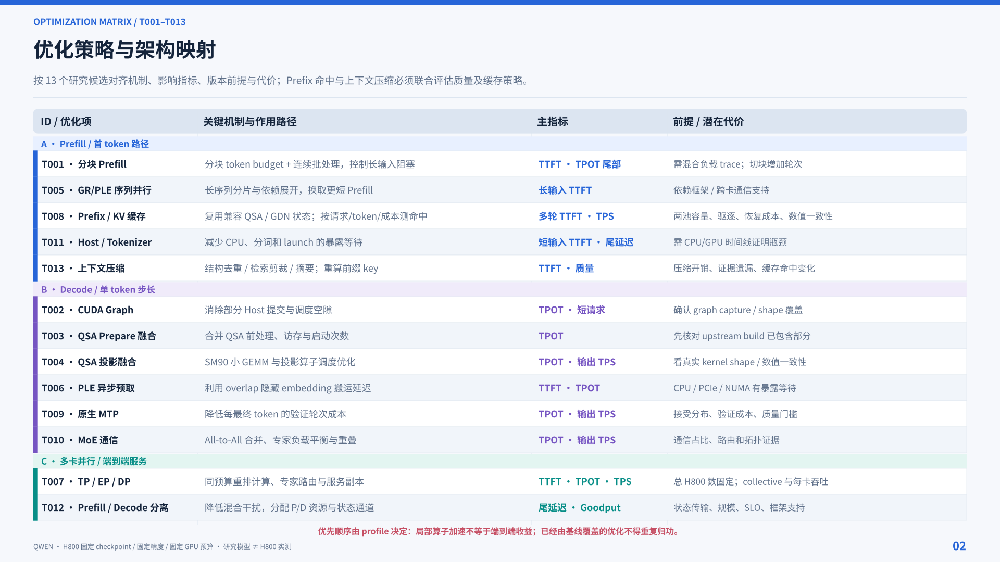

# H800 推理优化综述：三页技术图

**三页高信息密度、可编辑的 draw.io 技术综述**。面向 Qwen3.8-Flash-Next 的 H800 推理优化，统一固定 checkpoint、量化精度和总 GPU 预算；核心指标是 TTFT、TPOT 和饱和输出吞吐。

> **证据边界：** 图中 13 个 trick 是条件候选，尚无用户 H800 上的实测加速结论。第 3 页的数值均为合成演示，不能引用为实验成绩；其中上下文压缩**尚未通过质量证明**。

**[下载三页 draw.io 源文件](inference-optimization-map.drawio)** · 画布 1920×1080 · 原生 mxCell、文字、连线、表格均可单独编辑。

## 理论总览（模型与硬件无关）

[LLM 推理优化理论总图](llm-inference-theory-overview.md) · [完整理论总纲](../llm-inference-optimization-theory.md)

这张独立总图与下方三页 H800 专项技术图互补，采用标准 SVG 预览，不属于原三页 draw.io 的自动生成产物。

## 01 · 推理性能分解与瓶颈识别

[查看独立 SVG](previews/01-performance.svg)

- 请求生命周期：接入/调度 → Prefill → 首 token Decode → 迭代 Decode → 输出。
- 低负载**时延关键路径**：TTFT、TPOT 的时间定义；串行 + 计算 + 通信 − 重叠；Prefix 命中与压缩成本归入 Prefill。
- 高负载**资源容量**：GPU Compute、HBM、互联与 CPU 作为不同瓶颈。
- 公平比较：实际输出长度、缓存冷热、模型 revision、dtype、总 GPU 数量、RPS/并发必须固定或明确分组。

## 02 · 优化策略与架构映射

[查看独立 SVG](previews/02-strategies.svg)

三类策略、13 条独立 trick，在同一张矩阵中对应**机制—指标—实施前提/副作用**：

| 类别 | Trick |
|---|---|
| Prefill / TTFT | T001 分块 Prefill；T005 GR/PLE 序列并行；T008 Prefix/KV 状态缓存；T011 Host/Tokenizer；T013 上下文压缩 |
| Decode / TPOT | T002 CUDA Graph；T003 QSA prepare；T004 QSA 投影；T006 PLE 预取；T009 原生 MTP；T010 MoE 通信 |
| 多卡与服务 | T007 TP/EP/DP；T012 P/D 分离 |

实施前必须检查实际 build 是否已包含该优化，避免重复归功。具体实验设计与一手来源仍以 [周目录](../../weeks/2026-W47/README.md) 及 trick 卡片为准。

## 03 · 优化收益预测模型与实验校准

[查看独立 SVG](previews/03-prediction.svg)

从三组实测/假设参数进入模型：

1. **Baseline**：低负载 TTFT/TPOT、配对冷/热 Prefill、实际输入/输出分布、饱和输出 tok/s。
2. **Profile**：关键路径、资源约束、混合状态 MiB、前缀 lookup/restore/eviction。
3. **Intervention**：有限缓存 MiB、精确前缀 key、压缩前后 token 和耗时、质量门槛，及已有内核/MTP 资源因子。

中部计算框同时给出四类约束：**Critical Path/Roofline、TPOT 与吞吐容量、Prefix 请求/token 命中率、压缩后重新哈希与质量门槛**。右侧 8 请求例子展示同一 trace 在无缓存、有限 LRU、无淘汰 oracle、理想免费命中和压缩后的 TTFT 差异。

注意：缓存/压缩模块当前只预测**按序完整键 LRU 的低负载平均 TTFT**，不输出 p95/p99 或饱和输出 TPS；后者仍由主资源容量模型及实测校准。压缩示例在质量缺失时**不能算可采纳的优化**。

可运行的预测器及数据字段说明：

- [模型推导与使用方法](../predictor/README.md)
- [Python CLI](../predictor/predict.py)
- [合成输入和输出](../predictor/examples/synthetic-prediction.md)
- [Prefix/上下文预测 CLI](../predictor/cache_context.py)
- [缓存/压缩数据契约](../predictor/CACHE_CONTEXT_SCHEMA.md)
- [缓存/压缩合成回放](../predictor/examples/synthetic-cache-context-result.md)
- [专题研究及天花板推导](../cache-context-ceilings.md)
- [H800 实测数据收集任务卡](../predictor/examples/measurement-checklist.md)

## 编辑与维护

- 运行 `python3 theory/diagrams/build_diagrams.py` 重新生成同一份三页 draw.io 与对应三张 SVG。Python 标准库，无外部图形依赖。
- `python3 theory/diagrams/validate_diagrams.py` 检查页数、页面尺寸、图元 ID、边界与 SVG 合法性。
- **脚本生成是确定性的**。若在 diagrams.net 手动修改了图，须同步到脚本后再重建，否则生成的三页会覆盖手动布局。
- SVG 是基于同一组几何元素生成的轻量预览；主格式始终是可编辑 draw.io。
- [上一版 11 页图解](https://github.com/Sunhuahai/qwen38-next-h800-tricks/tree/beb5096ec16d8ab008848f7a857402dc36881051/theory/diagrams) 可在 Git 历史中查阅与恢复；当前主线只保留三页，旧预览不再作为现行图解使用。

理论依据与细节见 [完整优化收益预测综述](../optimization-benefit-prediction.md)。
