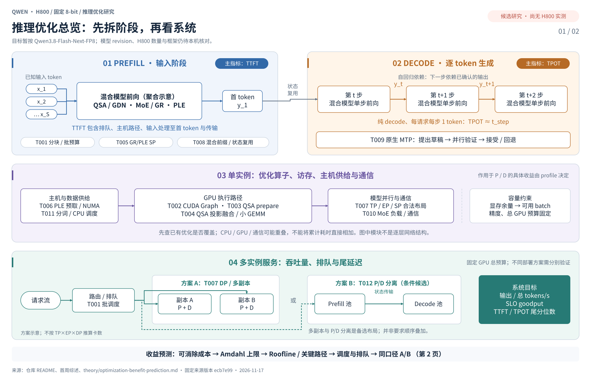
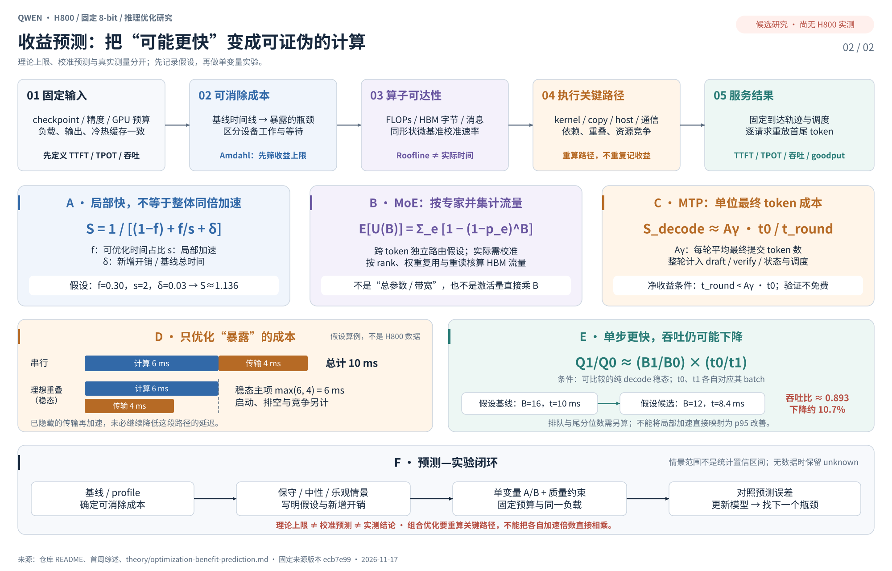

# 推理优化与收益预测图解

本目录把现有综述整理成一个双页 **draw.io 原生可编辑文件**。依据版本：[`ecb7e99`](https://github.com/Sunhuahai/qwen38-next-h800-tricks/commit/ecb7e9915bd2e9d016611f96a555549d226a5c3a)。整理日期：2026-11-17。

**内容是研究候选与理论方法，不是已经验证的 H800 性能结论。** 沿用原综述的固定 checkpoint、固定各类精度和固定总 GPU 预算约束，不引入量化或压缩模型的优化。图中的具体数值都是原理论文档中的假设算例。

## 打开与编辑

[下载 / 查看 draw.io 源文件](inference-optimization-map.drawio)。在 draw.io / diagrams.net 中选择“文件 → 从设备打开”，打开这个 `.drawio` 文件；底部有两页标签。方框、文字、连线和分组均为原生元素，不是嵌入的整张图片。

图的画布均为 2000 × 1280。字体指定 `Noto Sans CJK SC`；没有该字体时可在编辑器中改为系统中文字体。文件未嵌入或附带字体文件。

SVG 是与源图同布局的静态预览，适合 GitHub 页面查看；以 `.drawio` 为可编辑源。修改原图后，应从 draw.io 重新导出对应 SVG，保持两者一致。本次未将用户提供的参考截图或其水印上传进仓库。

## 第 1 页：推理优化总览

按“Prefill 输入阶段 → Decode 逐 token 生成 → 单实例执行优化 → 多实例服务”组织。保留 T001–T012 原编号，将它们挂在对应的阶段或成本路径上。

Prefill / Decode 面板只表示请求生命周期，不表示它们已经部署在不同机器上。中间的状态交接不是对跨机传输能力的确认。QSA、GDN、MoE、GR、PLE 是模块聚合示意，不是实际逐层网络拓扑。

底部的“多副本”和“P/D 分离”是用于比较的两种布局，而不是要求串行叠加的步骤。路由 / 排队只是草图对应的逻辑位置，没有新增网关实现方案。一个实例可以使用多张 GPU；实际 TP、EP、DP 进程组不能机械相乘。SLO goodput 指满足既定 SLO 的成功请求吞吐。

## 第 2 页：收益预测链路

主线为“固定输入 → 找到可消除成本 → 估计算子可达性 → 重算执行关键路径 → 预测服务结果”。下方用原文的 Amdahl、MoE 专家并集、MTP 盈亏条件、重叠时间线及容量约束案例补充解释。

`f` 是可优化时间占比，`s` 是局部加速倍数，`δ` 是新增开销占基线总时间的比例。`B` 是可比较的 decode batch；`p_e` 是一个 token 选择专家 e 的概率，`U(B)` 是 batch 内触达的专家数。`Aγ` 是每轮平均最终提交 token 数，`t_round` 是包括草稿、验证和状态管理在内的整轮时间。`t0`、`t1` 分别对应各自 batch 下的单步时间，不可跨负载直接复用。

这些公式保留了来源的条件：Amdahl 使用不重复的成本；MoE 并集公式假设跨 token 独立；MTP 使用最终提交 token；`Q1/Q0` 的简式只用于可比较的纯 decode 稳态。排队和尾分位数需要单独建模。

## 图中内容与来源对应

| 图中内容 | 来源 |
|---|---|
| T001–T012 的名称、指标与研究状态 | [仓库 README](https://github.com/Sunhuahai/qwen38-next-h800-tricks/blob/ecb7e9915bd2e9d016611f96a555549d226a5c3a/README.md)、[首周综述](https://github.com/Sunhuahai/qwen38-next-h800-tricks/blob/ecb7e9915bd2e9d016611f96a555549d226a5c3a/weeks/2026-W47/research.md)、[本周卡片目录](../../weeks/2026-W47/tricks/) |
| 模块名称与本机身份仍待确认的边界 | [模型核对](https://github.com/Sunhuahai/qwen38-next-h800-tricks/blob/ecb7e9915bd2e9d016611f96a555549d226a5c3a/docs/model-and-support.md)、[环境清单](https://github.com/Sunhuahai/qwen38-next-h800-tricks/blob/ecb7e9915bd2e9d016611f96a555549d226a5c3a/environment.yaml) |
| TTFT / TPOT / 吞吐 / goodput 的口径 | [测量协议](https://github.com/Sunhuahai/qwen38-next-h800-tricks/blob/ecb7e9915bd2e9d016611f96a555549d226a5c3a/docs/benchmark-protocol.md)、理论文档 §1 |
| Amdahl 上限、组合优化与关键路径 | [理论文档](https://github.com/Sunhuahai/qwen38-next-h800-tricks/blob/ecb7e9915bd2e9d016611f96a555549d226a5c3a/theory/optimization-benefit-prediction.md) §2–3 |
| MoE 并集与内存容量 | 理论文档 §4.3、§4.5 |
| Graph、融合、预取、并行、缓存 | 理论文档 §5、§7 |
| MTP 的单位最终 token 成本 | 理论文档 §6 |
| 调度 / 排队 / P-D 分离 | 理论文档 §8 |
| 10 ms → 6 ms 的理想重叠例子 | 理论文档 §5.3；启动、排空与资源竞争另计 |
| batch 16 → 12、单步 10 → 8.4 ms 的吞吐例子 | 理论文档 §9；属于明确的假设容量情景 |
| 校准、情景范围、实验和误差闭环 | 理论文档 §10–12 |

本图没有补写上游支持状态、硬件峰值、实测性能或新的部署结论。专业术语和公式的文献依据沿用[完整理论综述](../optimization-benefit-prediction.md)的参考资料。
