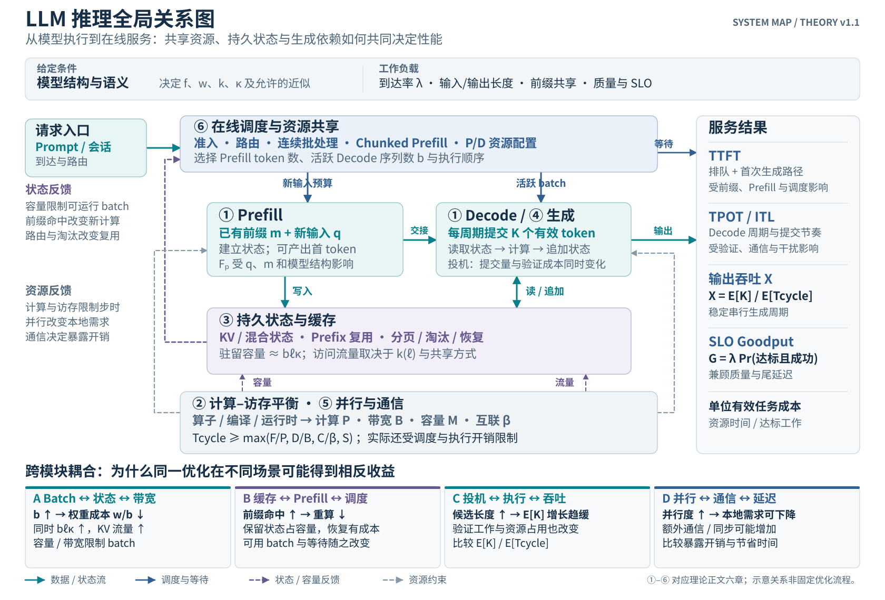

# LLM 推理优化理论总图

> 模型与硬件无关的理论体系。2026-11-24。

[查看独立 SVG 大图](previews/llm-inference-theory-overview.svg) · [完整理论正文](../llm-inference-optimization-theory.md)

## 图的核心关系

一次生成周期的有效提交数与周期时间共同决定长期输出吞吐（在相应稳定周期条件下）。周期时间由计算、数据移动、通信及依赖路径形成下界，容量和语义质量决定可行性。图中的六个模块是并列且耦合的理论支柱，不是执行流程。

| 理论 | 基本约束与优化方向 |
| --- | --- |
| 推理成本 | 分解 Prefill/Decode 的计算与共享、独立访问成本；指导减少工作与中间数据搬运。 |
| 计算–访存平衡 | 根据算术强度与权重/KV 流量临界条件，研究 Batch、算子及资源边际价值。 |
| 状态复用与压缩 | 区分容量和流量，研究缓存、恢复、重算及共享。 |
| 自回归生成效率 | 比较期望提交长度与周期成本，研究减少串行生成轮次的条件。 |
| 并行与通信 | 比较本地执行节省与额外通信、同步及不均衡成本。 |
| 推理服务效率 | 研究执行、排队、干扰、尾延迟与 SLO goodput 的关系。 |

**跨层耦合。** 权重摊薄与状态容量改变活跃 batch；投机验证同时改变提交量和执行资源消耗；调度及通信改变这些局部收益能否兑现为服务性能。优化后的主导约束可能迁移，收益不能直接相乘。

各公式的假设、严格边界和适用范围见[正文](../llm-inference-optimization-theory.md)。图中 M/M/1 仅为经典排队示例，不是对真实动态批处理的完整建模。表示压缩属于一般理论边界，仓库当前固定精度约束保持不变。

## 预览兼容性

总图以标准 SVG 形状和文本绘制，使用相对路径嵌入 Markdown，无脚本、外部资源、foreignObject、Mermaid 或 LaTeX 依赖；浏览器可单独打开并缩放。如果客户端缺少中文字体，以上 Markdown 表格提供等价阅读入口。正文使用 GitHub 支持的 Markdown 数学分隔符，图本身无需数学渲染器。
