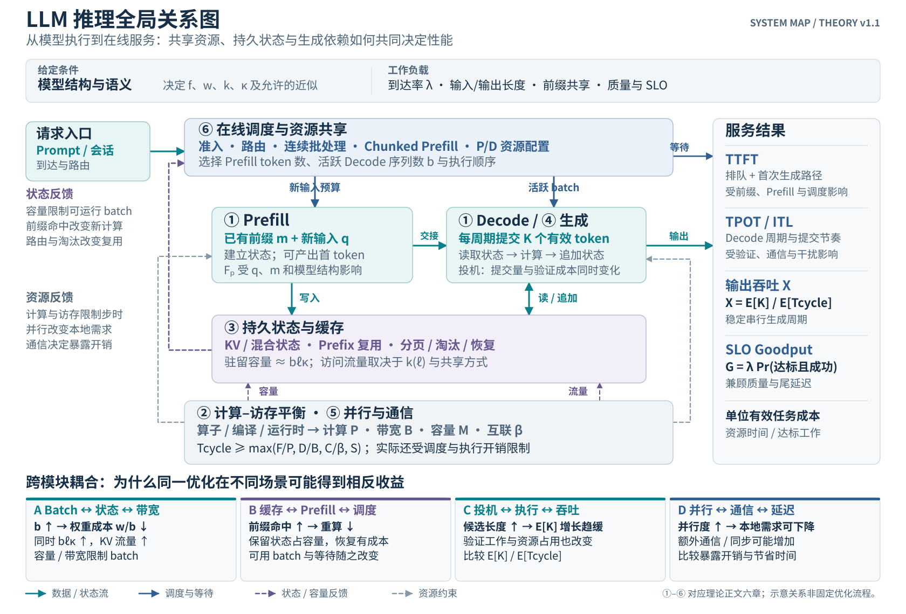

# LLM 推理优化理论：成本、状态、生成与服务边界

> LLM Inference Optimization Theory  
> 日期：2026-11-24｜版本：v1.0｜性质：理论综述与条件性推导。  
> 本文不绑定特定 checkpoint、硬件、引擎或并行拓扑，不提供未经实测的加速承诺。训练、后训练及通用集群运维不在研究范围内。

## 理论总览：推理系统的全局关系

[查看独立大图及关系解读](diagrams/llm-inference-theory-overview.md) · [独立 SVG](diagrams/previews/llm-inference-theory-overview.svg)

这张图以真实的推理执行与资源共享关系为骨架。Prefill 建立状态，Decode 反复读取和追加状态；调度决定每批计算规模，状态容量反过来限制调度；算子与并行策略将工作映射到计算、带宽和互联资源；有效提交数、执行时间与等待共同决定服务指标。六个理论不是孤立分类，而是解释同一个系统不同部分的数学关系。

图底部列出四个关键耦合：Batch 与权重/KV 成本，缓存与 Prefill/调度，投机生成与验证成本，并行与通信。理解这些关系才能判断局部优化为何会改变其他模块的瓶颈。图中执行箭头描述系统本身，而非规定优化流程。

## 摘要

LLM 推理优化的核心，是降低单位有效生成结果所需的计算、权重访问、状态访问、通信及等待成本，或者增加一次执行能够提交的有效 token 数量。本文建立六个相互关联的理论支柱：推理成本、计算–访存平衡、状态复用与压缩、自回归生成效率、并行与通信、推理服务效率。重点在于性能下界、临界条件、边际收益以及瓶颈迁移，而非框架功能清单或实验执行流程。

本文将严格的恒等式和资源下界、依赖假设的解析模型、经验规律与实测结论区分开来。解析式用于解释优化成立的条件与理论空间；具体参数需要由目标系统确定。此文是通用理论层，现有仓库中的[优化收益预测](optimization-benefit-prediction.md)、[缓存与上下文专项推导](cache-context-ceilings.md)和[预测器](predictor/README.md)属于后续实例化。仓库当前固定权重、激活及各类状态精度的研究范围不变；量化、近似计算等仅作为一般理论中的边界变换讨论，不表示将其加入当前实验。

## 0. 统一描述

### 0.1 任务语义与评价目标

令模型定义条件分布

$$
p_\theta(x_t\mid x_{<t}).
$$

标准自回归采样的联合分布为

$$
p_\theta(x_{1:n})=\prod_{t=1}^{n}p_\theta(x_t\mid x_{<t}).
$$

优化可以改变计算实现、状态表示、并行方式、调度方式，或在允许的质量预算内改变算法。必须区分：

- 精确或分布保持变换：在约定数值容差及采样机制下保持任务语义；数学等价不必然意味着浮点逐位相同。
- 近似变换：允许分布、输出或任务质量发生受控变化，必须另有质量约束。
- 工作负载变换：改变输入、输出长度或所要求的任务，不应与固定任务下的性能提升混为一谈。

这里的有效 token 指最终提交给请求的输出 token，而非草稿、验证时未被提交的候选、padding 或被丢弃的计算。若输出长度、分词器或任务成功率变化，token/s 不能独立代表任务效率。

### 0.2 符号及计量口径

| 符号 | 定义 |
| --- | --- |
| $b$ | 活跃序列数；简化均匀 Decode 每步每序列生成一个 token |
| $\ell_i$、$\ell$ | 第 $i$ 个序列的上下文长度及等长近似 |
| $m,q$ | 已缓存前缀长度、新输入长度 |
| $L$ | 模型层数 |
| $h_q,h_{\rm kv},d$ | Query head 数、KV head 数、head 维度 |
| $s$ | 每个 KV 元素的字节数 |
| $f(\ell)$ | 每序列单步所需 FLOPs |
| $w(b)$ | 一步执行在指定存储边界上的权重读取字节数 |
| $k(\ell)$ | 每序列单步在同一边界上的 KV 读取字节数 |
| $D_{\rm other}$ | 激活、中间结果、写入、索引等其他流量 |
| $P,B$ | 对应精度和操作类别的计算速率、指定存储边界的带宽 |
| $M$ | 可用容量 |
| $K$ | 一个生成周期最终提交的有效 token 数 |
| $\lambda$ | 稳定接纳的请求到达率 |

容量是 Byte，流量是 Byte，带宽是 Byte/s。容量与访存量不能互相替代。模型参数的静态字节数也不必然等于实际权重流量。不同存储层级的流量必须分别计量。

### 0.3 统一资源下界

对给定算法及执行图，令 $F$ 为计算量、$D_r$ 为存储层级边界 $r$ 的流量、$C_e$ 为链路 $e$ 的通信量，$S$ 为依赖路径时间下界，则有

$$
T\ge
\max\left\{
\frac{F}{P},
\max_r\frac{D_r}{B_r},
\max_e\frac{C_e}{\beta_e},
S
\right\}.
$$

该式要求各资源上界与需求的口径匹配，并对实际可用资源成立。多类算子若使用不同计算单元，应分别增加对应资源约束。该式不是精确时间等式；共享链路、不能重叠的阶段、调度、同步和执行效率均可能使实际时间远高于下界。

容量约束则是

$$
M(t)\le M_{\rm available},\quad \forall t.
$$

在稳定、完整的生成周期中，以总提交 token 数除以总观测时长，得到长期吞吐量。对于单个串行执行组、无额外空闲且满足相应稳态或遍历条件，

$$
X=\frac{\mathbb E[K]}{\mathbb E[T_{\rm cycle}]}.
$$

多副本或重叠周期必须按整个系统的观测时间计量，不能直接套用单组周期的比值。

## 1. 推理成本理论

### 1.1 Prefill 与 Decode

对标准因果全注意力 Transformer，假设各层维度相同，所有 Query heads 执行 attention，乘加按 2 FLOPs 计，忽略 softmax、归一化和逐元素操作等低阶项。令 $N_{\rm lin}$ 为每 token 实际参与计算的线性变换权重元素数（不将未触及的 embedding 或非活跃专家计入）。

给定 $m$ 个已经缓存的 token 和 $q$ 个新输入 token，因果 attention 的合法位置对数量是

$$
A(m,q)=mq+\frac{q(q+1)}{2}.
$$

因此近似算术成本为

$$
F_P(m,q)\approx
2qN_{\rm lin}+4Lh_qd A(m,q).
$$

第一项来自逐 token 线性变换，第二项来自 QK 与 AV。是否实现为稠密矩阵、是否计算被 mask 的位置、是否有稀疏或滑窗结构，会改变实际 FLOPs。

无已缓存前缀时，$F_P(0,q)$ 的线性项随 $q$ 增长，标准全注意力项随 $q^2$ 增长。Prefill 的较多已知 token 可并行处理，权重有较大的复用机会。

Decode 每序列每次生成一步，令 $\ell$ 为该步实际参与 attention 的位置数，则

$$
f(\ell)\approx 2N_{\rm lin}+4Lh_qd\ell.
$$

标准全注意力中，单个序列每步 attention 的计算与上下文长度近似成正比；生成 $n$ 步且初始长度为 $\ell_0$ 时，相关位置数累计为

$$
\sum_{j=0}^{n-1}(\ell_0+j)
=n\ell_0+\frac{n(n-1)}{2}.
$$

所以输出长度不仅增加模型执行次数，还增加未来每一步的上下文成本。混合 Attention、滑窗、状态空间模型、稀疏 Attention 等应将 $f(\ell)$ 与状态访问函数替换为相应形式，不能照搬全注意力的线性或二次规律。

### 1.2 权重成本与状态成本

固定稠密模型、活跃序列等长、权重在一步内可近似共享、各请求 KV 状态独立时：

$$
F_D\approx bf(\ell),\qquad
D_D\approx w+bk(\ell)+D_{\rm other}.
$$

因此

$$
T_D\ge\max\left(
\frac{bf(\ell)}{P},
\frac{w+bk(\ell)+D_{\rm other}}{B}
\right).
$$

对非均匀上下文，独立项应替换为 $\sum_i f(\ell_i)$ 与 $\sum_i k(\ell_i)$，而不是只用平均长度。非线性结构、异质 batch、padding、分块和负载失衡可能进一步改变执行成本。

此处 $w$ 近似为常数是一个理想共享假设，不是对任意实现的保证。MoE 权重流量还依赖实际激活的专家集合、放置和存储复用。例如有 $E$ 个等大专家，每 token 独立均匀选择 $r$ 个不同专家时，$b$ 个 token 触及的不同专家数量期望为

$$
\mathbb E[U_b]=E\left[1-\left(1-\frac rE\right)^b\right].
$$

这是简化的占用模型，并不代表实际路由均匀，也不直接等于物理访存量。它说明活跃专家的并集会随 batch 增大，权重不一定能按 $1/b$ 完全摊薄；专家负载偏斜还影响计算与通信关键路径。

### 1.3 I/O 复杂度与中间状态

计算量相同的实现可以产生不同的数据移动量。Hong–Kung I/O 理论研究有限快速存储下的必要数据交换；例如经典稠密矩阵乘法在相应两级存储与算法假设下具有 $\Omega(n^3/\sqrt M)$ 的 I/O 下界（以元素为单位，并考虑输入输出必要流量）。

标准 Attention 不必将完整的 score 或 probability 矩阵反复物化到较慢存储。分块、在线归一化、融合可以减少中间流量而不改变数学上的 attention 语义。FlashAttention 是代表性实例。[1–3]

理论含义：算子优化不仅取决于 FLOPs，还取决于必要与额外流量、局部存储容量、数据复用、执行形状及并行映射。融合可能增加寄存器压力或降低并发，净收益仍取决于实际资源约束。

## 2. 计算–访存平衡理论

### 2.1 Roofline 与无量纲参数

设 $I=F/D$ 为算术强度，$I^*=P/B$ 为计算–带宽平衡点。由计算和访存下界得到

$$
P_{\rm actual}\le\min(P,BI).
$$

因此 $\chi=I/I^*$ 刻画两种资源下界的相对大小。$\chi<1$ 表示访存下界较高，$\chi>1$ 表示计算下界较高。实际瓶颈还可能是其他资源、依赖或利用率不足，不能单凭 Roofline 判定。

对于第 1 节的简化 Decode，忽略 $D_{\rm other}$：

$$
I_D(b,\ell)=\frac{bf(\ell)}{w+bk(\ell)}.
$$

每步每序列提交一个 token 时，聚合吞吐上界为

$$
X_{\rm roof}(b,\ell)=
\min\left(
\frac{P}{f(\ell)},
\frac{B}{w/b+k(\ell)}
\right).
$$

定义

$$
u=\frac{bk(\ell)}w,\qquad
v=\frac{Bf(\ell)}{Pk(\ell)}
$$

（假设 $w,k>0$），则

$$
\frac{X_{\rm roof}}{B/k(\ell)}=\min\left(\frac1v,\frac{u}{1+u}\right).
$$

这一无量纲形式不依赖特定硬件或模型名称：$u$ 表示独立状态流量相对于共享权重流量的比例，$v$ 比较计算与纯状态访问的吞吐边界。

### 2.2 Batch Size 的边际收益

在纯访存理想区域，令 $X_B=Bb/(w+bk)$，则

$$
\frac{\partial X_B}{\partial b}
=\frac{Bw}{(w+bk)^2}>0,
$$

$$
\frac{\partial^2 X_B}{\partial b^2}
=-\frac{2Bwk}{(w+bk)^3}<0.
$$

因此增加 batch 的理论吞吐收益边际递减。其对数弹性为

$$
\frac{\partial\log X_B}{\partial\log b}
=\frac{w}{w+bk}.
$$

权重主导时，增加 batch 的吞吐收益较大；KV 主导时，继续扩大 batch 的收益较低。

忽略容量限制的形式极限为

$$
\lim_{b\to\infty} X_{\rm roof}
=\min\left(\frac P{f(\ell)},\frac B{k(\ell)}\right).
$$

这不是可实现的无限 batch；实际 $b$ 受状态容量、延迟、负载和引擎限制。

聚合吞吐改善也不等于单请求加速。在该简化模型中，访存下界 $(w+bk)/B$ 随 $b$ 增长，而聚合吞吐仍然增加，表明吞吐与逐 token 延迟可以具有相反趋势。实际 $T_D$ 还取决于利用率改善与调度。

### 2.3 两种临界点与瓶颈相图

权重流量等于 KV 流量时，

$$
b_{WK}(\ell)=\frac{w}{k(\ell)}.
$$

若标准全注意力近似 $k(\ell)=\kappa\ell$，则 $b_{WK}=w/(\kappa\ell)$，在 $(\log\ell,\log b)$ 平面上是斜率为 $-1$ 的直线。

计算与访存下界相等时，

$$
\frac{bf(\ell)}P=\frac{w+bk(\ell)}B.
$$

当 $Bf(\ell)>Pk(\ell)$ 时，存在有限正临界值

$$
b_{CB}(\ell)=\frac{Pw}{Bf(\ell)-Pk(\ell)}.
$$

否则增加 batch 不会使简化 Roofline 上界进入严格计算主导区域；当等号成立时只能渐近接近平衡。若 $b_{CB}$ 超出容量或延迟允许范围，该临界点同样不可达。

示意：横轴为上下文长度、纵轴为 batch，权重–KV 流量边界与计算–访存边界需分别绘制；容量可行域和延迟约束再叠加。仅凭长短上下文、并发高低不能确定所有系统的实际瓶颈。

| 条件（理想资源模型） | 有理论依据的优化方向 | 收益终止条件 |
| --- | --- | --- |
| 权重流量主导且访存主导 | 权重复用、减少重复权重访问 | KV、计算或其他成本成为主约束 |
| KV 流量主导且访存主导 | Attention 数据流、状态复用及减少读取量 | 计算、容量、质量或通信约束 |
| 计算主导 | 减少必要工作、提高有效计算效率 | 访存或依赖限制 |
| 容量限制 batch | 改善分配、缩短不必要的状态驻留、共享状态 | 容量解除后转为带宽或计算限制 |
| 启动或依赖主导 | 合并执行、减少串行轮次 | 关键路径上的其他成本 |

### 2.4 局部优化的资源弹性

在纯访存区域，固定 $b,\ell,B$，分别改变 $w,k$，有

$$
-\frac{\partial\log X_B}{\partial\log w}=\frac{w}{w+bk},
\qquad
-\frac{\partial\log X_B}{\partial\log k}=\frac{bk}{w+bk}.
$$

二者和为 1。它们度量小幅成本变化的局部吞吐灵敏度，而非实测加速承诺。

例如权重流量减少为 $w/r$，在其他项不变且优化前后都处于访存主导的理想情况下，

$$
S_w=\frac{w+bk}{w/r+bk}.
$$

当 $r\to\infty$，其形式上限为 $1+w/(bk)$。实际可能更早被计算或其他流量限制。KV 流量优化具有对称结论。由此可解释为何在权重读取已经很少的场景继续减少权重成本，边际收益通常低于减少 KV 流量。

## 3. 状态复用与压缩理论

### 3.1 KV 状态容量与访问

在普通全注意力、各层相同维度且无跨层或跨请求共享时，每 token 的逻辑 KV 容量为

$$
\kappa=2Lh_{\rm kv}ds.
$$

等长 batch 的逻辑状态大小为 $M_{\rm KV}=b\ell\kappa$。若每步全量读取已有 KV 且在目标存储边界不发生跨步复用或额外重复读取，$k(\ell)\approx\ell\kappa$。这不是对实际物理读流量的保证；GQA 实现、共享前缀的读取复用、硬件缓存、分块和布局均会改变它。

以 $M_0=M_{\rm available}-M_{\rm weights}-M_{\rm other}$ 为可分配 KV 预算，且 $M_{\rm other}$ 近似固定、忽略分页等额外开销时：

$$
b_{\max}=\left\lfloor\frac{M_0}{\ell\kappa}\right\rfloor.
$$

异长请求、共享前缀、分片、预留、碎片及工作区随 batch 变化时，需使用实际物理占用约束。PagedAttention 主要改善状态分配及共享效率，并不意味着每个逻辑 KV 元素更小；GQA/MLA 改变模型状态结构；状态低精度表示属于另一类变换。[4–6]

### 3.2 容量与带宽的耦合

假设一种状态变换使逻辑状态大小和读取流量均缩小为原来的 $1/r$，且没有新增计算、通信或质量损失，令原系统受 KV 容量限制，连续近似下 $b_{\max}'=r b_{\max}$。

将其代入简化访存吞吐边界：

$$
X'_B=\frac{B}{w/(rb_{\max})+k/r}
=rX_B.
$$

这里恰好是 $r$ 倍，不应把“batch 扩大 $r$ 倍”和“KV 访存减少 $r$ 倍”重复相乘。相对于固定 batch 的状态缩减，允许 batch 同时扩大可进一步改善共享权重的摊薄，但整个理想收益仍受计算上界与其他约束限制。

若某方案只改善分页碎片而不减少物理读取量，应只改变容量可行域；若方案只减少流量而不减少驻留容量，则不能自动扩大 batch。这个区分有助于正确归因。

### 3.3 Prefix Cache 的计算节省

对标准因果全注意力，原输入长度 $m+q$，已有可正确复用的前缀长度为 $m$，新增长度为 $q$：

$$
A_{\rm full}=\frac{(m+q)(m+q+1)}2,\qquad
A_{\rm cached}=mq+\frac{q(q+1)}2.
$$

相减：

$$
\Delta A=\frac{m(m+1)}2.
$$

定义 $r_p=m/(m+q)$。当序列足够长，消除的合法 attention 位置对比例约为 $r_p^2$，而消除的逐 token 线性计算比例约为 $r_p$。按第 1 节 FLOPs 模型，

$$
\Delta F_P\approx 2mN_{\rm lin}+4Lh_qd\frac{m(m+1)}2.
$$

这说明前缀命中率不是 FLOPs 节省率，更不是 TTFT 加速率。缓存新后缀仍需与前缀状态交互。完全命中时是否仍需末尾 token 重算、采样状态或 logits 恢复取决于引擎实现。

需要区分请求命中率（有多少请求匹配）、token 命中率（有多少输入 token 可复用）、计算节省率（按不同算子加权）与端到端收益。相同平均 token 命中率、不同匹配长度分布也可产生不同的计算收益，因为 $\mathbb E[m^2]$ 不等于 $\mathbb E[m]^2$。

缓存键必须与模型版本、输入、位置及影响状态的配置一致。复用不完整的混合模型状态可能改变任务语义。

### 3.4 保存、恢复与重算的经济性

对某段状态，记 $N$ 为未来被复用的次数，$T_{{\rm recompute},j}$、$T_{{\rm restore},j}$ 为第 $j$ 次复用的重算与恢复时间，$T_{\rm store}$ 为保存开销，$C_{\rm capacity}$ 为其占用容量产生的机会成本（统一折算为同一目标单位）。

在以总时间成本近似为目标、各项可加的简化模型下：

$$
V=\mathbb E\left[
\sum_{j=1}^{N}
(T_{{\rm recompute},j}-T_{{\rm restore},j})
\right]-T_{\rm store}-C_{\rm capacity}.
$$

$V>0$ 才具有净保存价值。对分层存储，恢复还可能受网络、存储带宽和访问启动延迟制约；若可与其他执行重叠，应比较暴露在关键路径上的时间。缓存价值随复用距离、未来访问概率、容量压力和负载变化而变化。

在严格容量约束下，缓存对象的价值/字节可作为启发式指标，但对象大小不一、共享依赖和未来不确定性意味着简单贪心不保证全局最优。缓存、路由与并发之间具有反馈关系。

## 4. 自回归生成效率理论

### 4.1 串行轮次与单位有效 token 成本

自回归依赖不等于任何生成算法都必须为每个 token 串行执行一次完整目标模型。优化可以减少每周期耗时，也可以增加每周期提交数。

设 $T_0$ 为普通 Decode 一个生成周期的时间。稳定周期模型下：

$$
\tau_{\rm token}=\frac{\mathbb E[T_{\rm cycle}]}{\mathbb E[K]},
\qquad
S=\frac{T_0\mathbb E[K]}{\mathbb E[T_{\rm cycle}]}.
$$

对于普通单序列逐 token 采样，$K=1$。批量生成时，$K$ 应统计整个周期所有请求最终提交的 token；与普通批量基线比较时也要使用同一口径，不能直接用单序列公式替代服务吞吐模型。

### 4.2 投机解码的接受长度

标准 speculative sampling 由 draft 提议候选、目标模型并行验证，并通过相应接受/拒绝与残差采样保持目标分布。[7]

设一次提议 $\gamma$ 个候选，$a_i$ 为前 $i-1$ 个候选均接受时第 $i$ 个的条件接受概率。忽略 EOS、预算截断、取消等情况；标准算法在拒绝位置提交一个修正 token，或者全接受时额外提交一个 token。则

$$
\Pr(K\ge j+1)=\prod_{i=1}^{j}a_i,
$$

$$
\mathbb E[K]=1+\sum_{j=1}^{\gamma}\prod_{i=1}^{j}a_i.
$$

若 $a_i=\alpha$，则

$$
\mathbb E[K]=\sum_{j=0}^{\gamma}\alpha^j
=\frac{1-\alpha^{\gamma+1}}{1-\alpha},\quad 0\le\alpha<1.
$$

当 $\alpha=1$ 时，$\mathbb E[K]=\gamma+1$。不同实现的提交规则、树形验证及 EOS 会改变这一式子。

若串行分解下周期耗时为

$$
T_{\rm cycle}=T_{\rm draft}+T_{\rm verify}+T_{\rm overhead},
$$

则加速条件为

$$
\mathbb E[K]>\frac{\mathbb E[T_{\rm cycle}]}{T_0}.
$$

若存在重叠，则使用实际周期关键路径时间，而不是直接相加。该判据给出三种机制：降低草稿成本、提高连续接受长度、降低并行验证的边际成本。

### 4.3 候选长度的理论最优点

令 $A_\gamma=\mathbb E[K_\gamma]$，$C_\gamma=\mathbb E[T_\gamma]$。增加候选长度的收益条件为

$$
\frac{A_{\gamma+1}}{C_{\gamma+1}}>\frac{A_\gamma}{C_\gamma}
\iff
\frac{A_{\gamma+1}-A_\gamma}{A_\gamma}>
\frac{C_{\gamma+1}-C_\gamma}{C_\gamma}.
$$

固定条件接受率下，新增一个候选的期望有效提交增量为 $\alpha^{\gamma+1}$，呈几何衰减。实际验证成本也依赖候选长度、活跃 batch、计算–访存区域及缓存行为，不能据固定接受率直接断言最佳长度。

投机验证通过在一次目标模型执行中处理更多候选位置，提高计算密度和权重摊薄机会；在原本计算主导或高并发区域，额外验证工作可能挤占其他请求资源。故低延迟收益不必然转化为高负载吞吐收益。

Multi-Token Prediction、Self-Speculation、树形验证与其他生成算法可从“单位周期的有效提交数与成本”这一共同关系理解，但是否保持采样分布必须逐方案判断。

## 5. 并行与通信理论

### 5.1 计算分解、通信和依赖

分布式推理通过分散权重、计算或状态改变单设备资源需求。对 $p$ 个设备的执行，可在一个不重复计时的近似分解中写为

$$
T_p=T_{\rm local}(p)+T_{\rm comm}^{\rm exposed}(p)
+T_{\rm imbalance}(p)+T_{\rm other}(p).
$$

其中 $T_{\rm comm}^{\rm exposed}$ 是不能隐藏的通信时间，负载不均衡项仅计入尚未被本地关键路径时间或通信项计入的部分。严格分析应使用依赖图及共享资源，而非直接把所有 profiler duration 求和。

简单点到点消息或已确定通信算法的阶段可写成

$$
T_{\rm comm}\approx n\alpha+\frac{D}{\beta}.
$$

$\alpha$ 是通信启动延迟，$n$ 是串行通信阶段数，$D$ 是对应瓶颈路径的有效流量，$\beta$ 是有效带宽。集合通信的次数、字节数和路径与算法、拓扑及并发有关。总集群流量不能直接除以单链路带宽。

增加并行度的收益条件：

$$
-\Delta T_{\rm local}>
\Delta T_{\rm comm}^{\rm exposed}+
\Delta T_{\rm imbalance}+\Delta T_{\rm other}.
$$

增加并行度首先可能解除容量约束，未必改善单请求延迟。

### 5.2 理想扩展与最优并行度

忽略通信时，固定工作量的理想本地耗时可近似为 $T_1/p$。加入随并行度增长的简化暴露开销，举例

$$
T(p)=\frac{a}{p}+c(p-1)+d,\quad a,c>0.
$$

若把 $p$ 暂视为连续变量，则驻点为 $p^*=\sqrt{a/c}$；实际选择需满足整数、容量、拓扑及并行维度可整除约束。这只是展示收益与代价平衡的假设模型，不能用于直接预测真实系统的最佳卡数。

从一般形式可知，当本地工作减少的边际收益低于通信、同步和负载不均衡增长的边际成本时，继续扩展不会改善目标延迟。

### 5.3 不同并行方式的理论作用

| 策略 | 主要改变 | 主要约束 |
| --- | --- | --- |
| Tensor Parallelism | 分片线性计算与权重 | 层内集合通信、分片效率 |
| Pipeline Parallelism | 按层分摊权重、跨请求流水 | 单请求顺序依赖、流水线气泡、激活传输 |
| Expert Parallelism | 专家权重与 token 计算的分布 | 路由、All-to-All、最慢专家及设备负载 |
| Context Parallelism | 长上下文计算及状态分布 | Attention 所需信息交换 |
| Data Parallelism | 独立副本的服务能力 | 资源成本、路由及缓存局部性；通常不直接缩短单请求执行 |

对 MoE 若设备 $j$ 的负载为 $W_j$，其计算能力为 $P_j$，则计算阶段下界至少为 $\max_j W_j/P_j$。若所有设备计算能力相同，负载均衡度可定义为 $\sum_jW_j/(p\max_jW_j)$，其值不超过 1。增加专家并行度是否有效取决于负载尾部和通信，而不仅是平均每设备 token 数。

## 6. 推理服务效率理论

### 6.1 请求级指标

设请求 $i$ 到达时刻为 $a_i$，第 $j$ 个有效输出 token 的观测时间为 $t_{i,j}$，输出长度为 $n_i$：

$$
\begin{aligned}
TTFT_i&=t_{i,1}-a_i,\\
ITL_{i,j}&=t_{i,j}-t_{i,j-1},\\
TPOT_i&=\frac{t_{i,n_i}-t_{i,1}}{n_i-1}\quad(n_i>1),\\
E2E_i&=TTFT_i+(n_i-1)TPOT_i.
\end{aligned}
$$

这些是按一致观测点定义的恒等式。TPOT 是请求内平均 ITL，不能替代逐 token 抖动。不同实现可能把多个 token 同时返回；观测口径必须一致。分位数不可直接相加，且对长度与 TPOT 的乘积不能擅自拆分期望。

TTFT 包括接入、排队、prefill 到首次提交及返回等不重叠区间；首 token 可能直接由 prefill 产生，不应重复计算完整 Decode。

在稳定运行下，输出吞吐为 $\lambda\mathbb E[n]$（无丢弃、稳定接纳完成且使用同一请求分布等条件下）。它与请求吞吐、单请求 token 速率和 SLO goodput 不同。

### 6.2 排队、并发与容量

M/M/1 在 Poisson 到达、独立指数服务时间、单服务台、FCFS 与 $\lambda<\mu$ 的假设下，有

$$
\mathbb E[T]=\frac1{\mu-\lambda}
=\frac{1/\mu}{1-\rho},\qquad \rho=\lambda/\mu.
$$

其意义是接近容量边界时延迟对负载变化高度敏感，不是将 LLM 直接视作固定服务率系统。实际推理服务使用动态 batch，服务时间与状态、上下文及策略耦合。

对 GI/G/1，Kingman 重负载近似

$$
\mathbb E[W_q]\approx
\frac{\rho}{1-\rho}
\frac{c_a^2+c_s^2}{2}\mathbb E[S_{\rm req}]
$$

进一步说明到达波动和服务时间波动的影响。该近似同样依赖单服务台及相应假设，不是对在线 LLM 动态调度的完整模型。

Little 定律 $\mathbb E[N]=\lambda\mathbb E[T]$ 在稳定系统及匹配边界的长期平均意义下成立。注意系统内请求数 $N$ 不等于执行中的活跃 batch $b$，其中还可能有等待或暂停的请求。更大的排队长度不会自动带来更大的有效 batch。

在独立持久状态、稳定接纳、对每个请求的存储占用随驻留时间积分的条件下，还可以用更新报酬式刻画平均状态容量：

$$
\overline M_{\rm state}
=\lambda\,\mathbb E\left[\int_0^{T_{\rm resident}}m_i(u)\,du\right].
$$

这是时间平均而非峰值约束；共享状态应避免重复计量。它揭示了延迟、状态驻留时间、输出长度与可持续吞吐之间的联系。

### 6.3 Prefill–Decode 干扰与分离

Prefill 与 Decode 的成本结构和时延目标不同。共置有助于共享资源，但长 Prefill 可能占用关键执行时隙，增加 Decode ITL；分块可改变一次调度的执行粒度、干扰与并行利用率。

对于独立阶段的部署，将各阶段能力统一折算为同一工作负载的 requests/s，则

$$
\lambda_{\rm sustainable}\le\min(\mu_P,\mu_D,\mu_{\rm transfer}).
$$

若必要跨阶段传输平均字节数为 $\mathbb E[D_{\rm transfer}]$，聚合可用带宽为 $\beta$，则理想资源上界为 $\mu_{\rm transfer}\le\beta/\mathbb E[D_{\rm transfer}]$。实际还受传输启动延迟、拓扑、资源竞争及峰值波动影响。

P/D 分离的价值来自独立配置、减少干扰、控制尾延迟和改善资源匹配，而不是分离动作本身必然提高吞吐。DistServe 与 Sarathi-Serve 分别展示了分离与分块调度的研究方向。[8–9]

### 6.4 Goodput 与质量约束

以请求为单位，设 $\lambda$ 为接纳率，事件 $\mathcal E$ 同时包含完成成功、质量合格及 TTFT/TPOT 等服务时延达标，则在稳定观测条件下

$$
G=\lambda\Pr(\mathcal E).
$$

这里的概率可以通过请求联合分布估计；不能将各个指标的边际达标率直接相乘，除非有相应独立性。也可采用预先约定的 ITL、E2E 或任务级成功标准。

理论目标可定义为

$$
\max_{\pi\in\mathcal F}G(\pi)
\quad\text{s.t.}\quad
\mathrm{cost}(\pi)\le C_{\max},\quad
\mathrm{quality}(\pi)\ge Q_{\min},
$$

或在固定 goodput 和质量要求下最小化资源成本。不同目标产生不同最优配置，故不存在与负载和服务要求无关的统一最优 batch 或统一最优并行度。

## 7. 六类理论的统一与瓶颈迁移

### 7.1 统一资源–生成关系

在同一执行周期中，设有效提交数为 $K$，各资源消耗为 $F,D,C$，关键路径下界为 $S$，则

$$
T_{\rm cycle}\ge
\max(F/P,D/B,C/\beta,S).
$$

稳定周期模型下可推出

$$
X\le\frac{\mathbb E[K]}
{\mathbb E[\max(F/P,D/B,C/\beta,S)]}.
$$

对多资源和多级存储，最大值应纳入所有相应项。注意通常 $\mathbb E[\max_j Z_j]\ge\max_j\mathbb E[Z_j]$；用平均负载代替随机成本会损失信息。

因此，统一的优化机制是在任务语义约束下减少单位有效提交结果的资源消耗，减少关键路径，或提高有效提交数。对在线服务还需要处理等待及质量达标。

### 7.2 最乐观加速与实际加速的区别

固定任务及相应简化模型，令 $L_1$ 为优化后严格成立的执行时间下界、$T_0$ 为基线实际时间，则

$$
S_{\rm actual}=\frac{T_0}{T_1}\le\frac{T_0}{L_1}.
$$

若基线实际时间未知，仅知道两个下界 $L_0,L_1$，则 $L_0/L_1$ 只能表示理想边界的变化，不能直接声称是实际加速比的上界或预测值。

对无重叠的固定串行分解，若可优化部分占基线时间比例 $f_a$，局部加速 $r$ 倍且其余部分不变，则 Amdahl 关系为

$$
S=\frac1{(1-f_a)+f_a/r}.
$$

当局部开销移除后，剩余成本限制整体收益。若优化改变了执行图、batch、状态容量或队列，固定比例假设不再成立。[10]

### 7.3 耦合关系

| 变换 | 直接影响 | 可能的间接影响及失效条件 |
| --- | --- | --- |
| 权重复用 | $w/b$ 下降 | KV 流量或计算主导；batch 受容量/延迟限制 |
| 状态分配优化 | 可用 KV 容量增加 | 更大 batch 改善权重摊薄；未必改变读取量 |
| 状态表示或访问优化 | $k(\ell)$、容量或两者下降 | 额外解码、质量、通信成本；计算瓶颈转移 |
| 算子分块/融合 | $D_{\rm other}$ 或启动减少 | 局部存储压力、占用率变化 |
| 前缀复用 | 重复 Prefill 计算减少 | 状态恢复、容量机会成本、路由局部性 |
| 投机生成 | $\mathbb E[K]$ 增加 | 额外 draft/verify 工作；高负载资源竞争 |
| 并行分解 | 单设备工作/状态减少 | 通信、同步、最慢设备决定关键路径 |
| 调度与资源分离 | 共享方式、等待、干扰变化 | 阶段失衡、传输及尾延迟 |

重要推论是：各项优化的收益不能在不同假设、不同 workload 或不同瓶颈下简单相乘。权重访问优化可能使 KV 成为限制，KV 容量改善可能允许更大的 batch，batch 又会改变验证和通信的相对成本。

### 7.4 理论相图与边际价值

可行域由容量、延迟、质量、资源预算共同确定；资源下界与目标形成性能边界。资源的边际价值依赖当前活跃约束。比如在理想固定 batch 下，计算下界已主导时单独提高带宽不会继续提高该 Roofline 上界；而当容量约束解除，允许改变 batch 后，带宽优化的服务收益可能再次发生变化。

因此应把不同推理优化理解为改变性能边界和可行域的变换。一个完整理论结论应明确：

- 所研究的模型语义、成本函数、负载和资源假设；
- 主导的理论边界与必要临界条件；
- 成本之间的交换、边际收益和瓶颈迁移；
- 理想下界、条件性模型与需要实测的量之间的区别。

这些是理论结论的成立条件，不是规定的工程实施流程。

## 8. 参考文献与阅读入口

以下为理论与代表性研究的基础参考，不是最新论文的穷尽清单。数学推导中明确标为简化模型的关系属于本文的条件性归纳，不应自动归于引用论文或理解为其经验证明。

1. Hong, J. W.; Kung, H. T. *I/O Complexity: The Red-Blue Pebble Game*. STOC 1981. [论文](https://www.eecs.harvard.edu/~htk/publication/1981-stoc-hong-kung.pdf)。
2. Williams, S.; Waterman, A.; Patterson, D. *Roofline: An Insightful Visual Performance Model for Multicore Architectures*. CACM 2009. [DOI](https://doi.org/10.1145/1498765.1498785)。
3. Dao, T. et al. *FlashAttention: Fast and Memory-Efficient Exact Attention with IO-Awareness*. NeurIPS 2022. [arXiv:2205.14135](https://arxiv.org/abs/2205.14135)。
4. Kwon, W. et al. *Efficient Memory Management for Large Language Model Serving with PagedAttention*. SOSP 2023. [arXiv:2309.06180](https://arxiv.org/abs/2309.06180)。
5. Ainslie, J. et al. *GQA: Training Generalized Multi-Query Transformer Models from Multi-Head Checkpoints*. EMNLP 2023. [arXiv:2305.13245](https://arxiv.org/abs/2305.13245)。
6. DeepSeek-AI. *DeepSeek-V2: A Strong, Economical, and Efficient Mixture-of-Experts Language Model*. 2024. [arXiv:2405.04434](https://arxiv.org/abs/2405.04434)。
7. Leviathan, Y.; Kalman, M.; Matias, Y. *Fast Inference from Transformers via Speculative Decoding*. ICML 2023. [arXiv:2211.17192](https://arxiv.org/abs/2211.17192)。
8. Zhong, Y. et al. *DistServe: Disaggregating Prefill and Decoding for Goodput-optimized Large Language Model Serving*. OSDI 2024. [arXiv:2401.09670](https://arxiv.org/abs/2401.09670)。
9. Agrawal, A. et al. *Taming Throughput-Latency Tradeoff in LLM Inference with Sarathi-Serve*. OSDI 2024. [arXiv:2403.02310](https://arxiv.org/abs/2403.02310)。
10. Amdahl, G. M. *Validity of the Single Processor Approach to Achieving Large Scale Computing Capabilities*. AFIPS 1967. [DOI](https://doi.org/10.1145/1465482.1465560)。
11. Kingman, J. F. C. *The Single Server Queue in Heavy Traffic*. Mathematical Proceedings of the Cambridge Philosophical Society, 1961. [DOI](https://doi.org/10.1017/S0305004100036094)。
12. Little, J. D. C. *A Proof for the Queuing Formula: L = λW*. Operations Research, 1961. [DOI](https://doi.org/10.1287/opre.9.3.383)。
13. *How To Scale Your Model*. [Inference 章节](https://jax-ml.github.io/scaling-book/inference/)。用于计算、状态、并行及硬件映射的综合阅读。
14. Agrawal, A. et al. *Vidur: A Large-Scale Simulation Framework for LLM Inference*. MLSys 2024. [Microsoft Research](https://www.microsoft.com/en-us/research/publication/vidur-a-large-scale-simulation-framework-for-llm-inference/)。作为未来预测模型和在线服务仿真的参考，而非本文理论本身。

---

**核心结论：LLM 推理效率由单位有效生成结果的资源成本、依赖结构、状态可行域和负载共享共同决定。优化技术是对这些理论量的改变；优化是否成立由相应边界及条件决定，而非技术名称。**
