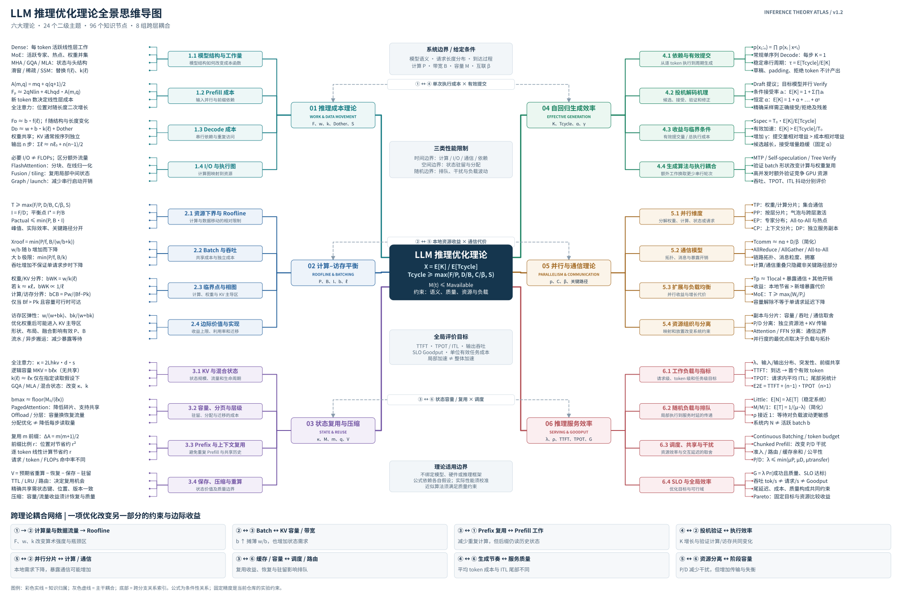

# Theory visualizations

[全景思维导图](diagrams/llm-inference-theory-mindmap.md) · [全局系统关系](diagrams/llm-inference-theory-overview.md) · [图解导读](../theory/README.md)

[七张理论框架 SVG](diagrams/framework-guide/) · [已有图形与编辑说明](diagrams/README.md)。历史 Qwen/H800 图形明确区分于通用理论；性能相图需要经过模型与数据验证。

## 自主优化图解

[AI 如何自动优化 AI 推理？](../research/industry/agentic-inference-optimization-guide.md) · [八张 SVG 图](diagrams/agentic-optimization/)
