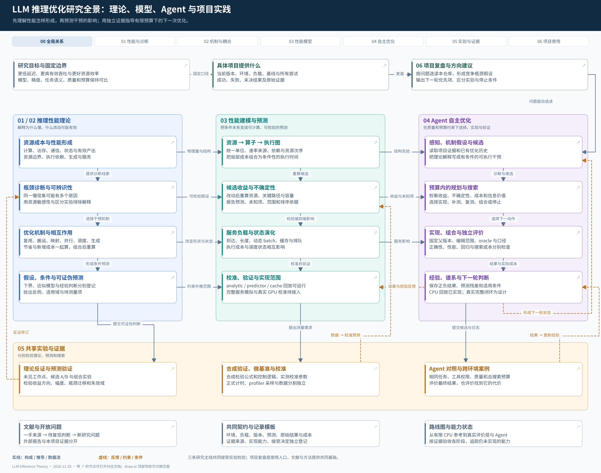

# LLM 推理优化研究图谱：全局关系与逐层展开

这套图以**性能形成、干预传播与证据反馈**组织全仓库。先用总图确认每个部分承担的职责，再进入子图理解资源、模型、Agent 和实验如何相互影响；带着具体项目使用时，从第 06 页及[项目指导文档](../../../docs/project-optimization-guide.md)进入。

**[下载完整七页 draw.io 源文件](llm-inference-research-atlas.drawio)** · [打开全局高清 SVG](00-overview.svg) · [可复制的项目 Agent 提示词](../../../docs/prompts/review-project.md)

draw.io 文件包含七个页面，每个内容节点、文字和连接都可编辑；顶部导航可在文件内跳转。SVG 使用原生矢量文字，供 GitHub 直接预览。GitHub 内嵌图会缩小，点击图片打开独立文件后可放大；在 draw.io 中阅读完整图集时更适合连续切换页面。

## 00｜全局关系

[](00-overview.svg)

总图中的三个核心模块是相互协作的研究职责：理论提供资源关系、条件与反例；模型给出可计算的条件预测；Agent 在预算中选择和实现下一项干预。实验同时检验三者，再通过反例、残差和正负经验改变下一轮判断。底部文献、契约和路线图为这些研究提供共同基础。

总图画布为 **3200 × 2520**；六张子图宽度均为 3000，分别保留对应主题的详细关系。图示表达研究结构，具体实现与证据范围以节点所链接的文档为准。

## 按问题进入六张子图

| 页面 | 要掌握的核心关系 | 继续阅读 |
| --- | --- | --- |
| [01 性能与瓶颈诊断](01-theory.svg) | 负载决定工作量；资源与依赖决定时间；生成与服务形成指标；观测与区分实验反向定位原因 | [理论索引](../../../theory/INDEX.md) · [诊断](../../../theory/diagnosis/README.md) |
| [02 优化机制与耦合](02-mechanisms.svg) | 每种改动同时改变资源需求与新增代价；候选绑定父版本；单项、组合与不同顺序必须重算和验证 | [机制](../../../theory/optimization/mechanisms.md) · [耦合](../../../theory/optimization/coupling.md) |
| [03 性能建模](03-models.svg) | 下界与有效预测分开；局部成本经过执行图和服务状态组合；校准、验证与不确定性贯穿各层 | [模型入口](../../../models/README.md) · [统一契约](../../../models/contracts.md) |
| [04 Agent 自主优化](04-agent.svg) | 观测、竞争假设、候选、规划、实现与独立评价形成闭环；补测和停止也是动作；控制器管理预算和晋升 | [自主优化入口](../../../optimizer/README.md) · [规划](../../../optimizer/planning/README.md) |
| [05 实验与证据](05-evidence.svg) | 合成自洽、模型验证和 Agent 对照并行开展；共同保存证据；最终留出与开发反馈分开 | [实验入口](../../../experiments/README.md) · [研究方法](../../../docs/methodology.md) |
| [06 具体项目如何使用](06-project.svg) | 已有尝试 → 可比性与机制复盘 → 问题驱动选读 → 竞争假设 → 下一轮方向与最小验证 | [项目指导](../../../docs/project-optimization-guide.md) · [可复制提示词](../../../docs/prompts/review-project.md) |

## 读懂箭头与跨层联系

节点的颜色表示主要研究职责：蓝色为理论、青色为模型、紫色为 Agent、橙色为实验、绿色为项目使用、灰色为公共契约。实线表示构成、推导或数据传递；虚线表示反馈、约束或条件联系。每条重要连接都有标签，方向以箭头为准。

下面六条联系是贯穿图集的主线：

| 联系 | 为什么影响实际优化 |
| --- | --- |
| **状态容量 → 可行 batch → 资源效率** | 减少单次工作量不一定提高服务容量；驻留与复用也会改变并发和排队 |
| **局部成本 → 执行关键路径 → 服务指标** | Kernel 更快需要经过真实依赖、资源竞争和服务状态才能转为用户收益 |
| **机制干预 → 新资源账本与新执行图** | 候选需要描述节省、新增成本和约束变化，不能只指定一个加速系数 |
| **模型预测 → Agent 选择 → 独立实验** | 预测用于排序和设计测量；候选是否接受由固定正确性与性能评价决定 |
| **失败与预测残差 → 假设修订与条件化记忆** | 一次失败限制的是具体实现或工作点；瓶颈变化后，旧方向可能需要重新判断 |
| **项目历史 → 选读文档 → 下一轮方向** | 用已有证据确定需要哪种理论，把阅读结果转为有条件的建议与最小验证 |

## 如何在 draw.io 中使用

下载上方 `.drawio` 文件，在 draw.io / diagrams.net 中打开。七个页面既可以用底部页签切换，也可以点击图顶导航；带链接的节点可以打开对应仓库文档。SVG 同样携带节点链接，但 GitHub 将 SVG 作为嵌入图片展示时可能不开放图内点击，此时使用本页表格或独立打开文件。

节点链接的是仓库 `main` 上的对应文章。具体项目进行可复查分析时，应同时记录实际阅读的仓库 commit，方法见[项目指南](../../../docs/project-optimization-guide.md)。

## 维护与再生成

七页的节点、文案、路径和关系保存在 [pages/](pages/) 中；[build_atlas.py](build_atlas.py)从同一份数据生成多页 draw.io 和七张 SVG，避免不同格式表达不同关系。

```bash
python3 visualizations/diagrams/research-atlas/build_atlas.py
python3 scripts/check_docs.py
```

生成器检查页面引用、节点 ID、文档路径、文字宽度、节点边界与重叠，以及连线端点、正交路径和穿越卡片的情况。渲染后还应检查中文、标签和连线是否清晰。手动编辑 draw.io 后，需同步修改页面数据再生成，避免后续重建覆盖布局。

draw.io 的页面链接与原生连接遵循[官方格式说明](https://www.drawio.com/docs/reference/diagram-generation/style-reference/)。本图集为结构与机制图，不包含真实实验曲线或加速成绩。

## 与已有图的关系

- [六大底层理论思维导图](../llm-inference-theory-mindmap.md)：展开理论知识树，适合查找更细的概念。
- [三主线与自主优化简图](../research-framework/README.md)：保留简洁入口，适合快速说明研究定位。
- [理论图解导读](../../../theory/README.md)：通过小图和算例解释 Roofline、关键路径、Amdahl 与排队。
- [业界自主优化图解](../../../research/industry/agentic-inference-optimization-guide.md)：解释外部项目的思想与证据。

## Skill 实践接口

[安装、逐轮比较与用户理论演化](../../../skills/llm-inference-optimizer/README.md) 将本专题连接到具体项目的长期优化。程序负责结构化证据与版本管理；实际模型校准、留出实验和独立审阅仍以项目真实数据为准。
