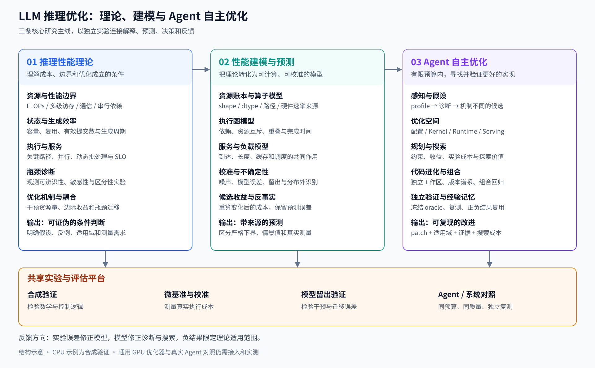
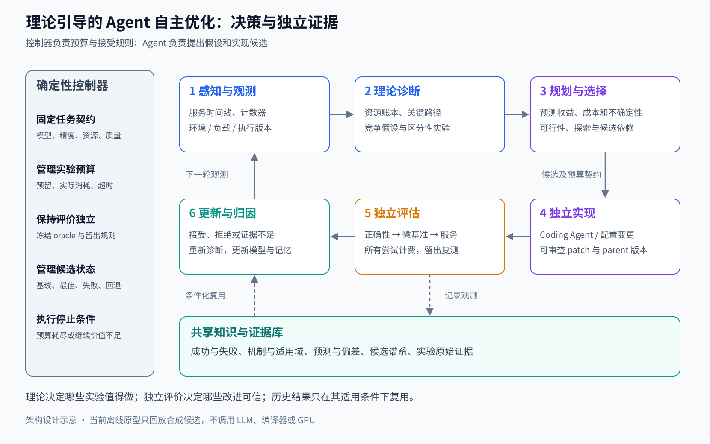

# 三条核心主线与自主优化闭环

需要纵览全部内容和跨模块联系时，进入[七页研究图谱](../research-atlas/README.md)；本页两图保留为简明入口。

这两张图表示研究结构与接口，不表示已完成的生产系统或实验成绩。SVG 可在 GitHub 直接预览；draw.io 文件可独立编辑。

## 全局研究架构

[高清 SVG](research-map.svg) · [可编辑 draw.io](research-map.drawio)



理论回答成本与边界，模型将其转成可计算预测，Agent 用预测选择干预；实验分别验证理论、模型和搜索过程，再反向修正三者。三个目录的区别是研究职责，不能据目录名推断代码已经实现。

## Agent 决策与证据循环

[高清 SVG](optimization-loop.svg) · [可编辑 draw.io](optimization-loop.drawio)



控制器管理可重复的执行规则，Agent 负责技术判断；评估器返回真实观测，记忆保存正负结果及适用条件。当前 [CPU 原型](../../../optimizer/systems/README.md)只实现有限候选的合成回放。

## 生成与维护

```bash
python3 visualizations/diagrams/research-framework/build_framework.py
```

标准库脚本同时生成 SVG 与 draw.io；修改生成脚本后重建两种格式，避免它们表达不同结构。手动编辑 draw.io 后若要保留修改，需要同步回生成脚本。现有 [六大推理理论思维导图](../llm-inference-theory-mindmap.md)继续展示底层理论，此图增加研究层次和相互关系。
